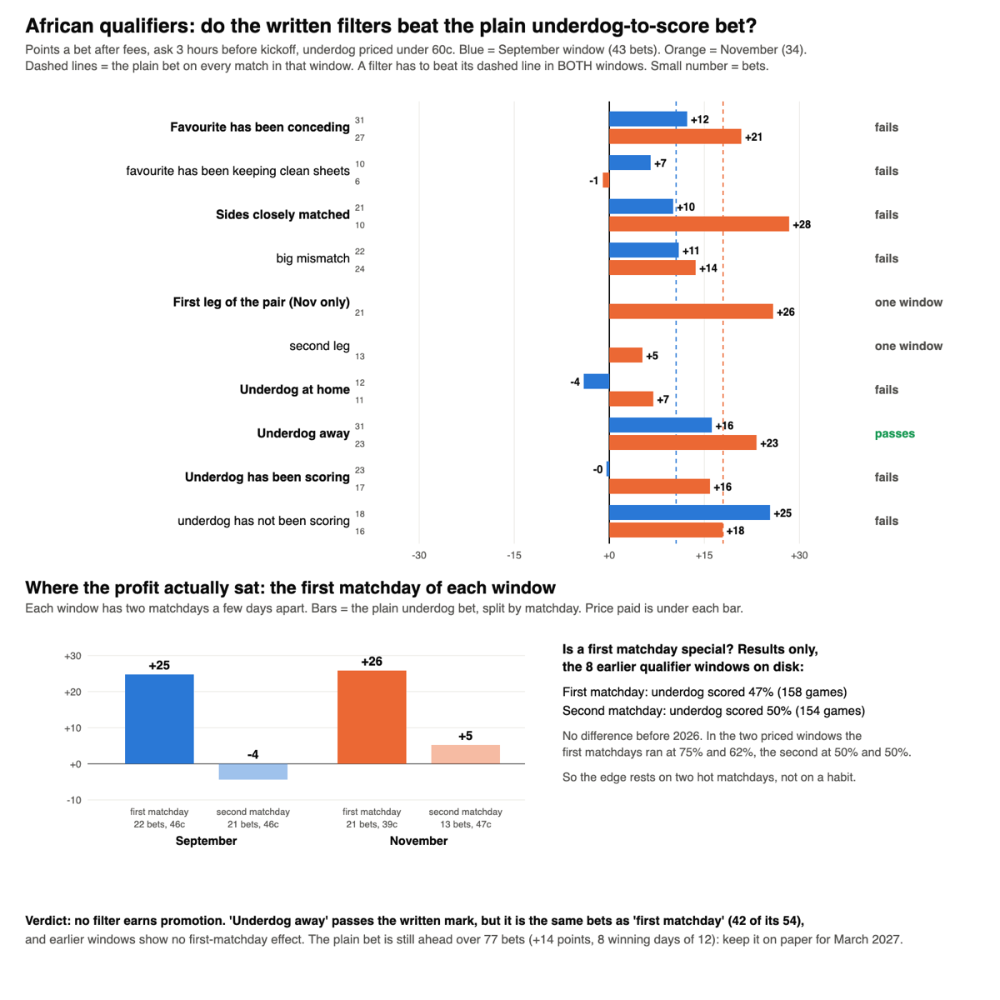

# African qualifiers: filter price test (Nov 19 2026)

**Verdict: no filter to promote.** None of the filters written in the primer clearly beats the plain underdog-to-score bet in
both windows. The plain bet is still ahead over 77 bets, but its profit sat in two hot first matchdays. Keep it on paper for
March 2027.

## What was tested
- **Bets:** underdog to score, ask under 60c, on the quote 3 hours before kickoff, fee included. Secondary: both teams to
  score. Watch: NO on over 3.5 goals at 80c or more.
- **Windows:** September 2026 (matchdays 1 and 2, 43 underdog bets) and November 2026 (matchdays 3 and 4, 34 bets).
- **Filters:** only those written in the primer before any price was read, unchanged.
- **Standard:** above zero after fees and 2+ points a bet better than the plain bet, in September and in November, each on its
  own. Luck = how often a random pick of the same number of bets from that window does as well.
- No new data was fetched.

## The plain bets

| Bet | September | November | Both |
|---|---|---|---|
| Underdog to score | +10.5 (43) | +18.0 (34) | +13.8 (77), z 2.3, 8 winning days of 12 |
| Both teams to score | +13.6 (48) | +10.4 (42) | +12.1 (90), z 2.8 |
| NO over 3.5 at 80c+ | -8.4 (29) | +9.9 (17) | -1.7 (46) |

Points a bet after fees; bets in brackets.

## The filters, on underdog to score

| Filter | Expected | September | November | Over the plain bet | Luck | Result |
|---|---|---|---|---|---|---|
| Favourite has been conceding (4 or fewer clean sheets in last 8) | better | +12.3 (31) | +20.8 (27) | +1.8 / +2.9 | 37% / 23% | fails |
| Favourite kept 5+ clean sheets | worse | +6.5 (10) | -1.0 (6) | -4.0 / -19.0 | | direction as expected, 16 bets |
| Sides closely matched (rating gap under 150) | better | +10.1 (21) | +28.4 (10) | -0.5 / +10.4 | 52% / 18% | fails |
| Big mismatch (150+) | worse | +11.0 (22) | +13.6 (24) | +0.4 / -4.3 | | fails |
| First leg of the pair | small | - | +25.8 (21) | +7.9 | 13% | one window only |
| Second leg | small | - | +5.2 (13) | -12.7 | | one window only |
| Underdog at home | none | -4.0 (12) | +6.9 (11) | -14.6 / -11.0 | | fails |
| Underdog away | none | +16.2 (31) | +23.2 (23) | +5.6 / +5.3 | 14% / 17% | passes the mark |
| Underdog has been scoring (5+ of last 8) | none | -0.4 (23) | +15.9 (17) | -11.0 / -2.1 | | fails |
| Nothing to play for | worse | - | - | - | | cannot occur before matchday 5 |

Both teams to score: no filter passes. Neutral grounds: not on disk, not tested.

## Why "underdog away" is not promoted
- It was not predicted (the primer expected no difference).
- It is the same bets as "first matchday of the window": 42 of its 54. Away underdogs on second matchdays made +1.0 on 10
  bets and -4.2 on 2.
- The whole profit sat in the first matchday of each window: +24.8 (22 bets) and +25.8 (21), against -4.4 (21) and +5.2 (13)
  on the second. Both teams to score shows the same split.
- Results alone, on the 8 earlier qualifier windows, show no first-matchday effect: the underdog scored in 47% of 158 first
  matchday games and 50% of 154 second matchday games. In the two priced windows the first matchdays ran at 75% and 62%.
- So the edge rests on two hot matchdays, not on a habit of the game.

## The level-shift risk
Scoring in these qualifiers rose from 2.22 goals a game in 2024 to 2.59 in 2026, and prices started near the old level. By
November's second matchday the underdog's price was 7c higher (47c against 39c) and the bet made +5.2. The market is moving
toward the new level and may be there by March.

## Build spec
- **Promote:** nothing. No size.
- **Keep on paper, unchanged, for March 2027 (matchdays 5 and 6):** underdog to score under 60c; both teams to score.
- **Add as paper rows in March, written now:** favourite kept 5+ clean sheets (expected worse); underdog away; a side already
  out (no underdog bet; expected worse); both sides with nothing to play for (no both-teams-to-score bet).
- **Read March on its own.** A row is a candidate for small size only if it is above zero on both March matchdays and across
  all three windows together.
