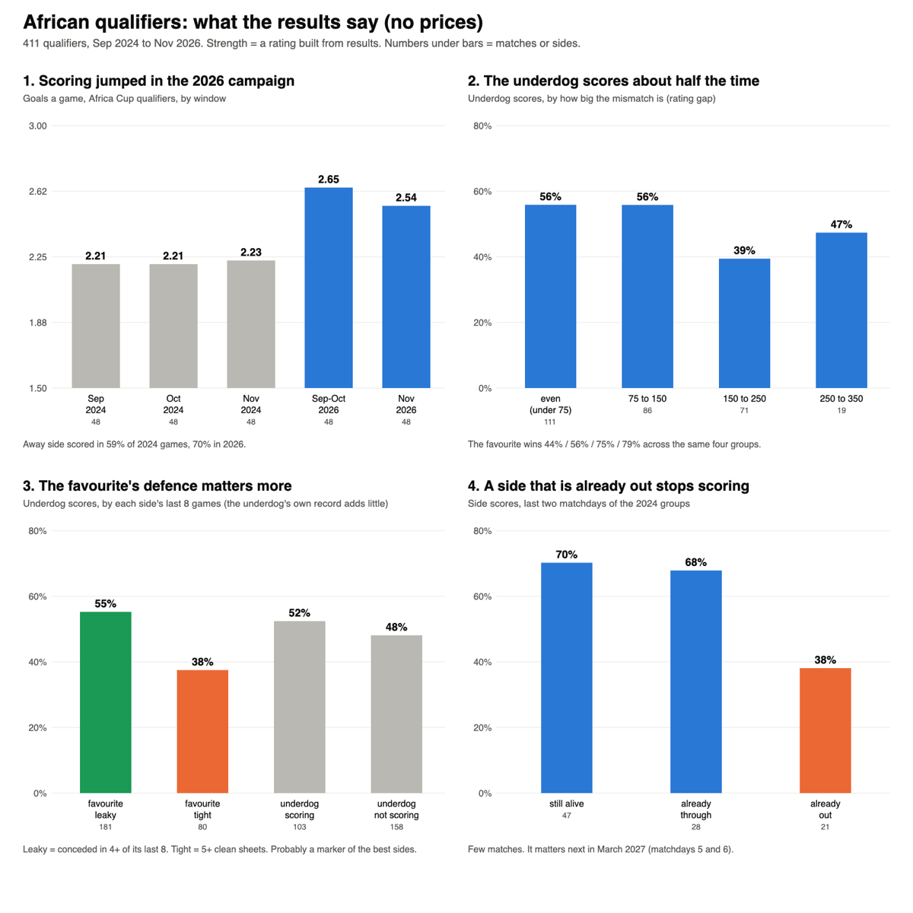

# African qualifiers primer: learn the game first (Nov 18 2026)

Research only, results only: no price was read for this. It is the reference for any filter on the two African qualifier
paper lanes (underdog to score at an ask under 60c; both teams to score), which today bet every match with no team or matchup filter.
Rules file: `~/edge-research/africa_primer_2026-11-18/PREREGISTERED.md` (labels, then the filters, written before any price test).

**Data:** 548 African internationals on disk, Sep 2024 to Nov 17 2026, scores only: 252 Africa Cup qualifiers, 159 World Cup
qualifiers (2025), 52 Africa Cup finals matches and 85 friendlies (used for the strength rating only). Strength is a
point-in-time rating built from these results. The files carry no venue, so neutral grounds, travel and altitude are not measured yet.

## Each mechanism, labelled

| Mechanism | What the results say | Label |
|---|---|---|
| Scoring level by campaign | Africa Cup qualifiers: 2.22 goals a game in 2024 (the same in all three windows), 2.59 in 2026 (z 1.9). Away side scored in 59%, then 70%. Both scored in 36%, then 51%. | Sizeable. It is the plain reason for September's lead: prices sat near the 2024 level |
| Home edge | Home wins 43%, away wins 34%. The home bonus that fits is 40 rating points (about 100 is usual). The same team scores 1.44 at home, 1.13 away. | Small |
| "Home" for the weaker team | At the same strength gap the weaker team scores as often away as at home (61% v 63%, 48% v 46%, 26% v 50%). | Worth nothing on scoring. Likely because many weaker federations host abroad; needs venue data |
| Mismatch size | Favourite wins 44% / 56% / 75% / 79% as the gap grows. The underdog still scores in 56% / 56% / 39% / 47%. Both score in 34% to 44% at every gap. | Sizeable for who wins; weak for whether the underdog scores |
| The underdog's own scoring record | Scored in 5+ of its last 8: +1.4 points against what the gap predicts. 4 or fewer: -2.7. Scoring beyond the matchup barely carries (+0.16). | Myth |
| The favourite's recent defence | Favourite kept 5+ clean sheets in its last 8: underdog scores 38% (80 matches). Favourite conceded in 4+: 55% (181). At a big gap: 25% of 40 against 57% of 49. | Sizeable in results; probably a marker of the very best sides, which a market already knows |
| Back-to-back fixtures (same opponent twice in a week, 54 pairs) | No revenge: the first-leg loser does 8.9 points worse than expected in the second (standard error 6). Scoring in leg 1 says nothing about leg 2. Second legs had fewer goals (2.09 v 2.61). | Small |
| Nothing to play for (last two matchdays, 2024 groups) | A side already out scored in 38% (21 sides); still alive 70%; already through 68%. Neither side alive: both scored in 18% of 17. | Sizeable but few. Matters in March 2027 |
| Neutral grounds, travel, altitude | Not on disk. | Not measured |

## What this says about the two lanes

- "Both sides score more than priced" was a level effect (the 2026 campaign scores more than 2024), not a matchup effect.
  November already showed the favourite's side of it gone.
- The underdog scores about half the time whatever the mismatch, so its own form is not the lever. The lever in results is
  who it is facing: a favourite that has been conceding.
- In March 2027 the groups reach matchdays 5 and 6, where sides with nothing left to play for behave differently.

## Filters written down for the price test (not yet run)

- **Leaky favourite:** bet only when the favourite conceded in 4+ of its last 8 competitive matches. Applies to both lanes.
- **Modest mismatch:** underdog to score only when the rating gap is under 150.
- **First leg only** in a back-to-back pair. Expected small.
- **The underdog's own record:** written as a myth; expected to add nothing.
- **Nothing to play for (forward only, March 2027):** no underdog bet on a side already out; no both-score bet when neither side is alive.
- **Venue:** waits for venue data.

Pass = above zero after fees and 2 points a bet better than the every-match version, in September and again in November,
each on its own. Both windows were already read for the every-match versions and hold about 70 underdog bets between them,
so the price test can only say "no" or "keep as a paper lead". March 2027 is the forward test.

## Build spec

None yet. Nothing changes on the two paper lanes until the price test is read.
