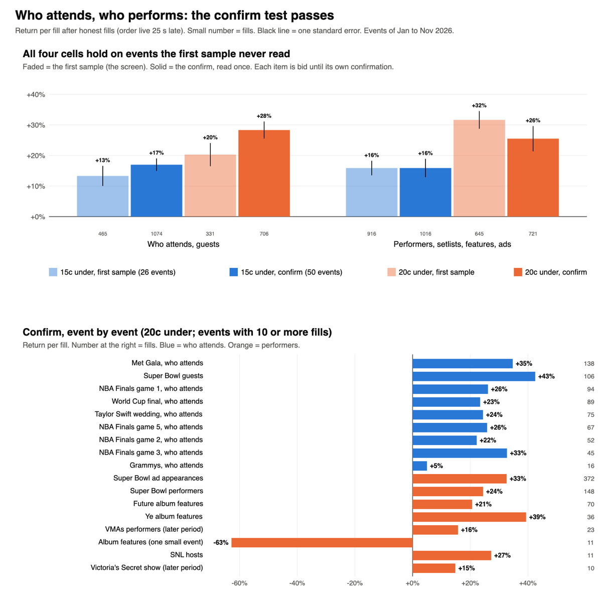

# Who attends, who performs: the confirm test passes (Nov 15 2026)

Research only. The screen (`attendance_screen_2026-11-14.md`) found that the mentions dump bid (#464) pays in Kalshi markets on who
attends, who performs, setlists and features, on a sample of 26 events. Olu: "OK, run the attendance confirm test."
The question: does it hold on events the screen never read?

**Short answer: yes. All four cells pass, on 50 events read once. It is worth a paper lane. Build spec at the end.
Two cautions carry over: it confirms on other events of the same months, not on a later season, and the paper result assumes
our bid is the best bid.**

## The result

Return per fill, order live 25 seconds late, honest fills, each item bid until its own confirmation. Scores clustered by event.

| Cell | First sample (26 events) | Confirm (50 events) | Verdict |
|---|---|---|---|
| Who attends, 15c under | +13.3% on 465 | +17.0% on 1,074 (t 8.3) | **Pass** |
| Who attends, 20c under | +20.3% on 331 | +28.3% on 706 (t 10.2) | **Pass** |
| Performers, 15c under | +15.9% on 916 | +15.9% on 1,016 (t 5.3) | **Pass** |
| Performers, 20c under | +31.6% on 645 | +25.5% on 721 (t 6.2) | **Pass** |

The pass mark, written before the pull: return above zero with t of 2 or more on 10 or more events, after the false-discovery
correction across the four. Without the best event the four cells stay at +10.9% to +26.8%. 91% to 93% of fills sell back.

## What was run

- **Cells fixed before the confirm:** the four above. Nothing was changed after the read.
- **Confirm set:** the 39 events of Jan 1 to Sep 14 that the screen sample did not reach (Super Bowl guests, Super Bowl performers
  and the Met Gala among them), plus all 11 events settled Sep 15 to Nov 13. 865 item histories. Big events capped as in the screen.
- **1,407 requests** of the 2,000 Olu approved. With the screen: 2,443 in all.

## What to know before building

- **Not a later season.** Sep 15 to Nov 13 is nearly empty for this family: 11 events and under 50 fills a rule. Performers there earned
  +1.0% on 46 fills (15c) and +15.2% on 40 (20c); attendance had no fills. Too few to say. The confirm is on other events of the same months.
- **Performers lean on the Super Bowl.** February is 65% of all performer fills. Without February performers earn +7.9% (15c) and
  +22.0% (20c). Who attends does not lean on it (16%; +15.3% and +24.5% without February).
- **Thin events lose.** Of 27 events with 20 or more fills, 26 are positive. Fills in events with fewer than 20 lose
  (performers -18% and -10%; attendance about -1% to -2%). Seen after the read, so it is a lead for the paper lane, not a tested rule.
- **It is being paid the gap in a wide book.** In 54% to 70% of fills a trade had already printed near our bid level in the half
  hour before. Buyers pay about 60c while sellers get about 40c, and the bid sits just inside. The fills are honest on the tape, but
  if whoever quotes those books steps one cent ahead of us, the fills go to them. Only resting orders can test this.
- **Small and bunched.** About 65 fills a week at 20c (94 at 15c) on average, about 72c a fill. In the autumn it is about 5 a week;
  most of the year's fills come around the Super Bowl, the Met Gala, the NBA Finals and the World Cup.
- **Bids at 50c or less pay most** (+23% to +40% against +7% to +17% above 50c), as in mentions.

## Build spec

- **Rule (paper lane, name suggestion `attendance_dump_bid`):** in every item of an attendance or performer event, each minute, rest a
  bid 20c under the last trade on YES and on NO. Needs a trade in the last 10 minutes, a last trade of 95c or less and a bid of 5c or
  more. Fill only on a trade strictly through the bid, order live 25 seconds late. On a fill, rest a sale 15c above the bid (5c under
  the old price). What does not sell rides to the result. One open position a side of an item.
- **Scope:** the 54 series fixed in `cfg.py`: who attends and guests (30 series), performers, setlists, features and ads (24 series).
  One-winner markets ("first song played") stay out.
- **Entry timing:** from the open of each item until that item is confirmed (a trade at 97c or more in an item that last traded under 90c).
  The listed start is not used.
- **The one change v1 to v2:** the clock. The mentions lane stops at the first confirmed word of the event; this lane runs each item
  until its own confirmation, because guests and performers are announced one at a time.
- **Rows:** main = 20c under, all prices (the tested rule), shown for each group. Second = 15c under. Third = 20c under, bids at 50c or
  less (the lead). Fourth = main row, only events that already have 20 fills (the lead). Control = first fill held to the result.
- **Retire or keep:** nothing to retire. It sits beside `mentions_dump_bid` with its own record.
- **Pre-registration text:** "Attendance and performers dump bid. Paper. Kalshi events on who attends, who performs, setlists and
  features; each minute a bid 20c under the last trade on both sides of every item, until that item is confirmed; honest fills, order
  25 seconds late; sold 15c above the bid, otherwise held. Read at 100 and 300 fills, scored by event. Held if the main row is
  positive with t of 2 or more at 300 fills. Retired if it is negative at 300. Expect few fills before February."

Data, scripts and the pre-registration: `~/edge-research/attendance_2026-11-14/` (`PREREGISTERED.md`, `confirm.md`, `confirm.py`, `look2.py`, `pics2.py`).
