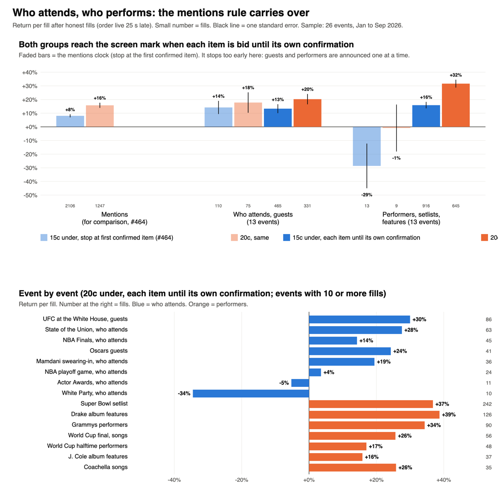
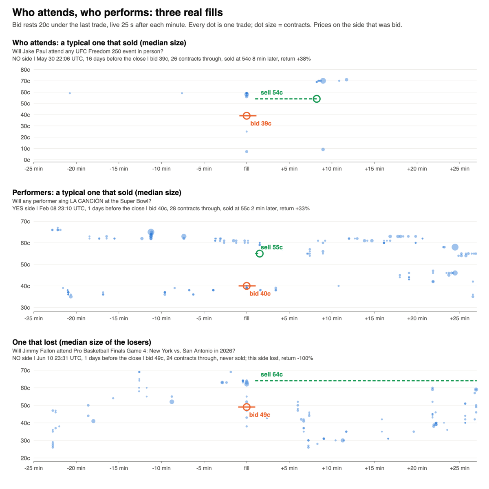

# Who attends, who performs: the mentions rule carries over (screen, Nov 14 2026)

Research only. The mentions dump bid (#464) failed in company ladders (#467), and Economics ladders did not pass the cheap check
(#470), because the rungs of a ladder move together. Olu: "Option 2: start with who attends / guests / performers / setlists."
These markets have the same shape as mentions: many separate yes/no items in one event.

**Short answer: yes, on the screen. Both groups pass the gate and reach the screen mark, clearly. This is a screen on one sample,
so the next step is a confirm test on events not yet read, not a build.**

## The result

Step 1, the gate (does one item drop alone, and does it come back?):

| Market | Drops | Whole event moved | Came back | Gate |
|---|---|---|---|---|
| Mentions (benchmark) | 6,735 | 11% | 56% | |
| Company quarterly ladders (benchmark) | 894 | 25% | 44% | |
| Who attends, guests | 1,644 | 7% | 63% | **Pass** |
| Performers, setlists, features, ads | 3,398 | 11% | 65% | **Pass** |

Step 2, the screen. Return per fill, order live 25 seconds late, honest fills:

| Group | Bids stop at | 15c under | 20c under | Screen mark |
|---|---|---|---|---|
| Who attends | first confirmed item (the mentions clock) | +14.2% on 110 (t 2.9) | +17.8% on 75 (t 2.4) | Missed: 8 events, 10 needed |
| Who attends | each item's own confirmation | +13.3% on 465 (t 4.1) | +20.3% on 331 (t 5.4) | **Reached** |
| Performers | first confirmed item (the mentions clock) | 13 fills | 9 fills | Too thin |
| Performers | each item's own confirmation | +15.9% on 916 (t 6.7) | +31.6% on 645 (t 10.9) | **Reached** |

The mark: return above zero with t of 1.5 or more on 40 or more fills in 10 or more events. Scores are clustered by event.

- **The mentions clock does not fit here.** Guests and performers are announced one at a time, weeks apart. The first confirmation
  comes a median 8 days (attendance) and 24 days (performers) before the close, so a rule that stops there barely bids. The second
  clock, written before the pull, bids each item until that item is confirmed, and counts the fill that buys the news.
- **About 9 in 10 fills sell back** (89% to 93%), in a median 8 minutes for performers and about 25 minutes for attendance.
  The rest never sell and lose nearly everything.

## Does it hold up (description after the read, not a test)

- **Without the best event** the four cells stay at +9.9% to +28.5% (t 2.9 to 7.2).
- **Every event with 40 or more fills is positive.** Small events (under 10 fills) are mixed.
- **Bigger fills pay the same.** Fills with 20 or more contracts through the bid earn +14% to +33%. In mentions bigger fills earned less.
- **Bids at 50c or less pay about twice the rest** (+19% to +41% against +8% to +17%), as in mentions.
- **Both sides pay**, YES and NO.

## What the rule is really doing

About half of the fills are not dumps. These books are wide: in the middle example buyers pay about 60c while sellers get about
40c, over and over. A bid 20c under the last trade sits just above the standing bid, and the sale sits just under the standing offer.
The rule is being paid the gap.

- Fills where the bid level had already traded in the last 30 minutes: 47% to 62% of fills, +11% to +26%.
- Fresh dumps: +16% to +39%.

So the paper result is honest about the tape, but it assumes nobody steps one cent ahead of our bid. Whoever is quoting those wide
books today may do exactly that once a better bid appears. History cannot test this. Only resting orders can.

## What was run

- **Groups fixed from the series list on disk:** who attends and guests (30 series, 114M lifetime contracts); performers, setlists,
  features and ads (24 series, 85M). One-winner markets such as "first song played" were left out.
- **Found half only:** events settled Jan 1 to Sep 14 2026. 65 events, 1,282 traded items, 152M contracts.
- **A seeded sample of 26 events** (13 and 13), 576 item histories. Big events were capped at about 150 requests each. Among the 39 events
  not reached: Super Bowl guests, Super Bowl performers and the Met Gala.
- **The rule:** the #464 code unchanged. **The gate:** the #470 measure unchanged.
- **1,036 requests** of the 1,200 Olu approved. Pre-registered before any request. Sep 15 to Nov 13 was never listed or read.

## What could still be wrong

- **One sample, one read.** 26 events, and February (Super Bowl week) is 43% of the fills. A confirm on unread events is needed.
- **Being the best bid** (see above). This is the main risk.
- **It is small and bunched.** About 65 to 95 fills a week on average across the whole family, at about 75c a fill, most of it in the
  weeks of big events. Mentions run about 420 to 690 a week.
- **The clock that works is the new one.** It was written before the pull, but it is not the tested #464 clock.
- **Eight cells were looked at.** The t-scores (4 to 11) are far beyond what that explains.

## Next step: the confirm test (needs Olu's OK)

Fixed before anything else is read:
- **Four cells:** each group x 15c and 20c, each item bid until its own confirmation, order 25 seconds late, honest fills.
- **Confirm set, read once:** the 39 found-half events the sample did not reach, plus everything settled Sep 15 to Nov 13.
- **Pass:** return above zero with t of 2 or more, by event, on 10 or more events, after the false-discovery correction across the four.
- **About 2,000 requests.**

## Draft build spec (not for building until the confirm passes)

- **Rule:** the `mentions_dump_bid` paper lane rule, with one change. In every item of an attendance or performer event, each minute,
  rest a bid 20c under the last trade on YES and on NO. Needs a trade in the last 10 minutes, a last trade of 95c or less and a bid of
  5c or more. Fill only on a trade strictly through the bid, order live 25 seconds late. On a fill, rest a sale 15c above the bid.
  What does not sell rides to the result. One open position a side of an item.
- **Scope:** the 54 series in `cfg.py` (who attends, guests, performers, setlists, features, ads).
- **Entry timing:** from the open of each item until that item is confirmed (a trade at 97c or more after trading under 90c).
- **The one change v1 to v2:** the clock. Mentions stop at the first confirmed word of the event; here each item runs until its own confirmation.
- **Rows:** main = 20c under. Second = 15c under. Third = 20c under, bids at 50c or less. Control = first fill held to the result.
- **Retire or keep:** nothing to retire. It would sit beside the mentions lane as its own rows.
- **Pre-registration text (draft):** "Attendance and performers dump bid. Paper. Kalshi events on who attends, who performs, setlists
  and features; each minute a bid 20c under the last trade on both sides of every item, until that item is confirmed; honest fills,
  order 25 seconds late; sold 15c above the bid, otherwise held. Read at 100 and 300 fills, scored by event. Held if the main row is
  positive with t of 2 or more at 300 fills. Retired if it is negative at 300."

Data, scripts and the pre-registration: `~/edge-research/attendance_2026-11-14/` (`PREREGISTERED.md`, `gate.md`, `screen.md`, `look.py`, `at.py`, `pics.py`).
