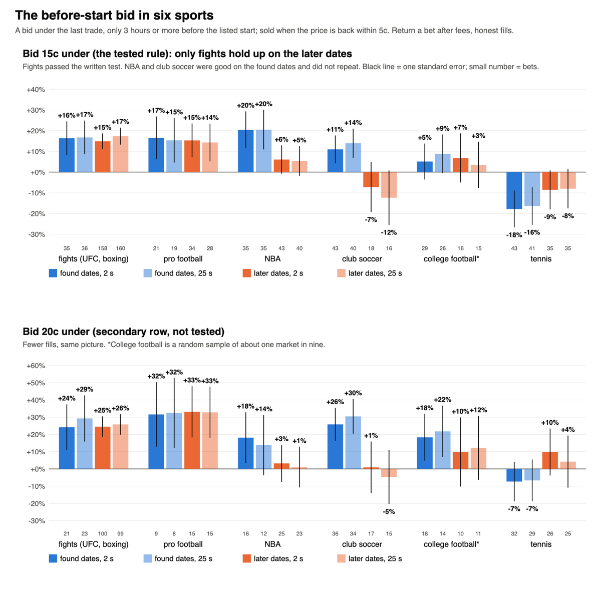
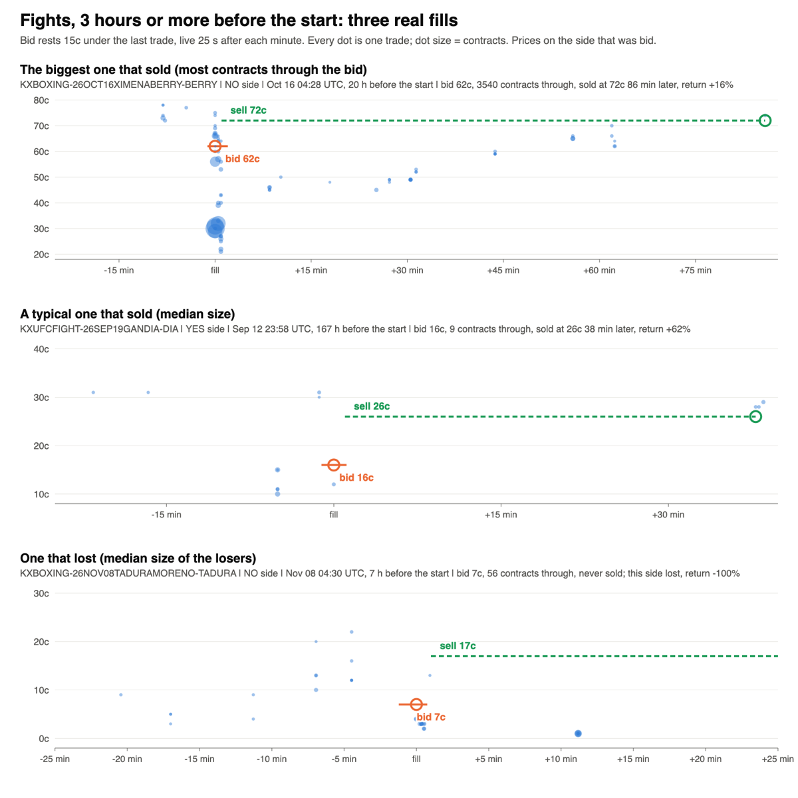

# The before-start bid in six sports (Nov 14 2026)

Research only. The flash-dump work left one lead (PR #450): before a game starts no news can arrive, so a sudden drop in the price is
almost always a sweep, and a bid resting under the price made money in national-team soccer. Olu: "okay, go with the before-start study".
This tests the same bid, unchanged, in six other sports.

**Short answer: fights pass. The other five do not.**

## Verdict by sport

| Sport | Found dates | Later dates | Verdict |
|---|---|---|---|
| **Fights** (UFC, boxing) | +16.8% on 36 bets (t 2.1) | **+17.4% on 160 bets (t 4.3)** | **Passes. Build as a paper watch.** |
| Pro football | +15.4% on 19 bets (t 1.4) | +14.3% on 28 bets | Not a pass: it fell just short on the found dates, so the later dates were not its test. The closest miss. |
| NBA | +20.5% on 35 bets (t 2.2) | +5.4% on 40 bets (t 0.8) | Fails. Good on the found dates, did not repeat. |
| Club soccer | +13.9% on 40 bets (t 2.0) | -12.4% on 16 bets | Fails. Did not repeat. |
| College football (a sample) | +8.8% on 26 bets (t 0.9) | +3.5% on 15 bets | Move on. Too little, on about one market in nine. |
| Tennis | -16.4% on 41 bets | -8.0% on 35 bets | Move on. It loses. |

Returns are a bet after fees, at the 25-second order delay. The 2-second column says the same in every sport: order speed does not matter here.

## What was run

- **The rule, fixed before any price was read (PR #450's, unchanged):** each minute a bid rests 15c under the last trade, both sides of the
  market, only while the event is **3 hours or more before its listed start**. It fills only on a print strictly through it. It is then sold
  when the price is back within 5c; what is not sold rides to the result. Honest-v1 fills and fees (maker fees where Kalshi charges them).
- **Markets:** every settled market Sep 15 to Nov 13 2026 in NFL game, college football game, NBA game, ATP and WTA match, UFC fight, boxing,
  and the Premier League, La Liga, Serie A, Bundesliga and Champions League game series: 6,278 markets, 3,142 events.
- **A cheap pull.** A screen on hourly candles marks every hour in which a 15c drop could have filled the bid; trade prints were pulled only
  for those hours. Checked beforehand on soccer tapes already on disk: 552 fills against 558 from the full tapes, 551 of them identical.
  2,836 requests in all (budget 3,000).
- **Found dates v later dates:** each sport's events cut at the middle by date. One fixed rule a sport, so nothing was chosen on the found
  dates. A sport needed 15 bets, a positive return and t of 1.5 there to get its one read on the later dates; three did (NBA, fights, club
  soccer). The later read had to be positive and survive the false-discovery correction across those three. Only fights did (q 0.0003).
- **Two things dropped for cost, as written in advance:** the 10c row (its windows did not fit), and most of college football (3,387
  candidate windows on its own; a random 380 requests' worth was pulled).
- **The 1 to 3 hour window is nearly empty** (a handful of fills in any sport), so it says nothing either way.

## The start time

PR #450 found wrong start times, so this was checked first. The field used for soccer there is not usable elsewhere (in tennis it sits
anywhere from 50 hours before the close to an hour after). Kalshi's own schedule has a start for every one of the 3,142 events, and that
is what the rule used. Every event with a fill was then checked against the actual start, read from its one-minute price path:

| Sport | Events checked | Listed start more than 30 min off |
|---|---|---|
| NBA | 42 | 1 |
| Pro football | 34 | 2 |
| Tennis | 52 | 0 |
| Club soccer | 27 | 2 |
| College football | 29 | 3 |
| Fights | 51 | 17 of the 28 that could be read (13 started earlier than listed) |

The schedule is good to about ten minutes everywhere except fights, where the listed time is often the card's, not the bout's. That matters
less than it sounds, because the rule already keeps 3 hours clear: keeping only fills that came 3 hours or more before the **actual**
start, fights still return +16.9% on 180 bets (t 4.4). In the other five sports the checked row is identical to the listed row.

## Fights, closer

- **Both halves together:** +17.3% on 196 bets in 49 fights (t 4.9). Scored by card day instead of by fight: t 4.5 on the later dates.
- **It is mostly boxing on the later dates** (156 of 160 bets) and mostly UFC on the found dates (23 of 36). UFC alone: +17.6% on 27 bets.
- **It is concentrated.** Three bouts on one boxing card (Oct 16) give 46% of the later bets. Without the busiest bout: +13.6% (t 3.2).
- **Many fills are repeats in the same market.** Counting only the first fill of each fight: +9.7% found, +7.3% later. Still positive, about half the size.
- **What it really is.** Days before a fight the book is wide and thin. Trades bounce between a low bid and a high offer. A bid placed
  inside that gap gets hit, and a sell placed inside it gets lifted. It is closer to making a market in a wide book than to catching a
  one-off sweep.
- **It is small.** A median of 10 contracts trade through the bid. About 23 fills a week, bunched on card days. 11 of 196 bets lost everything.
- **Further from the start is no worse:** 12 hours or more before the listed start, +19.0% on 149 bets (t 4.7). Looked at afterwards.

## What this says about the idea

"No news before the start" holds in fights and is at least not contradicted in pro football and the NBA (both positive on both halves, neither
enough to pass). It does **not** hold in tennis, where the bid loses on both halves: fitness and withdrawal news does arrive before a match.
The club-soccer back-test does not support the club row now running forward (#452): +13.9% then -12.4%, both together +6.4% on 56 bets
(t 1.1). That row should simply be judged at its own written reads.

## Build spec (Sandbox paper watch; the build belongs to another session)

- **Scope:** UFC fight and boxing winner markets (KXUFCFIGHT, KXBOXING), one row each.
- **Rule:** from listing until 12 hours before the start in Kalshi's schedule, each minute a paper bid 15c under the last trade on both sides,
  only if there was a trade in the last 10 minutes, the last trade is 95c or less and the bid is 5c or more. Live 25 s after the minute.
- **Fill:** only a print strictly through the bid. Size: what the stake buys, capped by the contracts that printed through.
- **Exit:** resting sell 5c under the price before the drop, up 60 s after the fill; what is not sold rides to the result. One position a
  market side at a time.
- **The one change from the tested rule:** 12 hours before the listed start, not 3. The tested rule (3 hours) passed; the listed start for a
  bout can be hours late, and the 12-hour cut gives up nothing in the back-test. It was chosen after looking, so the watch is what judges it.
- **Pre-registration text:** "Before-start bid, fights. Paper only. Rows: UFC, boxing. Read at 50 and at 100 fills a row. Keep = positive
  return after fees with t of 2 or more clustered by card day, and the row still positive counting only the first fill of each fight.
  Retire = under that at 100 fills. No retuning of depth, clock or exit before the 100-fill read."
- **Optional second watch, not a pass:** the same rule on NFL game markets (3 hours before the listed start; that schedule is accurate). It
  missed the found-dates bar by a hair and reads +14.7% on 47 bets over both halves. Judge it on its own if it is added.
- **Nothing to retire.**

## Files

Research folder `~/edge-research/prestart_2026-11-14/`: `PREREGISTERED.md` (rules, the screen, the found result and the later read, each
stamped before the step it governs), `screen.py`, `pull_windows.py`, `lib.py`, `replay.py`, `verify.py`, `stats.py`, `pics.py`, `found.md`,
`later.md`, `pics/`.
