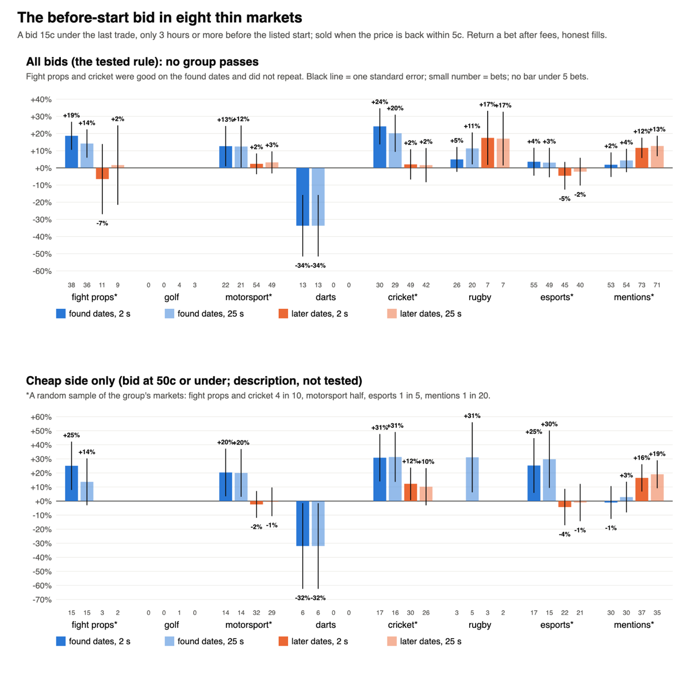
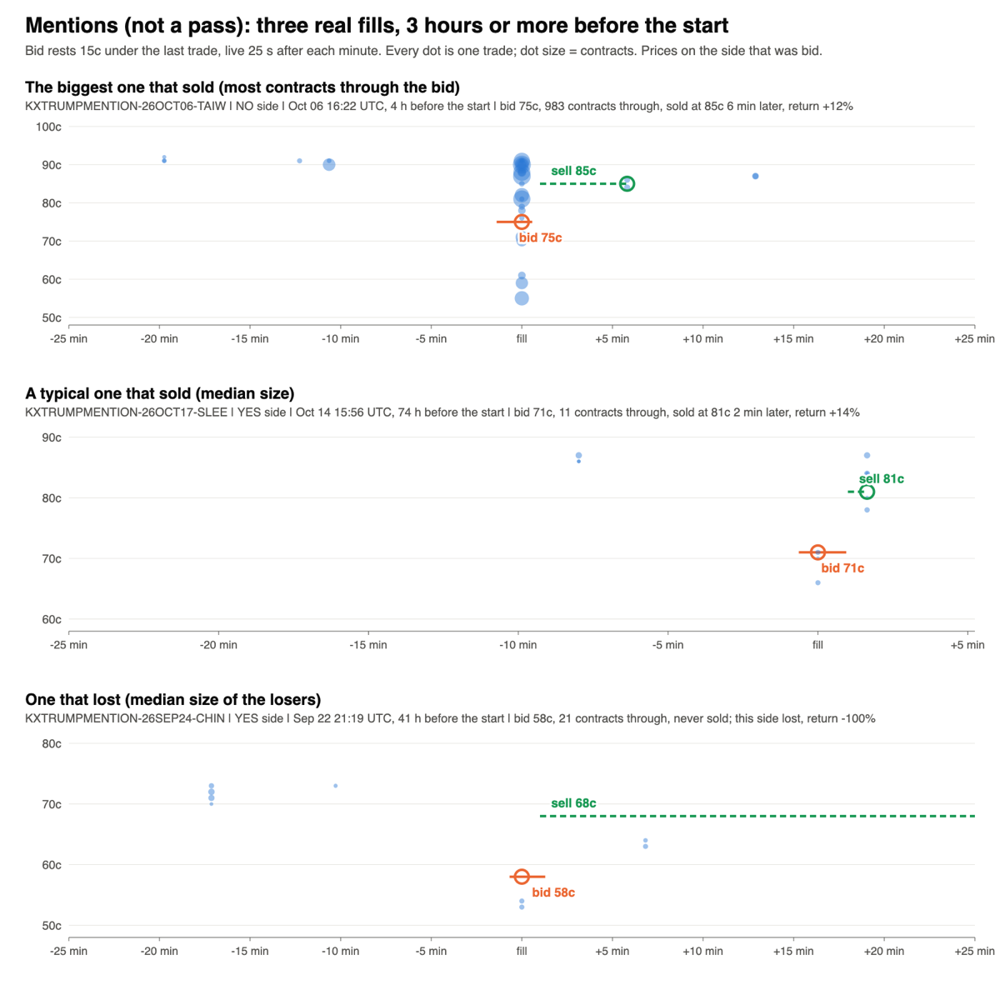

# The before-start bid in eight thin markets (Nov 14 2026)

Research only. PR #455 found that a bid resting under the price, hours before the start, made money in fights and nowhere else, and put
that down to two things together: a thin book, and no news before the start. Olu: "okay, go with the before-start study on those markets".
This tests the same bid, unchanged, in eight groups of markets with that profile.

**Short answer: no group passes. Nothing to build. Two leads are worth a cheap forward look: cricket, and a different kind of study for mentions.**

## Verdict by group

| Group | Found dates | Later dates | Verdict |
|---|---|---|---|
| Fight props (UFC and boxing method, round, distance; a sample) | +14.2% on 36 bets (t 1.7) | +1.6% on 9 bets | **Near-miss.** Went forward, too few later fills and no return there. Both together +11.7% on 45 bets (t 1.6). |
| Cricket (a sample) | +20.2% on 29 bets (t 1.9) | +1.6% on 42 bets (t 0.2) | **Move on as tested.** Went forward and did not repeat. A lead once the start time is fixed (below). |
| Mentions (a 1 in 20 sample) | +4.3% on 54 bets (t 0.6) | +12.7% on 71 bets | **Near-miss on paper, not the before-start effect.** Did not go forward. Both together +9.1% on 125 bets (t 2.0), but the start check takes it apart (below). |
| Motorsport (F1, NASCAR, MotoGP; a sample) | +12.5% on 21 bets (t 1.0) | +3.2% on 49 bets | **Move on.** Both together +6.0% on 70 bets in 16 races (t 1.0). |
| Rugby | +11.3% on 20 bets | +17.0% on 7 bets | **Too thin to say.** All 27 bets come from three French Top 14 matches; a median of one contract trades through the bid. |
| Esports (match winner; a sample) | +3.1% on 49 bets | -2.2% on 40 bets | **Move on.** Flat. |
| Darts | -33.7% on 13 bets | no fills | **Too few, and the schedule is wrong** (listed starts about four hours late, so these bids were in play). |
| Golf | no fills | 3 bets, all lost | **Too few.** The rule barely applies: almost no golf contract trades above 20c before round 1. |

Returns are a bet after fees, at the 25-second order delay. The 2-second column says the same in every group.

## What was run

- **The rule, fixed before any request (PR #455's, unchanged, same code):** each minute a bid rests 15c under the last trade, both sides of
  the market, only while the event is **3 hours or more before its listed start**. It fills only on a print strictly through it. It is sold
  when the price is back within 5c; what is not sold rides to the result. Honest-v1 fills and fees (maker fees where Kalshi charges them:
  PGA Tour winner, F1 race and podium, NASCAR race).
- **Markets:** every settled yes/no market Sep 15 to Nov 13 2026 in the 61 series that had any: 27,918 markets.
  Fight props 2,979, golf 6,435, motorsport 2,528, darts 1,485, cricket 1,666, rugby 241, esports 7,955, mentions 4,629.
- **Not listed in the window, so not tested:** LIV golf, IndyCar, IPL, The Hundred, PSL, Six Nations, boxing round props, Counter-Strike's old
  series, and 24 of the 40 biggest mention series (among them the NBA, NFL and World Cup announcer markets). Esports map winners were left
  out on purpose: later maps open while the match is under way.
- **Markets with many outcomes (golf, races, mentions):** the price limits were not changed. A 15c bid needs a last trade of 20c to 95c on
  its side, so longshots under 5c get no bid and outcomes at 5c to 20c get one only on their NO side. Every bet is tagged cheap side
  (bid at 50c or under) or expensive side, and shown apart in the lower chart. All outcomes of one tournament, race or speech count as one
  cluster.
- **A cheap pull.** Hourly candles of every market mark the hours in which a 15c drop could have filled the bid; trade prints were pulled
  only for those hours. 2,992 requests in all (budget 3,000): listings 121, schedule 89, screen 662, prints 1,900, start check 220.
- **Samples.** The print budget was shared equally before any print was read. Golf, darts and rugby were pulled in full. The rest are random
  samples of markets: fight props and cricket about 4 in 10, motorsport about half, esports about 1 in 5, mentions about 1 in 20 (mentions
  alone had 6,803 candidate windows).
- **Found dates v later dates:** each group's events cut at the middle by start date. A group needed 15 bets, a positive return and t of 1.5
  on the found dates to get its one read on the later dates. Two did (fight props, cricket). Neither held: +1.6% each.

## The start time

Kalshi's schedule lists a start for every group, speeches and shows included, and that is what the rule used. Each event with a fill was
then checked against the first sustained movement in its one-minute price path.

| Group | Events read | Listed start more than 30 min off | What it means |
|---|---|---|---|
| Fight props | 17 | 2 | Fine. |
| Motorsport | 12 | 4 (1 by three hours or more) | Mostly fine inside a 3-hour margin. |
| Cricket | 44 | 15 (5 began 3 hours or more before the listed time) | Some bids were in play. |
| Esports | 51 | 17 | Some bids were in play. Flat either way. |
| Darts | 5 | 5, all about 4 hours early | The schedule is wrong for darts. Every darts bid was in play. |
| Rugby | 3 | 3, about 2 hours early | The fills were still before the start. |
| Mentions | 41 | 22 (13 moving 3 hours or more before the listed time) | The price is already on the move long before the speech. |

Keeping only fills that came 3 hours or more before the **actual** start:

- **Cricket gets better: +15.3% on 59 bets (t 2.1), +15.9% found and +15.0% later.** The five later fills that were really in play lost half.
  The same shows in a row written down in advance: bids 12 hours or more before the listed start returned +16.8% on 22 bets, then +14.6%
  on 23. Neither is the test, so this is a lead, not a pass.
- **Mentions falls apart: -3.5% on 44 bets.** All of the profit (+17% on 52 bets) is in fills inside three hours of the price starting to
  move. That is not "nothing is happening before the start". It is a bounce inside an active market, which is a different idea.
- Fight props (+11.1% on 21), motorsport (+3.4% on 60) and esports (-0.6% on 45) do not change.

## Mentions, closer

- The 20c bid did better than the 15c bid on both halves: +20.6% on 34 bets, then +24.0% on 34 (both together t 3.1). A secondary row, not the test.
- 3 to 12 hours before the listed start: +14.6% on 74 bets. Two days or more before: -13.8% on 18.
- Mostly the evening-news series (+13.6% on 48 bets) and Trump speeches (+3.2% on 29).
- It is big compared with everything else here: scaled up from the sample, roughly 280 fills a week. A median of 11 contracts trade through the bid.
- An older lane already bids under mention words and holds (the dip-hold lane). This would be its short-hold cousin, and it needs its own
  study with a clock that does not rely on the listed start.

## What this says about the idea

- **Thin and quiet is not enough.** Fights passed in #455; nothing with the same look passes here. The winner market of a fight may simply be
  the one place where a wide, thin book meets steady two-way trade.
- **When the price does not come back, it was news.** In fight props, cricket and mentions together, 33 fills never sold. All 33 lost.
- **These markets do have news before the start:** weigh-ins and late changes for fight props, team sheets and the toss for cricket,
  qualifying for races, rosters for esports, released remarks and the day's headlines for mentions.
- **How thin:** median contracts through the bid: fight props 10, cricket 11, mentions 11, esports 12, darts 12, motorsport 21, golf 5, rugby 1.
- **How often,** scaled from the samples: fight props about 14 fills a week, motorsport 16, cricket 21, esports 50, mentions about 280.

## Recommendation

1. **No build from this study.** No group passed, so there is no build spec.
2. **Cricket: a cheap forward row, if Olu wants one.** Same rule as the fights watch in #455, bids stopping 12 hours before the listed
   start, on the cricket match series (T20, ODI, Test, women's T20 and ODI). It is a lead from a row that was written down but not tested,
   so the watch would be its test. Pre-registration text: "Paper bids 15c under the last trade, both sides, from listing until 12 hours
   before the start in Kalshi's schedule; fills only on prints strictly through; sold back within 5c of the price before the drop, the
   rest held. Read at 30 and 60 fills. Kept if the return after fees is positive at both reads and above +5% at 60; retired otherwise."
3. **Mentions: a study of its own, not a watch yet.** A full pull of the candidate hours (about 6,500 requests; needs Olu's OK), with the
   clock taken from the price itself rather than the listed start, the 15c and 20c bids, found then later.
4. **Fight props, motorsport, esports, darts, golf, rugby: move on.**

Rules, scripts and tables: `~/edge-research/prestart2_2026-11-14/` (`PREREGISTERED.md` holds every step in the order it was written).
