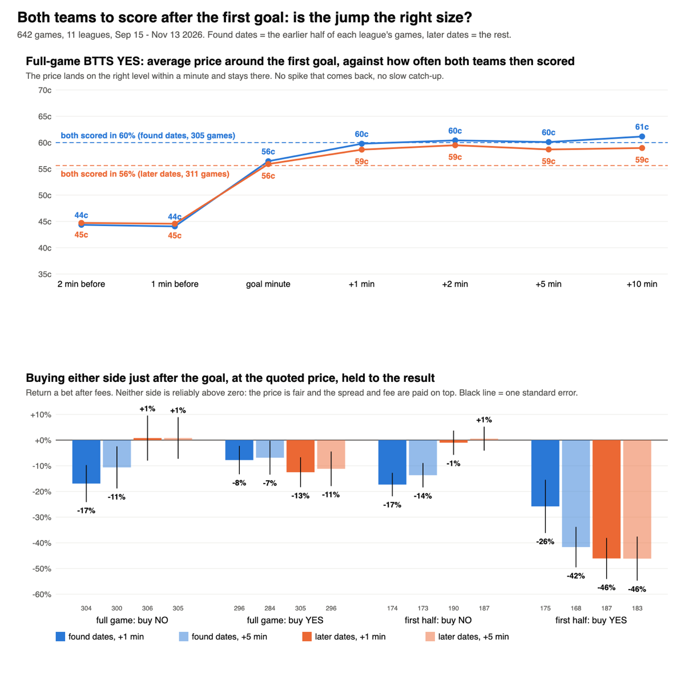
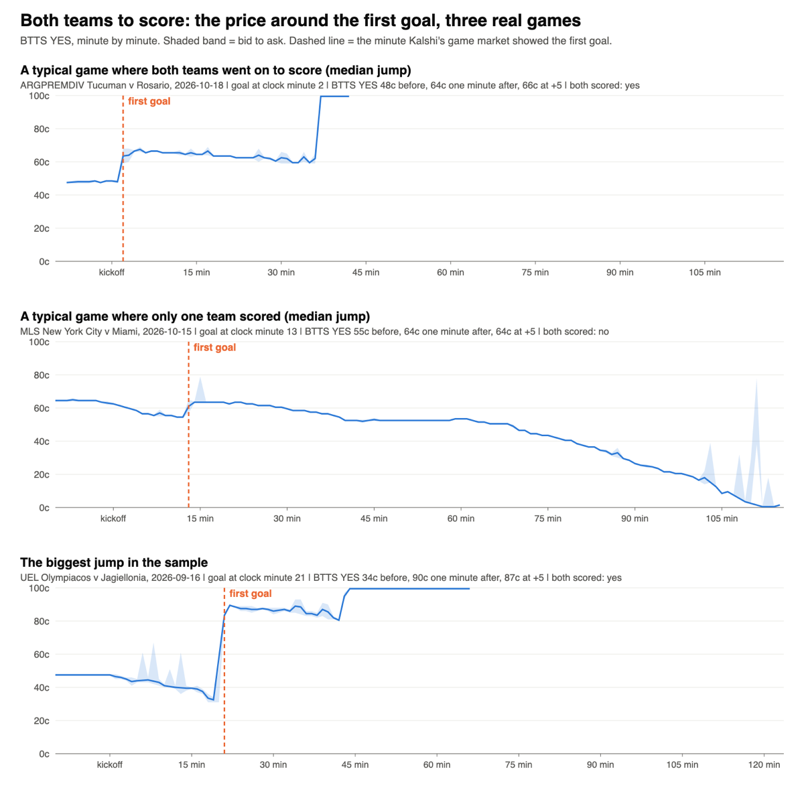

# Both teams to score after the first goal: is the jump the right size? (Nov 14 2026)

Research only. Olu's idea: "What about both teams to score? Does that spike after one team scores?" After the first goal the game needs only
one more goal from the other side, so Kalshi's BTTS YES jumps. If it jumps too far, buy NO just after the goal. If it is slow, buy YES.

**Short answer: the jump is the right size. No rule passes. Move on.**

## What was run

- **Games:** 642 settled games in 11 leagues (Premier League, La Liga, Champions League, MLS, Serie A, Liga MX, UEFA Nations League, Argentina,
  Europa League, Bundesliga, Ligue 1), Sep 15 to Nov 13 2026. Up to 60 a league at random.
- **Data:** Kalshi one-minute candles for the BTTS market, the first-half BTTS market and the two team legs of the game market. 2,536 requests.
- **The first goal** is read off Kalshi's own game market, to the minute: one team's win price jumps while the other's falls. That also says
  who scored. A first goal was found in 616 of the 642 games.
- **Rules, written down before any price was read:** buy NO, or buy YES, at the quoted price 1, 2 or 5 minutes after the goal, held to the
  result, after fees. Split by who scored (favourite, underdog, even), when the goal came, and the pre-match price. About 120 cells.
- **Found dates v later dates:** each league's games cut at the middle by date. A cell needed 30 bets, a positive return and t of 2 on the
  found dates to get one read on the later dates.

## What it shows

**The price lands on the right level inside a minute and stays there.**

| Full-game BTTS YES | 1 min before | 1 min after | 5 min after | 10 min after | Both teams then scored |
|---|---|---|---|---|---|
| Found dates (305 games) | 44c | 60c | 60c | 61c | 60% |
| Later dates (311 games) | 45c | 59c | 59c | 59c | 56% |

There is no spike that comes back and no slow catch-up. By the time of the goal:

| First goal at (clock minutes since kickoff) | Games | Before | 1 min after | Both teams then scored |
|---|---|---|---|---|
| 0-25 | 310 | 55c | 69c | 68% |
| 25-50 | 166 | 43c | 58c | 58% |
| 50-80 | 81 | 29c | 47c | 44% |
| 80 and later | 59 | 12c | 25c | 22% |

**Buying either side loses or breaks even**, because the price is fair and the spread and fee are paid on top. Return a bet after fees:

| Rule | Found, +1 min | Found, +5 min | Later, +1 min | Later, +5 min |
|---|---|---|---|---|
| Full game: buy NO (fade the jump) | -16.9% | -10.6% | +0.8% | +0.8% |
| Full game: buy YES (follow it) | -7.8% | -6.9% | -12.5% | -11.2% |
| First half: buy NO | -17.3% | -13.7% | -1.0% | +0.6% |
| First half: buy YES | -25.8% | -41.7% | -46.1% | -46.2% |

- **No cell cleared the bar on the found dates** (not one of about 120 had a positive return with t of 2), so nothing went forward and
  there was no later-dates read to test. The later dates were then opened as description.
- **Who scored, when, and the pre-match price do not open a gap.** Splits by favourite or underdog scorer and by goal time all sit within
  about one standard error of fair on the two halves together.
- **First-half BTTS** is a thin market: the gap between bid and ask is a median 15c one minute after a goal (2c in the full-game market).
  Its YES looks a few points dear after a goal (31c to 33c against 28% that came in), but a buyer of NO pays that whole gap, and ends at zero.

## Three real games

## Verdict

**Move on.** Kalshi prices the first goal into BTTS correctly and within a minute. There is nothing to fade and nothing to follow, in the
full-game or the first-half market. No build spec.

## Limits, stated plainly

- Goal times come from Kalshi's game market, not from a scoring feed. A red card or an overturned goal can look like a goal: 96% of games
  showed a "first goal", against roughly 92% that really have one, so about one event in 25 may not be a goal. That cannot turn a fair price
  into an edge, but it is why the numbers are to the minute, not the second.
- ESPN goal data was not downloaded. The coordinator relayed Olu's OK; a download needs Olu's own word in the research session, and the
  study did not need it.
- Entries are at the bid and ask recorded at the close of each minute. They were not checked against trade prints, because no rule survived
  to need it.

## Files

Research folder `~/edge-research/btts_goal_2026-11-14/`: `PREREGISTERED.md` (rules, amendment and verdict, each stamped before the read it
governs), `pools.py`, `pull.py`, `analyse.py`, `stats.py`, `pics.py`, `found.md`, `unseen.md`, `pics/`.
