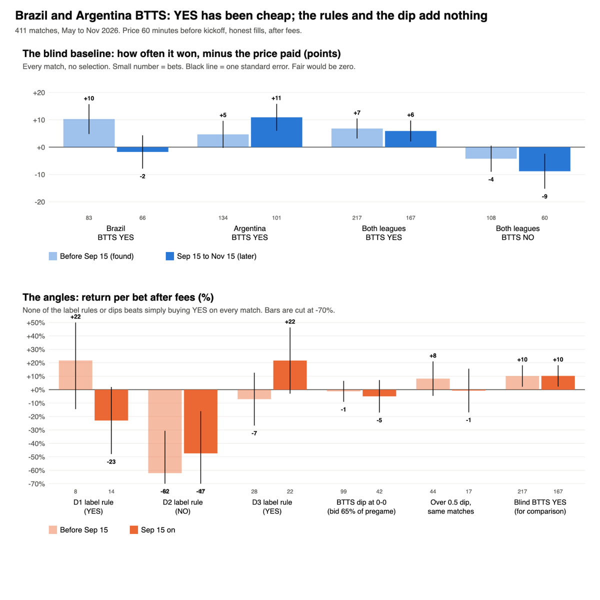
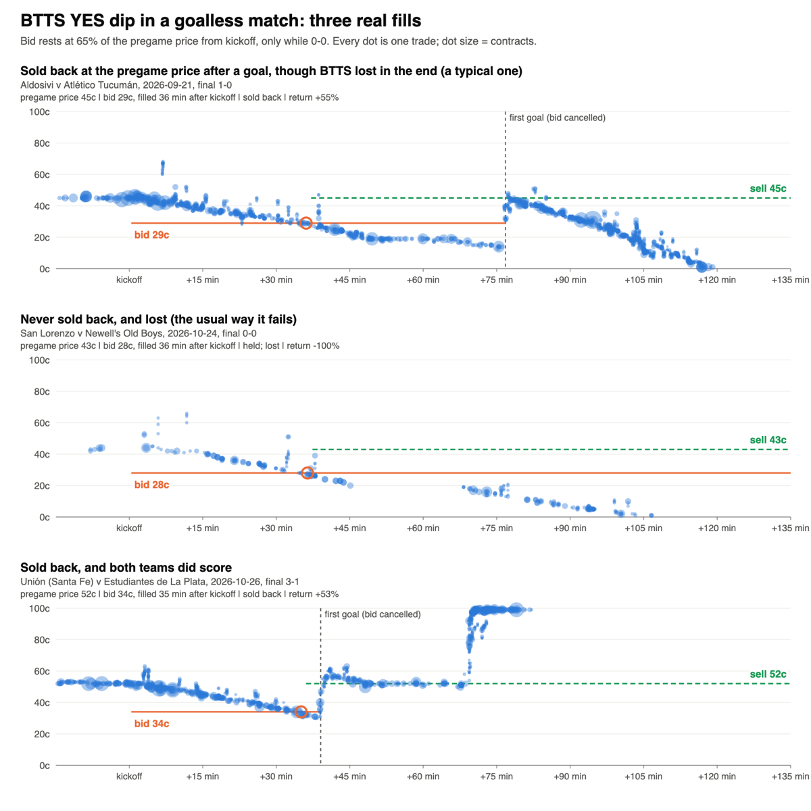

# Brazil and Argentina BTTS: baseline, label rules, goalless dip (Nov 16 2026)

Research only. Olu said yes to a Brazil + Argentina BTTS screen. Kalshi lists both-teams-to-score for Brazil's Serie A and
Argentina's Primera, and the D1-D3 label rules had never run there. The expectation, written down before the pull, was "fair".

**Short answer: the label rules and the in-play dip are a no. But the plain price was not fair: BTTS YES on every match won 6 points
more often than its price, in both halves. That was the reference row, not a tested rule, so it is a lead for a paper row and nothing more.**

## One table

Price 60 minutes before kickoff, honest fills (the price must be confirmed by trades), after fees. Found = kickoff before Sep 15;
later = Sep 15 to Nov 15. A match day is one cluster.

| Angle | Found half | Later half | Both | Verdict |
|---|---|---|---|---|
| (a) Blind BTTS YES, both leagues | +6.8 points on 217 | +5.9 points on 167 | won 53.6% at 47.2c, +6.4 points (z 2.5), return +10.2% | **Lead: a paper row** |
| (a) Blind BTTS NO, both leagues | -4.2 points on 108 | -8.8 points on 60 | -5.9 points, return -13.8% | Reference |
| (b) D1 label rule (YES 45-75c) | +21.7% on 8 | -23.0% on 14 | 22 bets, -2.2 points, -6.7% | **Move on** |
| (b) D2 label rule (NO 30-60c) | -62.1% on 9 | -47.4% on 10 | 19 bets, won 26% at 54.5c, -54% | **Move on** (too few by the rule, and losing) |
| (b) D3 label rule (YES 40-70c) | -7.1% on 28 | +21.7% on 22 | 50 bets, +5.2 points (z 0.7), +5.6% | **Move on** (no better than blind YES) |
| (c) BTTS YES dip at 0-0, bid 65% of pregame | -1.2% on 99 fills | -5.0% on 42 | -2.4% on 141 | **Move on** |
| (c) Over 0.5 dip, same matches | +8.2% on 44 | -0.7% on 17 | +5.7% on 61 | BTTS adds nothing |

## The map

- **Markets:** full-time BTTS for both leagues, one market a match. First-half BTTS exists for Brazil only and is thin (a median 2,100
  contracts a match). No second-half BTTS.
- **Matches:** Brazil 164 (Jul 28, Aug 39, Sep 33, Oct 52, Nov 12). Argentina 247 (May 7, Jul 27, Aug 74, Sep 49, Oct 66, Nov 24).
- **Volume:** a median 18,000 (Brazil) and 20,000 (Argentina) contracts a match.
- **Spread an hour before kickoff:** a median 1c, 2c at the 90th percentile.
- **ESPN results and labels:** in the repo for both leagues. 396 of the 411 matches get both team labels.

## (a) The blind baseline

- **YES was cheap in both halves.** Both leagues: +6.8 then +5.9 points. Argentina +7.4 points on 235 bets (z 2.2). Brazil +4.9 on
  149 (z 1.2): +10.3 in the found half, -1.8 in the later one, so Brazil alone is not steady.
- **NO lost**, and its quoted prices are often not real: over half of Brazil's NO prices were never confirmed by a trade.
- **Why it is only a lead:** the baseline was written down as a reference, with nothing to be forwarded from it. Several rows were
  looked at (two leagues, two sides, price bands). Two halves agreeing is encouraging, but it was not a test.
- It points the same way as the African qualifiers (BTTS YES +15 points in September).

## (b) The D1-D3 label rules

Every match here was out of sample for these rules. None passes. D3, the one with enough bets, earned +5.6% against +10.2% for
buying YES on every match: the labels pick no better than no selection. D2, the NO rule, loses, as the NO side does in general here.

## (c) The dip during a goalless match

- A resting YES bid at 65% of the pregame price, live only while 0-0, sold back at the pregame price.
- **It does not pay**: -2.4% a fill over both halves, and negative at all three bid levels. No cell reached the forward mark on the
  found half, so nothing was tested on the later half.
- **BTTS adds nothing over over 0.5.** On the same matches the over 0.5 dip earned +5.7% (Argentina +15.1% on 44 fills, Brazil
  -18.5% on 17, as the Oct 30 study found). BTTS was 4 to 14 points a fill worse in both halves.
- Why: after a long 0-0, over 0.5 needs one goal and BTTS needs two from different sides. A first goal lifts BTTS back to its pregame
  price only about two times in three.
- The same fills held to the result earned +13% (t 0.9): another sign that BTTS YES is priced low, not that the dip is special.

## What was run

- **411 settled BTTS markets**, Jan 1 to Nov 15 2026; 405 matched to their ESPN match (every settled result agrees).
- **Rules written before any request.** The found half was read first and the forwarded cells fixed (none); only then the later half.
- **The 0-0 clock** is the match's over 0.5 market (its first trade at 97c). It was found in all 360 matches with a goal. In 7 of
  the 29 goalless matches it fired early, which only cancels a bid sooner.
- **About 1,000 requests** of the 950 to 1,050 Olu approved. Over 0.5 could not be found for 19 early matches (May and mid-July); they are
  left out of the dip only.

## What could still be wrong

- **(a) is a lead.** One season, two leagues, 84 match days. Brazil's later half was flat.
- **Label rules are thin here:** 19 to 50 bets a rule.
- **Honest fills drop unconfirmed prices.** That removes few YES bets but many NO bets, so the NO rows are a smaller, pickier sample.

## Build spec

- **(b) and (c): none.** Move on.
- **(a), if Olu wants a paper row** (a sibling of the every-match `sa_o15` lane, same two leagues):
  - **Rule:** BTTS YES at the ask on every Brazil Serie A and Argentina Primera match.
  - **Scope:** `KXBRASILEIROBTTS` and `KXARGPREMDIVBTTS`. Paper only.
  - **Entry timing:** 20 to 90 minutes before kickoff, spread 5c or less, as the label rules enter.
  - **The one change v1 to v2:** none; there is no v1. It is the baseline of this study run forward.
  - **Rows:** both leagues (main), each league beside it, and BTTS NO as the control.
  - **Retire or keep:** nothing to retire. D1-D3 stay retired.
  - **Pre-registration text:** "Brazil and Argentina BTTS YES. Paper. Every Serie A and Primera match, YES at the ask 20 to 90
    minutes before kickoff, spread 5c or less, after fees. Scored by match day. Read at 50 and 100 bets. Held if it is positive
    with a clustered z of 2 or more at 100 bets. Retired if it is negative at 100."

Data, scripts and the pre-registration: `~/edge-research/btts_sa_2026-11-16/` (`PREREGISTERED.md`, `found.md`, `later.md`, `stats.py`, `data.py`, `pics.py`).
