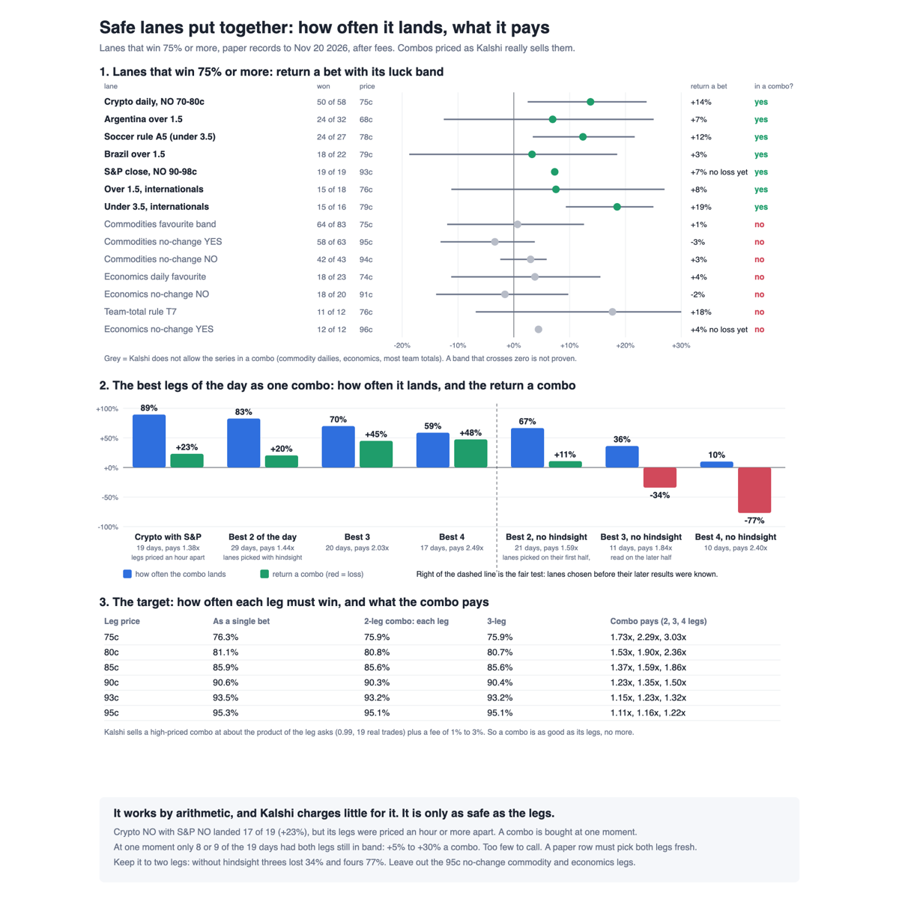

# Safe lanes put together: high hit rate, low return, as combos

Nov 20 2026. Research only. A follow-up to `combos_v_singles_2026-11-20.md`.

Olu's question was not "is there an edge in combos". It was: take the lanes that win often but pay little, put them together, and see how often the combo lands and what it pays. This answers that. The plan was written before any combo was built (copied at the end).

## The short table

| Combo | Days | Lands | Pays | Return a combo | Note |
|---|---|---|---|---|---|
| Crypto NO with S&P NO, each leg at its own entry time | 19 | 89% | 1.38x | +23% | Not buyable as scored: the legs were priced an hour or more apart. |
| The same pair, both legs at one moment | 8 or 9 | 78% to 100% | 1.30x to 1.36x | +5% to +30% | See "Timing". Too few days to call. |
| Best 2 legs of the day | 29 | 83% | 1.44x | +20% | Both halves above zero. |
| Best 3 legs of the day | 20 | 70% | 2.03x | +45% | Later half is 7 days. |
| Best 4 legs of the day | 17 | 59% | 2.49x | +48% | Lost 4 in a row once. |
| Best 2, lanes picked without hindsight | 21 | 67% | 1.59x | +11% | Could be anywhere from -23% to +47%. |
| Best 3, without hindsight | 11 | 36% | 1.84x | -34% | |
| Best 4, without hindsight | 10 | 10% | 2.40x | -77% | |

**Answer.**
- **It works by arithmetic, and Kalshi charges little for it.** A high-priced combo sells at about the product of the leg asks, plus a fee of 1% to 3%.
- **So a combo is exactly as safe as its legs.** Two legs that each beat their price make a combo that lands often and pays more. One leg that does not beat its price drags the whole combo under.
- **One pair is worth a paper row: crypto NO with S&P NO.** Keep it to two legs. Its 19-day figure overstates it, because the two legs were priced at different times (see "Timing"). The paper row must pick both legs at the same minute.
- **Three and four legs are where it breaks.** When lanes are chosen before their later results are known, win rates slip and every extra leg multiplies the slip.

## Step 1. Lanes that win 75% or more

Paper records, after the taker fee. Listed: 10 or more settled bets, 75% or more won, last settled bet on or after Nov 1 2026.

| Lane | Settled | Won | Hit rate | Avg price | Return a bet | Luck band | Picks on a pick day | In a combo? |
|---|---|---|---|---|---|---|---|---|
| Crypto daily, NO 70-80c | 58 | 50 | 86% | 75c | +13.7% | +2% to +24% | 1.8 | yes (not the HYPE coin) |
| Soccer rule A5 (under 3.5) | 27 | 24 | 89% | 78c | +12.4% | +3% to +22% | 4.5 | yes |
| Under 3.5, internationals | 16 | 15 | 94% | 79c | +18.5% | +9% to +25% | 3.2 | yes |
| S&P close, NO 90-98c | 19 | 19 | 100% | 93c | +7.3% | no loss yet | 1.0 | yes |
| Argentina over 1.5 | 32 | 24 | 75% | 68c | +7.0% | -13% to +25% | 3.2 | yes |
| Over 1.5 ranked, internationals | 18 | 15 | 83% | 76c | +7.5% | -11% to +27% | 2.6 | yes |
| Brazil over 1.5 | 22 | 18 | 82% | 79c | +3.3% | -19% to +19% | 2.4 | yes |
| Premier League rule A6 (under 2.5) | 10 | 8 | 80% | 45c | +75.3% | +30% to +119% | 1.7 | yes |
| Commodities favourite band | 83 | 64 | 77% | 75c | +0.7% | -12% to +13% | 2.9 | no |
| Commodities no-change YES | 63 | 58 | 92% | 95c | -3.4% | -13% to +4% | 2.9 | no |
| Commodities no-change NO | 43 | 42 | 98% | 94c | +3.0% | -2% to +6% | 3.3 | no |
| Economics daily favourite | 23 | 18 | 78% | 74c | +3.8% | -11% to +16% | 2.3 | no |
| Economics no-change NO | 20 | 18 | 90% | 91c | -1.6% | -14% to +10% | 1.2 | no |
| Economics no-change YES (diesel, gas) | 12 | 12 | 100% | 96c | +4.4% | no loss yet | 1.1 | no |
| Team-total rule T7 | 12 | 11 | 92% | 76c | +17.7% | -7% to +33% | 2.4 | no |
| Mentions rate | 85 | 66 | 78% | 69c | +8.7% | -3% to +21% | 21.2 | no (no new picks since Oct 30) |

- **"In a combo?"** means the series is on Kalshi's combo list today or was a combo leg on the tape. Commodity dailies, the economics dailies and most soccer team totals have never appeared.
- **Just under the line, still current:** MLS fade the home side 72% (29, +22.0%), Africa over 1.5 74% (42, +1.5%), Africa under 3.5 74% (42, -4.9%), the old crypto favourite band 71% (35, -6.2%).
- **Winning often is not the same as paying.** Eleven older lanes also won 75% or more and are no longer running. Nine of the eleven returned +0.3% a bet or less.

Live records for the lanes named, after the exchange's fees:

| Lane | Live settled | Won | Return a bet |
|---|---|---|---|
| Crypto daily NO | 23 | 20 | +14.7% |
| S&P close NO | 6 | 6 | +7.0% |
| Under 3.5, internationals | 15 | 14 | +19.6% |
| Economics no-change YES | 8 | 8 | +3.9% |
| Commodities favourite band | 30 | 22 | -2.8% |
| NBA win margin NO (not allowed in a combo) | 138 | 103 | +6.8% |

## Step 2a. What Kalshi charges for a high-priced combo

The first study measured mostly long-shot combos (about 10c). Combos built from 75c to 98c legs cost 40c to 90c, so they were measured again, from the pages already listed and inside the request cap Olu approved.

| Combo price | Combos | Price / product of leg asks | Price / product of leg mids | With the fee |
|---|---|---|---|---|
| Under 10c | 73 | 0.999 | 1.051 | 1.065 |
| 10c to 20c | 48 | 1.002 | 1.037 | 1.061 |
| 20c to 40c | 36 | 1.005 | 1.030 | 1.054 |
| 40c and up | 19 | 0.994 | 1.014 | 1.014 |
| 70c and up | 9 | 0.993 | 1.012 | 1.007 |

- **The markup shrinks as the combo gets safer.** Long shots pay 5% over the mid prices plus a 6% fee. A 70c combo pays about 1% over the mids, and the fee is about 1% to 2%.
- **The worry "a 93c leg against a 4% to 6.5% markup" does not apply here.** That markup is for long shots. For these combos the all-in cost is 1% to 5% over the product of the leg asks, about what the fees on the same legs as singles add up to.
- **Price used below (frozen before the combos were scored):** 0.994 times the product of the leg asks, plus the fee.
- **Crypto with S&P.** Makers price a link between them. On 22 same-direction combos the middle was 1.15 times the product of the asks, but those were coin-flip legs near 50c in the last hour. The three high-priced ones cost 1.01, 1.03 and 1.03. Used below: 1.03. This is the weakest number in the study.

## Step 2. The combos

Each day, one leg a linked group (all crypto dailies count as one group; so do S&P and Nasdaq; each soccer match is its own). The highest-priced legs of the day make the combo.

| Legs | Days | Lands | Pays | Return a combo | Score | Luck band | Longest losing run | Break-even markup | Found half | Later half |
|---|---|---|---|---|---|---|---|---|---|---|
| 2 | 29 | 83% | 1.44x | +20.4% | 1.84 | +1% to +38% | 1 | 1.24 | +24.4% (16 days) | +15.6% (13 days) |
| 3 | 20 | 70% | 2.03x | +45.0% | 1.69 | +4% to +91% | 1 | 1.50 | +59.5% (13 days) | +18.1% (7 days) |
| 4 | 17 | 59% | 2.49x | +47.5% | 1.41 | -3% to +101% | 4 | 1.54 | +33.2% (11 days) | +73.8% (6 days) |

- **Break-even markup** is the most the combo could cost, as a multiple of the product of the leg asks, before its return reaches zero. Today it costs about 1.02 to 1.05.
- **The same legs as singles** won 91% and returned +9.8% a leg. The combo's bigger number is the same edge on a bigger bet.
- **Every possible set of the day** (each day counted once) says the same with lower landing rates: 2 legs land 74% for +24.7%, 3 legs 55% for +43.1%, 4 legs 49% for +59.4%, with a losing run of 5.
- **A 4-leg combo can only be formed on 17 of 35 days.** Six days have one group and nine have two.

What the 2-leg combos were made of:

| Pair | Days | Landed | Return a combo |
|---|---|---|---|
| Crypto NO with S&P NO | 11 | 10 | +25.3% |
| Brazil over 1.5 with S&P NO | 4 | 2 | -35.6% |
| Brazil over 1.5 with crypto NO | 3 | 3 | +62.7% |
| Two A5 unders | 3 | 3 | +43.5% |
| Argentina over 1.5 with crypto NO | 2 | 1 | -12.0% |
| S&P NO with under 3.5 internationals | 2 | 1 | -38.7% |

**The one pair with a real count: crypto NO with S&P NO, every day both had a pick.** Each leg here is at its own entry time, an hour or more apart; the "Timing" section re-scores it at one moment.

| | Days | Lands | Pays | Return a combo | Break-even markup |
|---|---|---|---|---|---|
| All days | 19 | 89% (17) | 1.38x | +23.1% (score 2.30; band +6% to +38%) | 1.29 |
| Found half | 10 | 100% | | +39.3% | 1.46 |
| Later half | 9 | 78% | | +5.1% | 1.10 |

- As singles on those days: crypto won 17 of 19 at 75c (+17.3%), S&P won 19 of 19 at 93c (+7.3%).
- **How much rests on the link price:** unlinked +26.7% (later half +8.1%); at 1.03 +23.1% (+5.1%); at 1.08 +17.7% (+0.5%); at 1.15 +10.9% (-5.3%).
- **The S&P leg has never lost.** At 93c a fair contract wins 19 in a row one time in four. When it does lose, the combo loses with it.

## The fair test: lanes picked without hindsight

The list above was chosen knowing each lane's whole record. To test honestly, lanes were picked again using only the first half of each lane's own record (75% or more), and combos were read on the later half.

| Legs | Days | Lands | Pays | Return a combo | Luck band | Longest losing run |
|---|---|---|---|---|---|---|
| 2 | 21 | 67% | 1.59x | +10.7% | -23% to +47% | 2 |
| 3 | 11 | 36% | 1.84x | -34.1% | -82% to +10% | 3 |
| 4 | 10 | 10% | 2.40x | -77.0% | -100% to -31% | 7 |

- **Thirteen lanes passed on their first half. Seven of them won under 75% afterwards:** under 3.5 clubs 7 of 13, the old crypto favourite band 11 of 18, MLS fade home 5 of 8, MLS away fade 9 of 13, rule A6 3 of 5, under-3.5-to-over-1.5 7 of 10, Africa over 1.5 14 of 21.
- **The six that held:** crypto NO 29 of 34, S&P NO 9 of 9, rule A5 13 of 14, over 1.5 internationals 9 of 10, under 3.5 internationals 5 of 6, Brazil over 1.5 5 of 6.
- **This is the real risk.** A lane's early hit rate is partly luck. One slipping leg costs a single bet a little; it costs a 4-leg combo almost everything.

## Step 3. Which legs survive the combo price

Because the combo price is close to the product of the asks, a leg survives if it beats its own price by up to a point. No more is needed.

- **Turn negative once combined (already under their price as singles):** commodities no-change YES (92% at 95c, -3.4% a bet), economics no-change NO (90% at 91c, -1.6%). Not allowed in combos anyway.
- **About break-even, nothing to add:** commodities favourite band (+0.7%), Brazil over 1.5 (+3.3%), commodities no-change NO (+3.0%), economics daily favourite (+3.8%). Their luck bands cross zero.
- **No loss yet, so unproven:** S&P NO (19 of 19 at 93c), economics no-change YES (12 of 12 at 96c). At 96c a fair contract wins 12 in a row six times in ten.
- **Enough edge on paper, band above zero:** crypto NO (+13.7%), rule A5 (+12.4%), under 3.5 internationals (+18.5%). The last two are 27 and 16 bets.
- **Positive but not proven:** Argentina over 1.5, over 1.5 internationals, team-total T7 (not allowed), MLS fade home (72%).

## Step 4. The target for picking legs

How often each leg must win for the combo to break even, at the measured price:

| Leg price | As a single bet | 2-leg combo: each leg | 3-leg | 4-leg | Combo pays (2, 3, 4 legs) |
|---|---|---|---|---|---|
| 70c | 71.5% | 71.0% | 70.9% | 70.8% | 1.98x, 2.80x, 3.98x |
| 75c | 76.3% | 75.9% | 75.9% | 75.8% | 1.73x, 2.29x, 3.03x |
| 80c | 81.1% | 80.8% | 80.7% | 80.7% | 1.53x, 1.90x, 2.36x |
| 85c | 85.9% | 85.6% | 85.6% | 85.6% | 1.37x, 1.59x, 1.86x |
| 90c | 90.6% | 90.3% | 90.4% | 90.4% | 1.23x, 1.35x, 1.50x |
| 93c | 93.5% | 93.2% | 93.2% | 93.3% | 1.15x, 1.23x, 1.32x |
| 95c | 95.3% | 95.1% | 95.1% | 95.2% | 1.11x, 1.16x, 1.22x |
| 97c | 97.2% | 96.9% | 97.0% | 97.1% | 1.06x, 1.10x, 1.13x |

- **The bar is the same as for a single bet.** A leg that is worth taking alone is worth combining; a leg that is not, is not.
- **The combo's return is roughly its legs' returns added up.** Two legs at +7% and +14% make about +22%.
- **Rule of thumb for a leg:** a paper return above zero with its luck band above zero, on 30 or more settled bets. Today only crypto NO meets all of that.
- **Legs at 95c and up add almost nothing.** A 95c leg lifts the payout by 5% and adds one more way to lose everything.
- **Linked legs do not stack.** Two cryptos, or S&P with Nasdaq, cost what one leg costs.

## How sure

- **Thin everywhere.** 29 combo days, 19 for the main pair, 40 days of records at most.
- **The high-priced combo price rests on 19 trades**, and the crypto with S&P link on three.
- **With hindsight the numbers flatter.** The fair test is the row to believe for anything beyond the two lanes that have held.
- **A combo is still a bigger bet.** The first study stands: for the same swings it earns what the singles earn. What this adds is that for high-priced legs Kalshi's price does not take much of it away.

## Timing (added Nov 21)

Olu asked: "What about the timing". A combo is bought at one moment, and the two lanes pick at different times.

**1. How the 19 days were priced.** Each leg at its own entry time, not the same minute. S&P NO was logged at 12:30 ET (13:00 on two days). Crypto NO was logged between 13:33 and 14:34 ET. The gap was 63 to 122 minutes.

**2. Re-scored at one entry minute** (rules written before the prices were read; the same two contracts; S&P NO must be 90c to 98c and crypto NO 70c to 80c at that minute):

| Entry rule | Days with a combo | Landed | Pays | Return a combo |
|---|---|---|---|---|
| As first scored: each leg at its own time | 19 of 19 | 17 (89%) | 1.38x | +23.1% |
| Both legs at 14:00 ET, both in band | 3 of 19 | 3 | 1.29x | +28.9% |
| First minute both in band, 13:45 to 14:15 ET | 9 of 19 | 7 (78%) | 1.36x | +4.9% |
| At the crypto leg's entry minute, S&P re-priced and in band | 8 of 19 | 8 (100%) | 1.30x | +30.4% |
| Both legs at 14:00 ET, any price (not a rule) | 13 of 19 | 11 (85%) | 1.39x | +15.5% |

- **Most days do not survive.** By the time the crypto leg is picked, the S&P contract picked at 12:30 has usually left its band.
- **At 14:00 ET:** 10 days had a leg out of band and 6 had no S&P quote in the 5 minutes before.
- **At the crypto leg's entry minute:** on 7 of the 11 lost days the S&P contract had already risen to 99c or 100c, so there was nothing left to win. On 2 it had fallen to 74c and 80c. On 2 there was no quote.
- **The 13:45 to 14:15 window's later half is -9.1% on 6 days.** The crypto-entry rule is +29.2% and +31.6% on 4 days each. Nine days cannot settle it.

**3. Does waiting change the price?** Yes, a lot. On the 13 days with both quotes at 14:00 ET:

| Leg | Middle change from its own entry to 14:00 ET | Range | Up, down, flat |
|---|---|---|---|
| Crypto NO | +2c | -14c to +13c | 8, 5, 0 |
| S&P NO | +3c | -19c to +10c | 8, 3, 2 |
| The pair's cost | +4.8% | | |

- **Prices move more in that hour than the whole edge.** A leg that was 75c is 63c or 88c an hour later.
- **So the +23% on 19 days is not a price anyone could have bought.** The honest same-minute record is 8 or 9 days, somewhere between +5% and +30%.

**Limit.** This test keeps the contracts the lanes picked. A real same-minute rule would look at the whole S&P ladder and take whichever rung is in band at that minute, so it would find more days than 8 or 9. Testing that on past days needs the S&P ladder's minute prices for each day (a further pull, not done). A forward paper row tests it for free.

## Build spec (for the build session, if Olu wants it)

Changed on Nov 21 after the timing check: both legs are picked fresh at one minute.

- **Rule:** one paper combo a trading day, two legs, both chosen at the same minute: the minute the crypto NO lane logs its pick (about 13:35 ET, 3.5 hours before the crypto close).
- **Crypto leg:** that pick (the highest-priced coin if there are several).
- **S&P leg:** run the S&P NO lane's own rule AT THAT MINUTE, not at 12:30: the cheapest 16:00 ET rung with a NO ask of 90c to 98c, a spread of 3c or less and 25 or more contracts. At 13:35 ET the S&P close is about 2 hours 25 minutes away, inside that lane's own 2 to 3.5 hour window.
- **No combo** on a day when either rule has no pick at that minute. Weekdays only (S&P does not trade at weekends).
- **Scope:** those two lanes only. No third leg. No commodity, economics or 95c-and-up extra legs.
- **Paper price:** 0.994 x 1.03 x the product of the two NO asks at that minute, plus the fee 0.07 x price x (1 - price). If a real quote is ever logged by hand, record it beside the paper price.
- **The one change from today:** none to either lane. This is an extra row beside them. The S&P leg in the combo can be a different rung from the lane's own 12:30 pick.
- **Retire or keep:** read at 30 settled combos. Keep only if the return is above zero and the break-even markup is above the paper price on those 30. Retire at once if either lane's own singles go under zero.
- **Page:** each day's pair with the minute it was priced, both asks, the paper price and payout, landed or not; the same two legs as singles; lines for lands, payout, return a combo, longest losing run, and days with no combo. Percentages only.
- **Pre-registration text:** "Crypto NO with S&P NO, one two-leg paper combo a trading day. Both legs are chosen at the minute the crypto NO lane logs its pick: the crypto pick, and the cheapest S&P 16:00 ET rung with a NO ask of 90c to 98c, a spread of 3c or less and 25 or more contracts at that minute. Priced at 0.994 x 1.03 x the product of the two NO asks, plus the taker fee. The idea came from 19 days to Nov 19 2026 on which the two legs were priced at different times (17 landed, +23.1%); at one moment only 8 or 9 of those days could be formed (+5% to +30%). None of that counts: the row starts at zero. Read at 30 settled combos against the same legs as singles."

## The plan as written before the read

- List: every lane with 10 or more settled, 75% or more won, last settled bet on or after Nov 1. Baselines are not lanes.
- Pool: listed lanes Kalshi allows in a combo. One leg a linked group, the highest-priced.
- Primary: the top 2, 3 and 4 legs of the day by price, one combo a size a day. Support: every possible set, each day counted once.
- Price: fixed from the tape before the combos are scored (the middle ratio for combos priced 40c or more), plus the fee. Crypto with S&P: unlinked as the base row, with a worse case.
- Measured: lands, payout, return a combo, longest losing run, break-even markup, score by day, luck band, both halves.
- Fair test: lanes picked on their first half only, combos read on the later half.
- A combo holds up only if it is above zero in both halves and its break-even markup is above the price in both halves. Landing often is not a pass mark.
- Expectation written beforehand: a short list; two safe legs with real edge land 70% to 85%; the risk is legs with no proven edge; crypto with S&P looks fine on paper and cannot be called proven.

Changes from the plan:
- Crypto with S&P is shown at the measured link (1.03) instead of unlinked, because the tape had such combos after all. The unlinked figures are given beside it.
- "Current" is judged by the date a lane's last bet settled. That lets in the mentions lane, which has taken no new picks since Oct 30.
- Price requests used for step 2a: 432 more, 1,187 in all against the 2,000 approved. No new list requests.
- The timing check (Nov 21) was planned separately before its prices were read (PREREGISTERED_timing.md) and used 19 more price requests.

Files: `~/edge-research/combo_hit_2026-11-20/` (PREREGISTERED.md, PREREGISTERED_timing.md, scan.py, hit.py, timing_pull.py, timing_score.py, pics.py, results.md, timing_results.md) and `~/edge-research/combo_2026-11-20/` (tape_pull2.py, tape_score2.py, tape_results2.md).
