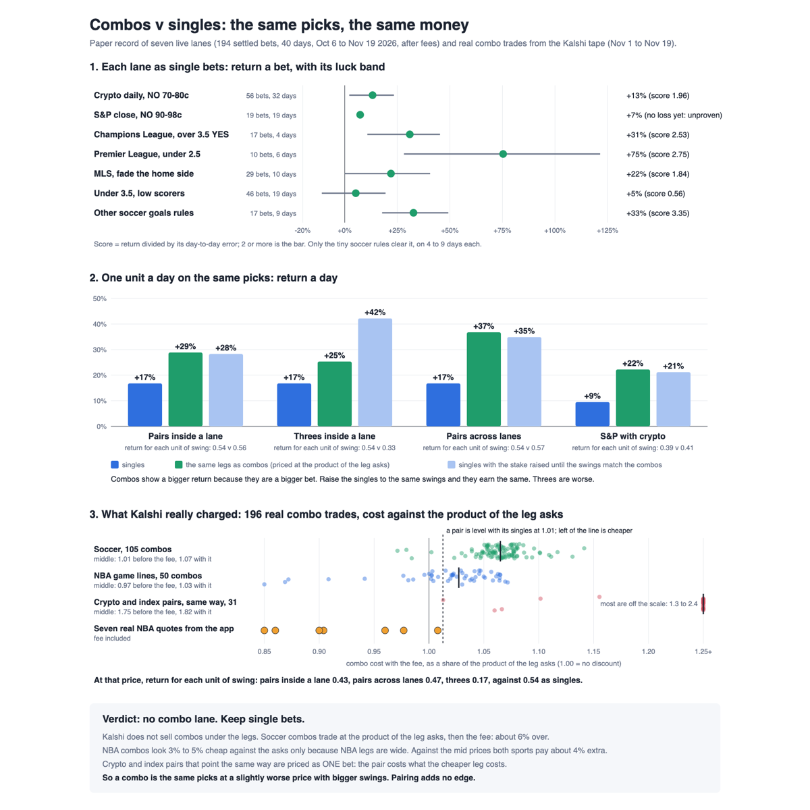

# Combos v singles: should any lane be placed as a Kalshi combo?

Nov 20 2026. Research only. Two sources: the lanes' paper records already on disk, and Kalshi's public combo trade tape (pulled with Olu's OK). The plan was written before any combo result was read (it is copied at the end).

**Answer: no combo lane. Keep single bets.**
- A combo is a bigger bet on the same picks. It adds no edge.
- Kalshi does not sell combos under the legs. Soccer combos trade at the product of the leg asks, and then the fee is added: about 6% over.
- At that real price, pairs earn less than their own singles for the same swings (0.43 against 0.54). Threes are far worse (0.17).

## Primer: how a Kalshi combo works

- **One contract, all legs must win.** A combo pays 1 only if every leg wins. Its value is the legs' settled values multiplied together.
- **No order book.** You ask for a price. Market makers answer with a quote. You take it or leave it. The quote can move between seeing it and buying. If nobody answers, there is no bet.
- **No way back.** Once filled, a combo cannot be cancelled. Kalshi's help page does not say it can be sold early.
- **Fee.** The combo series carries the usual taker fee formula on the combo's own price, and makers pay a fee too. By default the amount typed in covers price plus fee.
- **A void or part-value leg does not refund the combo.** The leg settles by its own market's rules at a value between 0 and 1, and the combo's payout is multiplied by it. Kalshi's example: one leg at 0.70 with two legs at 1.00 pays 0.70.
- **A combo can end early.** It settles as soon as one leg loses.
- **Protected picks** (NBA and NFL player lines): if the player is out by half-time without reaching the line, the leg settles at its fair price, not zero. In the one real quote we have, protection cut the payout by about 5% (1.61x to 1.53x).
- **One leg an event.** Two rungs of the same ladder cannot share a combo. Different markets of the same game can.
- **What can go in.** Kalshi's list held 237 series on Nov 20. It reopens daily and only shows series with open games in the window. A series missing today may only be out of season.
- **Checked on the tape:** Nations League, friendlies, the Scottish and Portuguese leagues, the African Cup (winner, goals, both-to-score) and Champions League team totals were all used as combo legs on days they had games. Not seen as legs in about 35,000 listed combos: the Saudi league, the HYPE coin, NBA win margin, first team to score.
- **The tape is public.** Each combo is its own market, listed with its legs, its result and its trades (price, size, time).

Two label fixes for the record: rule A7 is YES on over 3.5 goals in the Champions League, and rule A6 is under 2.5 goals in the Premier League.

## What a combo does to a bet (arithmetic only)

Two unlinked legs. Singles put half a unit on each and pay the taker fee. The combo puts one unit on both at K times the product of the leg asks, fees included.

| Leg price | True chance | Singles: return, swings | Combo at K 1.00 | Combo at K 0.95 | Combo at K 0.90 |
|---|---|---|---|---|---|
| 75c | 75% (no edge) | -1.7%, 40% | 0.0%, 88% | +5.3%, 93% | +11.1%, 98% |
| 75c | 80% | +4.8%, 37% | +13.8%, 85% | +19.8%, 90% | +26.4%, 95% |
| 55c | 60% | +5.7%, 61% | +19.0%, 159% | +25.3%, 167% | +32.2%, 176% |
| 94c | 97% | +2.8%, 13% | +6.5%, 27% | +12.1%, 28% | +18.3%, 30% |

- **A combo is a bigger bet on the same edge.** The return roughly doubles and the swings more than double.
- **It adds no edge.** Legs with no edge make a combo with no edge.
- **Price is everything.** Each 5% off the combo price adds about 6 points of return. So the question is what K really is.

## Part a. What Kalshi really charges

425 traded combos with 2 to 4 legs from different games, created before the first leg started. 196 could be scored: bought before any leg started, by a buyer of the YES side, with a bid and ask for every leg at most 10 minutes old. Each combo's first trade is set against its legs' bid and ask just before.

Middle value, with the 25th to 75th range in brackets. K adds the taker fee to the trade price.

| Group | Combos | Days | Middle leg spread | Price / product of leg asks | Price / product of leg mids | With fee (K) |
|---|---|---|---|---|---|---|
| Soccer | 105 | 8 | 1.0c | 1.007 (0.998 to 1.012) | 1.039 (1.029 to 1.052) | 1.065 (1.054 to 1.077) |
| Soccer, 2 legs | 26 | 5 | 1.0c | 1.008 (0.998 to 1.010) | 1.029 (1.027 to 1.036) | 1.059 (1.052 to 1.067) |
| Soccer, 3 legs | 35 | 5 | 1.0c | 1.007 (0.994 to 1.013) | 1.037 (1.027 to 1.050) | 1.067 (1.054 to 1.077) |
| Soccer, 4 legs | 44 | 7 | 1.0c | 1.007 (1.000 to 1.014) | 1.051 (1.038 to 1.062) | 1.071 (1.060 to 1.080) |
| NBA game lines | 50 | 2 | 2.4c | 0.970 (0.949 to 0.994) | 1.038 (1.030 to 1.058) | 1.027 (1.003 to 1.047) |
| NBA, legs 2c wide or less | 23 | 2 | 1.5c | 0.994 (0.974 to 0.999) | 1.035 (1.026 to 1.047) | 1.046 (1.032 to 1.063) |
| NBA, legs over 2c wide | 27 | 2 | 2.7c | 0.954 (0.939 to 0.970) | 1.046 (1.030 to 1.079) | 1.008 (0.981 to 1.022) |
| Crypto and index, same direction | 31 | 6 | 3.5c | 1.751 (1.309 to 2.301) | 1.831 (1.364 to 2.973) | 1.818 (1.333 to 2.402) |
| Crypto and index, mixed directions | 8 | 5 | 2.6c | 0.384 (0.296 to 1.010) | 0.406 (0.302 to 1.031) | 0.409 (0.315 to 1.047) |

- **Soccer: no discount at all.** Combos trade at the product of the leg asks, almost to the decimal. No soccer combo in the sample came in at a K of 0.95 or less.
- **Every sport pays about 4% over the mid prices.** About 3% for two legs, 4% for three, 5% for four. Then the fee.
- **NBA only looks cheap.** Its legs are wide, so the asks sit well above the mid. A quote near the mid then shows as 3% to 5% under the asks. With the fee an NBA combo costs about what the leg asks multiply to.
- **The seven app quotes** (0.84 to 1.01, fee included) sit lower than the NBA tape. The likely reason is wider legs on first-quarter and player lines. That cannot be checked without the leg books at those moments.
- **Crypto and index pairs are priced as one bet.** When both legs point the same way, the pair costs what the cheaper leg alone costs (pair price over the cheaper leg's ask: middle 1.00, range 0.95 to 1.02, 26 pairs). Makers price the link. No extra payout for the second leg.
- **Not on the tape:** a crypto leg with an index leg (none in the sample), and too few all-goals-line soccer combos to read alone. With quotes up to 3 hours old there are 11 soccer combos holding a goals line (price over asks 1.000) and 12 holding a NO leg (0.999): the same as the rest.
- **Check:** with leg quotes up to 3 hours old, 288 combos score and the middles do not move (soccer 1.007, NBA 0.973).
- **Fee:** the standard taker formula is assumed for combos (the series says so; the exact rule for quoted trades is not published). Without any fee, soccer is still at 1.007.

## Part b. Each lane as single bets

Paper record, after the taker fee. Score = return divided by its day-to-day error; 2 or more is the bar.

| Lane | Bets | Days | Won | Avg price | Return a bet | Score | Luck band | Found half | Later half |
|---|---|---|---|---|---|---|---|---|---|
| Crypto daily, NO 70-80c | 56 | 32 | 48 | 74c | +13.2% | 1.96 | +2% to +23% | +12.8% (22) | +13.5% (34) |
| S&P close, NO 90-98c | 19 | 19 | 19 | 93c | +7.3% | no loss yet | none | +7.2% (10) | +7.5% (9) |
| Champions League A7 | 17 | 4 | 10 | 45c | +30.9% | 2.53 | +11% to +45% | +27.6% (7) | +33.2% (10) |
| Premier League A6 | 10 | 6 | 8 | 45c | +75.3% | 2.75 | +28% to +121% | +111.7% (5) | +38.9% (5) |
| MLS fade the home side | 29 | 10 | 21 | 58c | +22.0% | 1.84 | 0% to +41% | +28.8% (21) | +4.1% (8) |
| Under 3.5, low scorers | 46 | 19 | 36 | 74c | +5.2% | 0.56 | -11% to +19% | +12.4% (19) | +0.2% (27) |
| Other soccer goals rules | 17 | 9 | 13 | 55c | +32.7% | 3.35 | +18% to +49% | +34.2% (9) | +31.0% (8) |

- **Live records agree in size:** crypto +14.7% on 23, S&P +8.0% on 5, MLS +16.4% on 19, A6 +71.7% on 8, A7 +33.2% on 10.
- **Nothing is proven yet.** The rules that clear the bar do it on 4 to 9 days. The two lanes with real counts (crypto, under 3.5) sit under it.
- **The S&P lane has not lost.** At 93c a fair contract wins 19 in a row about one time in four, so 19 from 19 shows nothing yet. One loss costs about 13 wins.

## Part c. The same picks as singles and as combos

One unit a day, split equally by leg, so both sides put the same money on the same picks.

**First at the product of the leg asks, fees included (K = 1.00), as planned:**

| Rule | Days | Combos (won) | Singles a day | Combos a day | Singles at the same swings | Return for each unit of swing: singles v combos | Found half | Later half |
|---|---|---|---|---|---|---|---|---|
| Pairs inside a lane | 40 | 61 (37) | +16.8% | +28.9% | +28.3% | 0.54 v 0.56 | 0.48 v 0.61 | 0.60 v 0.49 |
| Threes inside a lane | 40 | 53 (27) | +16.8% | +25.3% | +42.2% | 0.54 v 0.33 | 0.48 v 0.38 | 0.60 v 0.26 |
| Pairs across lanes | 40 | 85 (52) | +16.8% | +36.8% | +34.9% | 0.54 v 0.57 | 0.48 v 0.65 | 0.60 v 0.52 |
| S&P with crypto | 19 | 19 (16) | +9.5% | +22.2% | +21.2% | 0.39 v 0.41 | 7.95 v 7.10 | -0.10 v -0.08 |

- **Combos show a bigger return because they are a bigger bet.** Raise the singles' stake until the swings match and they earn the same.
- **Pairs are level with singles at that price.** Ahead in one half, behind in the other; ahead in 50% and 54% of day resamples.
- **Threes are worse.** Ahead in 8% of resamples. Losing days go from 25% to 40%.
- **Break-even:** pairs match their singles at K = 1.01 to 1.02.

**Then at the price the tape shows** (1.007 times the product of the leg asks, plus the fee; a same-day crypto pair at the cheaper leg's ask, plus the fee):

| Rule | Days | Singles a day | Combos a day | Return for each unit of swing: singles v combos | Found half | Later half | Combo ahead (resamples) |
|---|---|---|---|---|---|---|---|
| Pairs inside a lane | 40 | +16.8% | +20.8% | 0.54 v 0.43 | 0.48 v 0.50 | 0.60 v 0.34 | 14% |
| Threes inside a lane | 40 | +16.8% | +11.5% | 0.54 v 0.17 | 0.48 v 0.31 | 0.60 v -0.04 | 0% |
| Pairs across lanes | 40 | +16.8% | +29.0% | 0.54 v 0.47 | 0.48 v 0.57 | 0.60 v 0.39 | 25% |
| S&P with crypto | 19 | +9.5% | +18.8% | 0.39 v 0.35 | 7.95 v 6.99 | -0.10 v -0.12 | 0% |
| Pairs inside crypto | 32 | +13.6% | +7.0% | 0.35 v 0.13 | 0.38 v 0.15 | 0.30 v 0.12 | 2% |
| Pairs inside MLS | 10 | +21.3% | +39.2% | 0.38 v 0.46 | 1.21 v 0.84 | 0.13 v 0.31 | 64% |

- **At the real price every rule is behind its singles** over the whole record. None is ahead in both halves.
- **Crypto pairs are the worst case.** The second leg adds risk and no payout.
- **S&P with crypto** is scored here as if the two legs were unlinked. The tape has no such pair, and makers price links, so the real figure is likely lower.

**Limit.** The replay takes each leg at its own logged price. A real combo is bought at one moment. MLS and under-3.5 legs are logged about 80 hours before kick-off, so their pairs would be re-priced.

## Part d. Do legs lose together?

| Group | Leg pairs on a day | Both won | Both lost | Expected both lost if unlinked | Shuffle band |
|---|---|---|---|---|---|
| Crypto daily | 35 | 27 | 1 (3%) | 2% | 0% to 6% |
| Champions League A7 | 32 | 10 | 3 (9%) | 17% | 9% to 22% |
| MLS fade the home side | 48 | 26 | 2 (4%) | 8% | 2% to 15% |
| Under 3.5, low scorers | 57 | 38 | 3 (5%) | 5% | 0% to 11% |
| Soccer, same kick-off time | 41 | 19 | 3 (7%) | 7% | 0% to 15% |
| S&P with crypto, same day | 19 | 16 | 0 | 1% | 0% to 5% |

- **No sign in our own results that legs lose together.** Every count sits inside its shuffle band.
- **This is thin.** S&P with crypto on a bad day cannot be tested: the S&P leg has not lost.
- **The makers do see a link** between coins and between indexes, and charge for it in full (part a).
- **How often a lane has two legs on a day:** crypto 15 of 32 days, MLS 6 of 10, under 3.5 12 of 19, the Champions League 4 of 4, S&P never.

## Verdict by the written rule

| Lane or rule | Result | Why |
|---|---|---|
| Crypto daily | No combo lane | Its pairs are priced as one bet (0.13 against 0.35 as singles). The lane's own score is 1.96 on 56 bets: keep reading it as singles. |
| S&P close | No combo lane | No loss yet, so no proof. With crypto it is behind its singles at the real price. |
| MLS fade the home side | No combo lane now | Score 1.84 on 29 bets. Pairs ahead in one half only, on 10 days. Soccer combos carry no discount. |
| Under 3.5, low scorers | No combo lane | No edge of its own (0.56 on 46 bets). |
| A7, A6, other soccer rules | No combo lane | Their pairs lose to their singles. Counts are tiny. |
| Threes, any lane | No | Clearly worse than singles. |

Rule 3 (Kalshi sells it at the price needed) fails for every group: pairs need 1.01 or less, soccer costs 1.06, crypto pairs far more.

## How sure

- **The price finding is firm for soccer.** 105 combos on 8 days in a tight range, and 156 with older quotes say the same.
- **NBA rests on two nights.** Good enough to explain the app quotes, not a fine measure.
- **Crypto and index rests on 39 combos,** none of them our exact pair (a crypto leg with an S&P leg).
- **The paper records are short** (40 days). That limits what can be said about any lane, as singles or combos.

## Build spec

Nothing to build.

- **Rule:** none. Lanes stay as single bets.
- **Scope, entry timing:** unchanged.
- **The one change:** none.
- **Retire or keep:** this question does not judge any lane. Each lane's own read point stands.
- **Pre-registration text:** none needed.
- **The leaderboard page:** this result gives no reason to swap it for a combo page.
- **If combos are still wanted for other reasons** (say, by hand, for fun), the honest paper price is 1.007 times the product of the leg asks in the same minute, plus the fee, and a same-direction crypto or index pair at the cheaper leg's ask. A page would show each day's pairs and legs, that price, the result, and beside it the same legs as singles at the same swings. Percentages only.

## The plan as written before the read

- Lanes fixed: the seven live lanes whose series Kalshi allows in a combo.
- Per leg: return after the taker fee, clusters are days, luck band from 2,000 day resamples, halves split at each lane's middle day.
- Pairing rules fixed: pairs inside a lane, threes inside a lane, pairs across lanes, S&P with crypto. One unit a day split equally by leg.
- Combo price: K times the product of the leg asks, fees included. Primary K = 1.00; support 0.95, 0.90, 1.05; break-even K reported.
- A pairing goes to paper only if (1) its legs' singles are above zero in both halves with a score of 2 or more, (2) the combo beats its own singles for the same swings in both halves and in 90% of day resamples, (3) the tape shows Kalshi sells it at that price.
- A bigger plain return is not enough: two wins multiplied always show one.
- The tape: settled combos with 2 to 4 legs from different games, bought before the first leg started; each combo's trade against its legs' bid and ask in the same minute; by market type and number of legs.
- Expectation written beforehand: level with singles or a little under at the price of the legs; any gain must come from the price; most lanes too young; no combo lane today.

Changes from the plan:
- The taker fee is rounded up to a hundredth of a cent (what the exchange charges), not to the cent.
- The combo list holds over a thousand combos every quarter hour, so it could not be read newest first. Pages were taken by settle-time window for each market type: soccer on Nov 4 and Nov 7; crypto and index at the two daily closes on nine trading days, Nov 9 to Nov 19; NBA on seven evening windows, Nov 12 to Nov 14.
- The sample took every qualifying combo instead of 120 a type (soccer 225, NBA game lines 146, crypto and index 51). NBA player lines gave only 2 and are not read.
- The sampled combos' own results are not reported: choosing pages by settle time picks up too many early losers. Prices at the time of purchase are not affected.
- Requests used: 40 list and 755 price, against 40 and up to 2,000 planned.

Files: `~/edge-research/combo_2026-11-20/` (PREREGISTERED.md, legs.py, score.py, tape_list.py, tape_win.py, tape_pull.py, tape_score.py, pics.py, results.md, tape_results.md).
