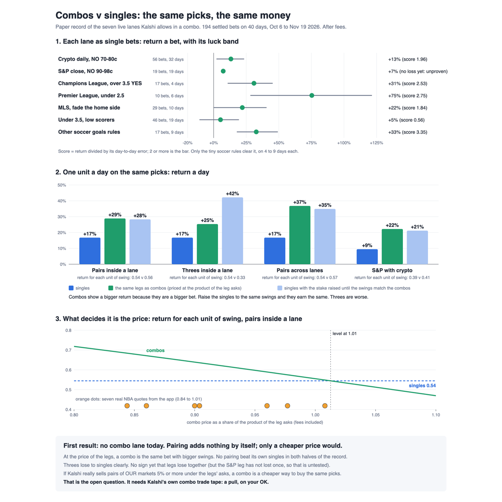

# Combos v singles: should any lane be placed as a Kalshi combo?

Nov 20 2026. Research only, from records already on disk plus Kalshi's public combo list. The plan was written before any combo result was read (it is copied at the end).

**Answer so far: no combo lane today.**
At the price of the legs, a combo is the same bet with bigger swings. None of the four pairing rules beat its own singles in both halves of the record. Threes are clearly worse than singles.
What could still change this is the price. If Kalshi sells pairs of our markets well under the legs' asks, a combo is a cheaper way to buy the same picks. That needs Kalshi's own combo trade tape, which is a pull and is not done yet.

## Primer: how a Kalshi combo works

- **One contract, all legs must win.** A combo pays 1 only if every leg wins. Its value is the legs' settled values multiplied together.
- **No order book.** You ask for a price. Market makers answer with a quote. You take it or leave it. The quote can move between seeing it and buying. If nobody answers, there is no bet.
- **No way back.** Once filled, a combo cannot be cancelled. Kalshi's help page does not say it can be sold early.
- **Fee.** The combo series carries the usual taker fee formula on the combo's own price, and makers pay a fee too. By default the amount typed in covers price plus fee.
- **A void or part-value leg does not refund the combo.** The leg settles by its own market's rules at a value between 0 and 1, and the combo's payout is multiplied by it. Kalshi's example: one leg at 0.70 with two legs at 1.00 pays 0.70.
- **Protected picks** (NBA and NFL player lines): if the player is out by half-time without reaching the line, the leg settles at its fair price, not zero. In the one real quote we have, protection cut the payout by about 5% (1.61x to 1.53x).
- **One leg an event.** Two rungs of the same ladder cannot share a combo. Different markets of the same game can.
- **What can go in.** Kalshi's list held 237 series on Nov 20. It reopens daily and only shows series with open games in the window (this one runs to Dec 1). So a series missing today may only be out of season.
- **In today:** match winner, total goals, both-to-score, corners and first-half markets in the big soccer leagues, the Champions League and MLS; crypto daily (BTC, ETH, SOL, XRP, DOGE); the S&P and Nasdaq close; all 15-minute markets; NBA and NFL lines and player lines.
- **Not in today:** weather, NBA win margin, soccer team totals, first team to score, commodity dailies, the African Cup. Also not listed today: Nations League, friendlies, the Saudi, Scottish and Portuguese leagues, two domestic cups, and the HYPE coin. Those make up 32 of the under-3.5 lane's 46 paper legs and 6 of the crypto lane's 56.
- **The tape is public.** Each combo is its own market, listed with its legs, its result and its trades (price, size, time). So the real price can be measured.

Two label fixes for the record: rule A7 is YES on over 3.5 goals in the Champions League, and rule A6 is under 2.5 goals in the Premier League.

## What a combo does to a bet (arithmetic only)

Two unlinked legs. Singles put half a unit on each and pay the taker fee. The combo puts one unit on both at K times the product of the leg asks, fees included.

| Leg price | True chance | Singles: return, swings | Combo at K 1.00 | Combo at K 0.95 | Combo at K 0.90 |
|---|---|---|---|---|---|
| 75c | 75% (no edge) | -1.7%, 40% | 0.0%, 88% | +5.3%, 93% | +11.1%, 98% |
| 75c | 80% | +4.8%, 37% | +13.8%, 85% | +19.8%, 90% | +26.4%, 95% |
| 55c | 60% | +5.7%, 61% | +19.0%, 159% | +25.3%, 167% | +32.2%, 176% |
| 94c | 97% | +2.8%, 13% | +6.5%, 27% | +12.1%, 28% | +18.3%, 30% |

- **A combo is a bigger bet on the same edge.** The return roughly doubles and the swings more than double.
- **It adds no edge.** Legs with no edge make a combo with no edge.
- **Price is everything.** Each 5% off the combo price adds about 6 points of return. Seven real NBA quotes from the app came in at 0.84 to 1.01 of the leg asks, middle 0.90.
- **Why a quote can sit under the asks.** In a wide market the ask is above the fair price. A maker quoting near fair then looks cheap against the asks. NBA first-quarter lines are 4c to 5c wide. Our markets are 1c to 2c wide, so the saving there is likely small. This is a reasoned guess until the tape is read.

## Part b. Each lane as single bets

Paper record, after the taker fee. Score = return divided by its day-to-day error; 2 or more is the bar.

| Lane | Bets | Days | Won | Avg price | Return a bet | Score | Luck band | Found half | Later half |
|---|---|---|---|---|---|---|---|---|---|
| Crypto daily, NO 70-80c | 56 | 32 | 48 | 74c | +13.2% | 1.96 | +2% to +23% | +12.8% (22) | +13.5% (34) |
| S&P close, NO 90-98c | 19 | 19 | 19 | 93c | +7.3% | no loss yet | none | +7.2% (10) | +7.5% (9) |
| Champions League A7 | 17 | 4 | 10 | 45c | +30.9% | 2.53 | +11% to +45% | +27.6% (7) | +33.2% (10) |
| Premier League A6 | 10 | 6 | 8 | 45c | +75.3% | 2.75 | +28% to +121% | +111.7% (5) | +38.9% (5) |
| MLS fade the home side | 29 | 10 | 21 | 58c | +22.0% | 1.84 | 0% to +41% | +28.8% (21) | +4.1% (8) |
| Under 3.5, low scorers | 46 | 19 | 36 | 74c | +5.2% | 0.56 | -11% to +19% | +12.4% (19) | +0.2% (27) |
| Other soccer goals rules | 17 | 9 | 13 | 55c | +32.7% | 3.35 | +18% to +49% | +34.2% (9) | +31.0% (8) |

- **Live records agree in size:** crypto +14.7% on 23, S&P +8.0% on 5, MLS +16.4% on 19, A6 +71.7% on 8, A7 +33.2% on 10.
- **Nothing is proven yet.** The rules that clear the bar do it on 4 to 9 days. The two lanes with real counts (crypto, under 3.5) sit under it.
- **The S&P lane has not lost.** At 93c a fair contract wins 19 in a row about one time in four, so 19 from 19 shows nothing yet. One loss costs about 13 wins.

## Part c. The same picks as singles and as combos

One unit a day, split equally by leg, so both sides put the same money on the same picks. Combo price = the product of the leg asks, fees included (K = 1.00).

| Rule | Days | Combos (won) | Singles a day | Combos a day | Singles at the same swings | Return for each unit of swing: singles v combos | Found half | Later half |
|---|---|---|---|---|---|---|---|---|
| Pairs inside a lane | 40 | 61 (37) | +16.8% | +28.9% | +28.3% | 0.54 v 0.56 | 0.48 v 0.61 | 0.60 v 0.49 |
| Threes inside a lane | 40 | 53 (27) | +16.8% | +25.3% | +42.2% | 0.54 v 0.33 | 0.48 v 0.38 | 0.60 v 0.26 |
| Pairs across lanes | 40 | 85 (52) | +16.8% | +36.8% | +34.9% | 0.54 v 0.57 | 0.48 v 0.65 | 0.60 v 0.52 |
| S&P with crypto | 19 | 19 (16) | +9.5% | +22.2% | +21.2% | 0.39 v 0.41 | 7.95 v 7.10 | -0.10 v -0.08 |

- **Combos show a bigger return because they are a bigger bet.** Raise the singles' stake until the swings match and they earn the same.
- **Pairs are level with singles.** Ahead in one half, behind in the other. In day resamples the pairs came out ahead 50% (inside a lane) and 54% (across lanes) of the time: a coin flip.
- **Threes are worse.** Ahead in only 8% of resamples. Losing days go from 25% to 40% and the deepest drop doubles (1.0 to 2.1 daily units).
- **S&P with crypto:** level. The combo's deepest drop was 2.0 daily units against 0.9 for the two singles.
- **Break-even price:** pairs match their singles at K = 1.01 to 1.02. Under that the combo is the better buy; at K = 0.90 the pairs' figure is 0.64 against 0.54.

Pairs inside each lane, return for each unit of swing (singles v combos): crypto 0.35 v 0.32; MLS 0.38 v 0.48; under 3.5 0.02 v 0.28; A7 1.24 v 0.44; A6 0.79 v 0.73; other rules 1.18 v 0.25. The under-3.5 lane is the only one ahead in both halves, and it is the lane with no edge of its own. Its losses happened to fall in the same combos.

**Limit.** The replay takes each leg at its own logged price. A real combo is bought at one moment. MLS and under-3.5 legs are logged about 80 hours before kick-off, so their pairs would be re-priced.

## Part d. Do legs lose together?

| Group | Leg pairs on a day | Both won | Both lost | Expected both lost if unlinked | Shuffle band |
|---|---|---|---|---|---|
| Crypto daily | 35 | 27 | 1 (3%) | 2% | 0% to 6% |
| Champions League A7 | 32 | 10 | 3 (9%) | 17% | 9% to 22% |
| MLS fade the home side | 48 | 26 | 2 (4%) | 8% | 2% to 15% |
| Under 3.5, low scorers | 57 | 38 | 3 (5%) | 5% | 0% to 11% |
| Soccer, same kick-off time | 41 | 19 | 3 (7%) | 7% | 0% to 15% |
| S&P with crypto, same day | 19 | 16 | 0 | 1% | 0% to 5% |

- **No sign that legs lose together.** Every count sits inside its shuffle band.
- **This is thin.** S&P with crypto on a bad day cannot be tested: the S&P leg has not lost. On the 3 days crypto lost, S&P won.
- **How often a lane has two legs on a day:** crypto 15 of 32 days, MLS 6 of 10, under 3.5 12 of 19, the Champions League 4 of 4, S&P never (one pick a day).

## Verdict by the written rule

| Lane or rule | Result | Why |
|---|---|---|
| Crypto daily | Wait | Score 1.96 on 56 bets, just under the bar. Its pairs need K at 0.95 or less to match its singles. |
| S&P close | No combo lane | No loss yet, so no proof. The pair with crypto is level with its singles and behind in the found half. |
| MLS fade the home side | Wait | Score 1.84 on 29 bets. |
| Under 3.5, low scorers | No combo lane | No edge of its own (0.56 on 46 bets). |
| A7, A6, other soccer rules | No combo lane | Their pairs lose to their singles. Counts are tiny. |
| Threes, any lane | No | Clearly worse than singles. |

## Still open: the price Kalshi really charges

- Known: seven NBA quotes at 0.84 to 1.01 of the leg asks.
- Not known: the price for pairs of our markets (soccer goals, crypto daily, the S&P close), where spreads are tight.
- How to learn it: Kalshi's settled combo markets and their trades, set against each leg's bid and ask in the same minute. About 40 list requests and up to 2,000 price requests. Waiting on Olu's OK.
- What would change the verdict: a measured price at or under 0.95 for pairs of our markets. Then the pairing rules are scored again at that price, by the same written rule.

## Build spec

Nothing to build now.

- **Rule:** none. Lanes stay as single bets.
- **Scope, entry timing:** unchanged.
- **The one change:** none.
- **Retire or keep:** this question does not judge any lane. Each lane's own read point stands.
- **If the price check passes later,** the paper row would be: pairs across lanes, two legs, formed once a day from that day's live picks; priced on paper at the product of the two leg asks in the same minute times the measured K (K = 1.00 until measured, never a guessed discount); read at 40 settled combos; judged against the same legs as singles at the same swings.
- **What a combo page would show:** each day's pairs with their legs, the paper price and the result; beside each pair the same two legs as singles; and three record lines: combos' return a day, singles' return a day, and singles at the same swings. Percentages only.
- **The leaderboard page:** this result gives no reason to swap it for a combo page yet.

## The plan as written before the read

- Lanes fixed: the seven live lanes whose series Kalshi allows in a combo.
- Per leg: return after the taker fee, clusters are days, luck band from 2,000 day resamples, halves split at each lane's middle day.
- Pairing rules fixed: pairs inside a lane, threes inside a lane, pairs across lanes, S&P with crypto. One unit a day split equally by leg.
- Combo price: K times the product of the leg asks, fees included. Primary K = 1.00; support 0.95, 0.90, 1.05; break-even K reported.
- A pairing goes to paper only if (1) its legs' singles are above zero in both halves with a score of 2 or more, (2) the combo beats its own singles for the same swings in both halves and in 90% of day resamples, (3) the tape shows Kalshi sells it at that price.
- A bigger plain return is not enough: two wins multiplied always show one.
- Expectation written beforehand: level with singles or a little under at the price of the legs; any gain must come from the price; most lanes too young; no combo lane today.

One change from the plan: the taker fee is rounded up to a hundredth of a cent (what the exchange charges), not to the cent.

Files: `~/edge-research/combo_2026-11-20/` (PREREGISTERED.md, legs.py, score.py, pics.py, results.md).
