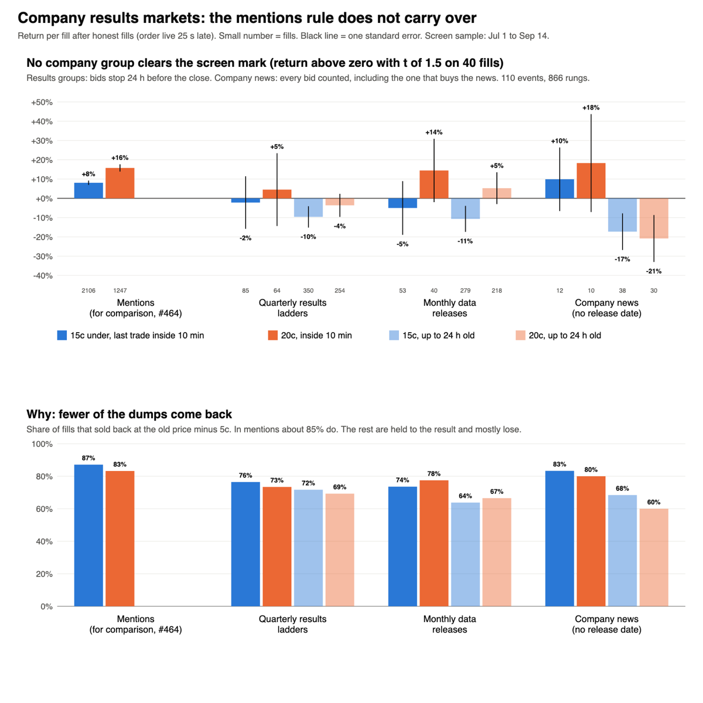
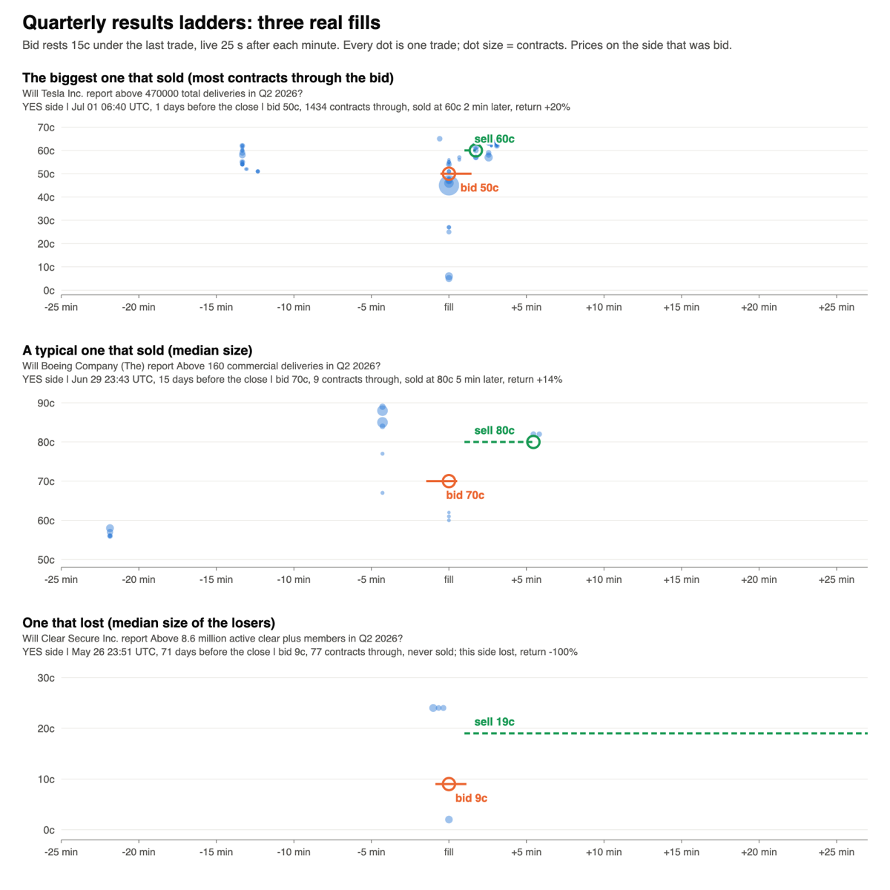

# Company results markets: does the mentions rule carry over? (Nov 14 2026)

Research only. PR #464 found that a bid resting under the last trade pays in mention markets. Olu: "yes, start with the company
results screen". The question: does the same rule pay in Kalshi company markets?

**Short answer: no. Nothing clears the screen, so there is no full test and nothing to build. Next is Economics.**

## What exists

Settled before Sep 15 2026, from Kalshi's archive:

| Group | Series with settled events | Events | Traded rungs | Contracts |
|---|---|---|---|---|
| Quarterly results ladders | 96 | 145 | 1,234 | 17.7M |
| Monthly data releases (card spend, point of sale, foot traffic, ad spend) | 50 | 50 | 405 | 0.9M |
| Company news with no release date (chief executive changes, listings, takeovers) | 33 | 37 | 174 | 26.2M |

Company results are about 30 times smaller than mentions by lifetime volume. A typical quarterly rung trades 52 times in its whole
life; a monthly data rung 23 times. The monthly data markets are new (all of them closed in August or September).

## The screen

A random sample of 110 events that closed Jul 1 to Sep 14 (46 quarterly, 46 monthly, 18 news; 866 rungs), whole trade history.
The latest results season (Sep 15 to Nov 13) was not listed or read, so it stays clean for any later test.

Return per fill, order live 25 seconds late, honest fills:

| Group | 15c under | 20c under | 15c, last trade up to 24 h old | 20c, last trade up to 24 h old |
|---|---|---|---|---|
| Mentions (#464, for comparison) | +8.1% on 2,106 | +15.8% on 1,247 | | |
| Quarterly results | -2.2% on 85 (t -0.2) | +4.5% on 64 (t 0.2) | -9.6% on 350 (t -1.7) | -3.6% on 254 (t -0.6) |
| Monthly data | -5.0% on 53 (t -0.4) | +14.5% on 40 (t 0.9) | -10.7% on 279 (t -1.6) | +5.3% on 218 (t 0.6) |
| Company news | +9.9% on 12 | +18.3% on 10 | -17.3% on 38 (t -1.8) | -20.8% on 30 (t -1.7) |

The mark written down before the pull: return above zero with t of 1.5 or more, on 40 or more fills in 10 or more events.
**No cell reaches it.** The best is monthly data at 20c: +14.5%, but on 40 fills in 10 events with t 0.9, and the 15c row beside it is negative.

## What was run

- **The rule is #464's, unchanged** (the code was checked equal on 300 mention tapes first): each minute a bid 15c or 20c under the
  last trade on both sides of every rung; fills only on a trade strictly through it; sold at the old price minus 5c, else held to the result.
- **One extra row, written down before the pull:** the last trade may be up to 24 hours old (the mentions rule needs one inside
  10 minutes). These books trade rarely, so the 10-minute rule gets under 2 fills an event against about 14 in mentions.
  The extra row gets four times the fills and is worse.
- **The news cutoff.** At a release every rung moves in the same second, so a bid cannot be pulled after seeing it. Bids stop
  24 hours before the market closes. For company news there is no release date, so the fill that buys the news is counted.
- 1,229 requests (map 332, trade histories 897).

## Why it does not carry

- **Fewer of the dumps come back.** In mentions 83% to 87% of fills sell back. In quarterly ladders 69% to 76% do, and the ones
  that do not are held to the result and mostly lose. At 15c under, roughly four in five fills must sell back for the rule to break even.
- **It is not a news problem.** Checked after the read: in quarterly ladders the release sits about an hour before the listed close
  (inside 24 hours in 28 of 29 events), so the cutoff worked. Fills more than a day before the release still return -5% (15c) and
  -1% (20c). The quiet period itself does not pay here.
- **A likely reason (not tested):** rungs of one ladder are tied together. A rung that drops 15c often drops because the whole
  ladder was re-priced, and then it does not come back. Mention words are separate, so a dump in one word is more often just a hurried seller.
- **A stale last trade is not a price.** With the last trade up to a day old, the "drop" is often a real move that happened
  while nothing traded.

## Limits

- A screen, not a full test: 110 of the 162 events that closed Jul 1 to Sep 14, one period. It can miss a small effect; it cannot hide one the size of mentions.
- Monthly data is the only open question (new product, 10 events with fills at 20c). Worth a second look once it has
  three or four months of history, not now.
- Annual results ladders were left out (139 series, a median of 4k contracts each).

## Build spec

None. No rule, no lane. The mentions lane stays scoped to mention markets.

Data, scripts and the pre-registration: `~/edge-research/company_results_2026-11-14/` (`PREREGISTERED.md`, `screen.md`, `look.py`).
