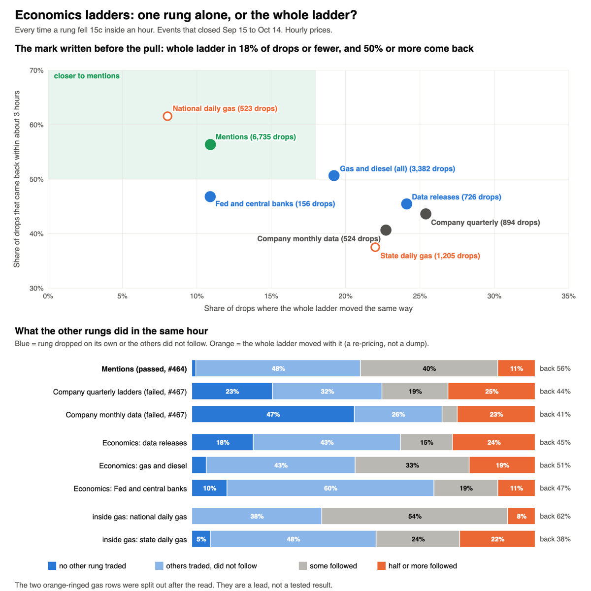

# Economics ladders: one rung alone, or the whole ladder? (Nov 14 2026)

Research only. PR #467 found that the mentions dump bid (#464) does not carry to company ladders, most likely because the rungs of a
ladder move together. Olu: "yes, send Fable the economics check". The question: do Economics ladders behave like mentions (one item
drops alone and comes back) or like company ladders (the whole ladder re-prices)?

**Short answer: mostly like company ladders. No Economics group passes the mark written before the pull, so no screen is run.
One slice looks different, national daily gas, but it was split out after the read, so it is a lead and not a result.**

## The result

Every time a rung fell 15c inside an hour: did half or more of the other rungs that traded move the same way ("whole ladder"), and
was the price back within 5c of the old price inside about three hours ("came back")?

| Market | Drops | Whole ladder | Came back | Mark |
|---|---|---|---|---|
| Mentions (passed, #464) | 6,735 | 11% | 56% | benchmark |
| Company quarterly ladders (failed, #467) | 894 | 25% | 44% | benchmark |
| Economics: data releases | 726 | 24% | 45% | **No** |
| Economics: gas and diesel | 3,382 | 19% | 51% | **No**, by one point |
| Economics: Fed and central banks | 156 | 11% | 47% | **No** |
| Economics: other (annual, one-off) | 1 | | | Too few to say |

The mark: whole ladder in 18% of drops or fewer and 50% or more come back, on 100 or more drops in 10 or more events.

- **Data releases** (inflation, jobs, jobless claims, mortgage rates, Texas power peak) sit on top of company quarterly ladders.
- **Gas and diesel** is in between. It misses the whole-ladder line by one point.
- **Fed and central banks** has few drops, and 94 of the 156 are one daily interest-rate ladder. Dumps there do not come back often enough.

## How long before the release

Kalshi closes these markets just before the number is published, so the release itself is outside the market.

| Group | 7 days or more before the close | 1 to 7 days | 1 to 24 hours | Last hour |
|---|---|---|---|---|
| Data releases | 47 | 198 | 451 | 30 |
| Gas and diesel | 130 | 1,066 | 1,747 | 439 |
| Fed and central banks | 12 | 56 | 78 | 10 |

Most drops come in the last day. The whole-ladder share is about the same early and late (19% to 27% in data releases, 11% to 35% in gas),
so staying away from the close does not turn these into mention-like markets.

## Economics markets that are not ladders

Of 714 settled events listed, 685 are number ladders, 10 are a single market and **19 are separate items**:
central bank decisions with 5 to 7 outcomes (England, Japan, Brazil, Mexico, Australia, Czech Republic, the ECB), who dissents at the
Fed (12 names), and the inflation and jobs "combo" grids. Nine of them closed in the found half and gave 42 drops in 5 events.
Too few to say. Most are one-winner events: when one outcome falls another rises, so they are linked too.

## The lead: national daily gas

Split out after the read (so it is not a tested result):

| Inside gas and diesel | Drops | Whole ladder | Came back |
|---|---|---|---|
| National daily gas | 523 in 30 days | 8% | 62% |
| State daily gas (five states) | 1,205 | 22% | 38% |
| Weekly gas and diesel | 941 | 21% | 58% |
| Daily diesel | 358 | 20% | 54% |
| Monthly | 355 | 20% | 55% |

National daily gas comes back more often than mentions do. Two cautions:

- **The 8% flatters it.** That ladder has 17 rungs half a cent apart. The far rungs trade at 1c or 99c without moving, so a real
  re-pricing shows as "some followed" (54% of its drops) and not as "whole ladder". The came-back share does not have that problem.
- **Five slices were looked at.** One of five standing out is not rare. Only a screen on trades can say whether a resting bid would
  have been filled and sold back.

It is a busy market: about 385,000 contracts a day, a median of 14 drops a day.

## What was run

- **Measure fixed first, on data already on disk** (mentions and company trade histories), where it separates the market that passed
  from the ones that failed.
- **Groups fixed from the series list on disk:** 137 Economics series with 200,000 or more lifetime contracts.
- **Listing:** settled markets Sep 15 to Nov 13. **Hourly prices:** events that closed Sep 15 to Oct 14 only, last 14 days of each
  rung, 5,968 rungs. The later half (Oct 15 to Nov 13) was listed but never priced or read.
- **259 requests** of the 350 Olu approved. Pre-registered before any request.

## What could still be wrong

- **Hourly prices, not trades.** A drop inside an hour is not the same as a fill on a resting bid. This check only says which markets
  are worth a screen.
- **One month.** Sep 15 to Oct 14.
- **Wide ladders hide re-pricing** in the whole-ladder share (see national gas above).

## Build spec

**None.** Nothing here is ready to build.

Two choices for the next step, Olu's call:

1. **A small screen on national daily gas only.** The #464 rule unchanged on trade histories, honest fills, order 25 seconds late,
   bids stop before the close, the same screen mark as #467 (return above zero with t of 1.5 or more on 40 or more fills in 10 or
   more days). Found on Sep 15 to Oct 14, with Oct 15 to Nov 13 kept unseen for a full test. About 700 requests.
2. **Move on to markets that are many separate yes/no items in one event**, the shape mentions have. Sized from the series list on
   disk (names only, so which ones are truly separate items needs one listing each):

| Family | Series | Lifetime contracts | Note |
|---|---|---|---|
| Who attends, guests, performers, setlists, features | 185 | 200M | Closest in shape to mentions. Mostly one-off events; the big ones are in February |
| Charts and rankings (Spotify, Netflix, Billboard) | 275 | 185M | Daily and weekly, so many events. "Who is number 1" items are linked |
| Weekly politics lists (orders signed, photos, pardons, who leaves) | 131 | 107M | Weekly |
| Award nominations | 38 | 32M | Several items win. Season is December and January |
| Reality TV eliminations | 21 | 63M | Weekly in season. Usually one item wins |

For scale: mentions are 465 series and 1,320M contracts.

Data, scripts and the pre-registration: `~/edge-research/economics_2026-11-14/` (`PREREGISTERED.md`, `read.md`, `hourly.py`, `eco.py`, `pics.py`).
