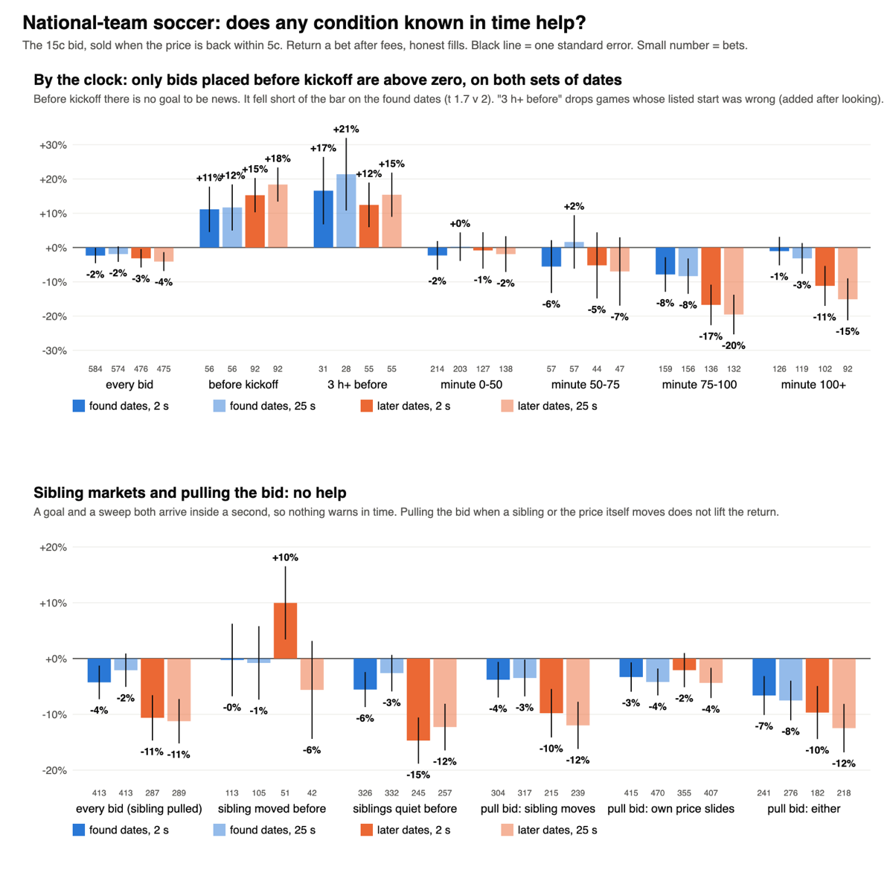
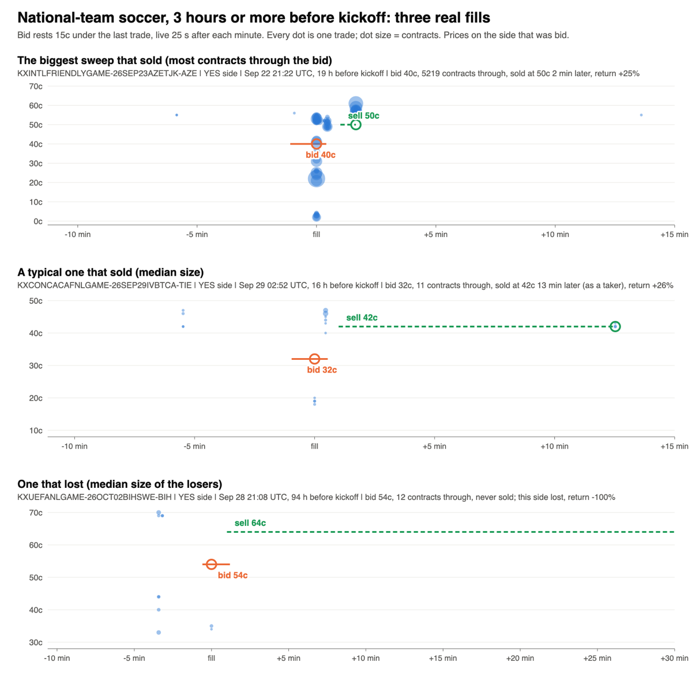

# Flash dump map: is there a filter that tells a sweep from real news? (Nov 14 2026)

Research only. Olu's question after stage 2: "Shouldn't there be some sort of filter to determine what conditions create these dumps or spikes?"
Stage 2 showed a bid resting under the price loses because about half its fills are news, not sweeps. This study looks for a condition, known at
or before the fill, that separates the two. It uses only the trade prints already pulled. No new requests.

## Short answer

- **During a game: no.** Nothing visible in time separates a sweep from a goal. Price level, minute of the game, how busy or steady the market
  was, earlier dumps, sibling markets, pulling the bid when a sibling or the price itself moves: none of them turns any group profitable.
- **Before the game: one lead.** In national-team soccer game markets, the same bid placed before kickoff made money on both sets of dates.
  Before kickoff there is no goal to be news, so a drop is nearly always a sweep. It fell just short of the written bar on the found dates,
  so by the rules it is **not a pass**. It is the one thing in the whole flash-dump study worth a forward paper watch.

## How it was run

- **Base rule (fixed):** the stage-2 bid 15c under the last trade, both sides, sold when the price is back within 5c, honest-v1 fills, at 2 s
  and 25 s order delay. Each filter is replayed as its own strategy.
- **Filters, written down before any was computed.** All measured at the minute the bid is set:
  price before the drop (four bands); the clock (minute of the game, minute of the 15-minute window, or quarter of the run-up for props);
  trading in the last 5 minutes against the market's normal; how steady the price was; earlier dumps in the same market; whether a sibling
  market on the same game had just moved. Plus three live rules: pull the bid as soon as a sibling moves 5c, as soon as the price itself
  slides 5c, or either. About 30 bands a group.
- **Bar:** on the found dates a band needs 30 bets, a positive return and t of 2 or more to go forward to one read on the later dates,
  with the false-discovery correction across those reads.
- **Groups:** national-team soccer game markets, UEFA Nations League total, pro football props, NBA points, 15-minute Solana and XRP
  (S&P 500 as description).

## Result

**No band in any group cleared the bar on the found dates**, so nothing went forward and there was no later-dates read to test. The later
dates were then opened as description.

National-team soccer, return a bet after fees (bets in brackets):

| Filter | Found, 2 s | Found, 25 s | Later, 2 s | Later, 25 s |
|---|---|---|---|---|
| Every bid | -2.4% (584) | -1.9% (574) | -3.1% (476) | -4.1% (475) |
| **Before kickoff** | **+11.1% (56)** | **+11.7% (56)** | **+15.3% (92)** | **+18.4% (92)** |
| Sibling moved in the 2 minutes before | -0.3% (113) | -0.8% (105) | +10.0% (51) | -5.6% (42) |
| Siblings quiet before | -5.6% (326) | -2.6% (332) | -14.7% (245) | -12.3% (257) |
| Pull the bid when a sibling moves | -3.8% (304) | -3.5% (317) | -9.8% (215) | -12.0% (239) |
| Pull the bid when its own price slides | -3.3% (415) | -4.2% (470) | -2.1% (355) | -4.4% (407) |
| Pull the bid on either | -6.6% (241) | -7.5% (276) | -9.7% (182) | -12.5% (218) |

**Why the sibling check does not work.** It was the most promising idea: a goal moves the winner, the draw and the total together, a sweep hits
one market. That is true, but only after the fact. The goal reaches every market inside the same second, so by the time a sibling has moved, the
bid is already filled. Pulling the bid on a sibling move, even 2 seconds later, removes almost no bad fills.

**The other groups.** Nearest band on the found dates, then the same band on the later dates:

| Group | Nearest band | Found | Later |
|---|---|---|---|
| Pro football props | price 75-95c, 25 s | +5.9% (42, t 1.0) | +6.5% (67, t 1.5) |
| 15-minute Solana and XRP | price 20-35c, 2 s | +20.0% (65, t 0.5) | -33.3% (68) |
| UEFA Nations League total | trading over 3x normal, 2 s | +9.2% (42, t 1.3) | -10.5% (32) |
| NBA player points | nothing positive | -10.4% (30) | -41.4% (18) |
| S&P 500 15-minute | price 75-95c, 25 s | +0.8% (36) | -20.9% (38) |

No filter turns any of these profitable.

## The lead: national-team soccer before kickoff

- **What it is.** Days or hours before a game the book is thin. Someone sells into it, the price prints 15c or more under the last trade, and
  a resting bid is filled. With no game on, nothing has happened to the teams: the price drifts back and the sell fills (92% are sold in
  full, half of those within 13 minutes; only four in ten are back inside two minutes).
- **The numbers.** Found dates +11.7% on 56 bets (t 1.74, short of the bar of 2). Later dates +18.4% on 92 bets (t 3.69). Both: 148 bets in
  54 games, +15.8% (t 3.96) at 25 s and +13.7% (t 3.43) at 2 s. Positive in each of the four series.
- **Why it is a lead and not a pass.** It missed the bar on the found dates, so the later dates were opened as description, not as its one
  test. It was, though, the one band named in writing as the closest before the later dates were opened.
- **A flaw found and fixed, after the fact.** One example picture showed a "before kickoff" fill in a game plainly under way. The listed start
  time is unreliable for friendlies and AFCON, and about one in five of these fills sat inside 3 hours of the listed kickoff. Keeping only bids
  **3 hours or more before the listed kickoff**: found +21.4% (28 bets, t 2.0), later +15.4% (55 bets, t 2.4), both +17.4% on 83 bets in 43
  games (t 3.1) at 25 s; +13.9% (t 2.6) at 2 s. This cut was made after looking, so it too is description.
- **It is small.** A median of 11 contracts trade through the bid, and there is about one fill for every six markets. At small stakes that is
  fine; it cannot carry size. Order speed does not matter here (25 s does as well as 2 s).
- **It did not carry to the UEFA Nations League total** before kickoff (about zero), nor to the early run-up in pro football props or NBA points.

## Verdict

- **No filter passes.** For in-game dumps the answer to Olu's question is no: what creates a sweep and what creates a real move look the same
  until after the fill.
- **One build worth making, as a paper watch only:** the before-kickoff bid in soccer game markets. Spec below. It needs a forward record
  before anything else.
- A clean test on data never read is also possible: club soccer prints before kickoff (not pulled). That is roughly 1,000 to 1,800 requests
  for five leagues and is Olu's call; the forward watch gets there without it.

## Build spec (Sandbox paper watch; the build belongs to another session)

- **Rule:** in soccer game markets, from listing until 3 hours before the listed kickoff (expected expiration minus 6 hours), each minute a
  paper bid 15c under the last trade on both sides of every leg, only if there was a trade in the last 10 minutes, the last trade is 95c or
  less and the bid is 5c or more. Live 25 s after the minute.
- **Fill:** only a print strictly through the bid (honest-v1). Size: what the stake buys, capped by the contracts that printed through.
- **Exit:** resting sell 5c under the price before the drop, up 60 s after the fill; what is not sold rides to the result. One position a
  market side at a time.
- **Scope:** row 1, national-team game series (CONCACAF Nations League, AFCON, international friendlies, UEFA Nations League), in their
  windows. Row 2, kept apart because it was never tested: Premier League, La Liga, Serie A, Bundesliga, Champions League.
- **v1 to v2:** the one change from the stage-2 rule is the clock: bids stop 3 hours before the listed kickoff.
- **Pre-registration text:** "Before-kickoff dump bid, soccer game markets. Paper only. Read at 50 and at 100 fills a row. Keep = positive
  return after fees with t of 2 or more, clustered by game, and both halves of the record positive. Retire = under that at 100 fills. Row 2
  is judged on its own. No retuning of depth, clock or exit before the 100-fill read."
- **Retire/keep:** nothing to retire; the in-game trailing bid was never a lane.

## Files

Research folder `~/edge-research/flashdump_2026-11-13/`: `PREREGISTERED.md` (filters, bar, verdict and the after-the-fact notes, each stamped),
`s3_cond.py`, `s3_stats.py`, `s3_pics.py`, `s3_found.md`, `s3_unseen.md`, `pics/C_G1_filters.png`, `pics/C_G1_before_kickoff_examples.png`.
The unfiltered rows reproduce stage 2 exactly.
