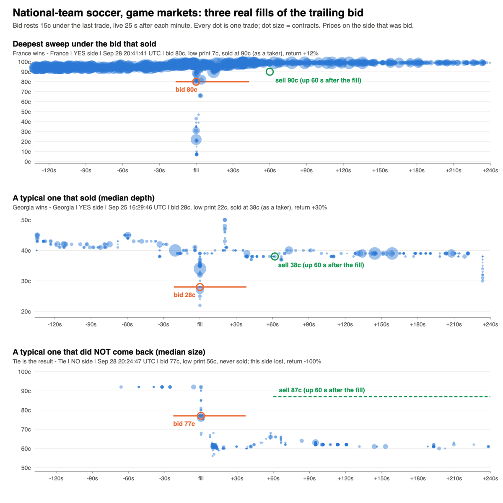
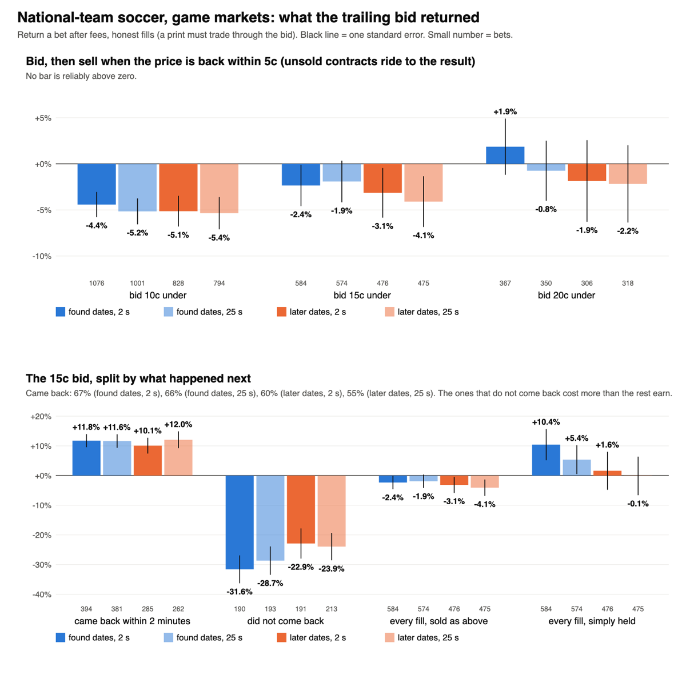

# Flash dump map, stage 2: can a resting bid catch the dump? (Nov 14 2026)

Research only. Stage 0 was the map, stage 1 the one-minute candle screen. Stage 2 takes the series Olu picked to the trade prints and asks one
question: if a bid rests under the price, does it get filled in the dump, and does it make money after fees once every fill is counted.

**Short answer: no. Nothing passes. Every group that was pulled loses or sits at zero, on the found dates and again on the later dates.**
Olu's call was to go one group at a time; this file holds every group that was pulled, with national-team soccer (the lead from stage 1) in full.

## What was run

- **The rule, written down before any print was read.** Every minute a bid rests 10c, 15c or 20c under the last trade, on both sides of the market.
  It is live 2 s later (a fast loop) or 25 s later (the order path today). It fills only when a print trades strictly through it (honest-v1).
  The position is then sold when the price is back within 5c of where it was, or halfway back, or simply held. The sell goes up 60 s after the
  fill. What is not sold rides to the result. Taker fees on taker sales; maker fees where Kalshi charges them.
- **Found dates v later dates.** Each series' games are cut at the middle by date. The earlier half is where a rule may be found; a rule that
  clears the bar there (t of 2 or more) gets one read on the later half.
- **Groups pulled:** national-team soccer game markets (CONCACAF Nations League, AFCON, international friendlies, UEFA Nations League), UEFA
  Nations League total goals, pro football props (touchdowns, first touchdown, rushing yards), NBA player points, 15-minute Solana and XRP, and the
  S&P 500 15-minute market as the known case. 120 random markets a series, none of them seen in stage 1 (the S&P ones were all seen before).
- **Not pulled:** club soccer, ATP match and NBA game prints. That part would have taken the pull to about 8,000 requests; Olu chose to work
  with what was in hand first. They count as not passed.
- **Cost:** about 4,500 requests for stage 2 in all (4,185 for prints, 250 for the club candle screen, the rest listings), one at a time, no errors.

## Result in one table

Return a bet after fees, selling when the price is back within 5c. In brackets: bets, and t (clustered by game, or by day for 15-minute markets).

| Group | Bid under | Found, 2 s | Found, 25 s | Later, 2 s | Later, 25 s | Came back (found / later, 25 s) | Median contracts through |
|---|---|---|---|---|---|---|---|
| National-team soccer, game | 10c | -4.4% (1076, t -3.24) | -5.2% (1001, t -3.67) | -5.1% (828, t -3.09) | -5.4% (794, t -3.07) | 76% / 71% | 177 |
| National-team soccer, game | 15c | -2.4% (584, t -1.05) | -1.9% (574, t -0.85) | -3.1% (476, t -1.17) | -4.1% (475, t -1.49) | 66% / 55% | 237 |
| National-team soccer, game | 20c | +1.9% (367, t 0.61) | -0.8% (350, t -0.23) | -1.9% (306, t -0.42) | -2.2% (318, t -0.52) | 57% / 47% | 319 |
| Pro football props | 10c | -16.6% (203, t -4.51) | -15.1% (185, t -3.92) | -11.4% (227, t -3.08) | -10.9% (209, t -3.13) | 41% / 45% | 61 |
| Pro football props | 15c | -11.2% (146, t -2.01) | -10.7% (134, t -2.03) | -10.3% (149, t -2.01) | -5.1% (144, t -1.08) | 40% / 44% | 64 |
| Pro football props | 20c | -0.4% (96, t -0.05) | -2.1% (87, t -0.27) | -7.0% (104, t -1.01) | -2.1% (99, t -0.29) | 38% / 43% | 74 |
| 15-minute crypto (SOL, XRP) | 10c | -15.7% (439, t -6.64) | -14.3% (362, t -5.71) | -14.9% (464, t -6.83) | -17.0% (342, t -6.25) | 70% / 67% | 983 |
| 15-minute crypto (SOL, XRP) | 15c | -16.4% (306, t -4.64) | -14.5% (289, t -4.16) | -11.3% (328, t -3.1) | -12.5% (296, t -3.15) | 55% / 50% | 903 |
| 15-minute crypto (SOL, XRP) | 20c | -18.1% (207, t -3.69) | -17.9% (204, t -3.73) | -11.6% (226, t -2.43) | -9.0% (225, t -1.88) | 42% / 39% | 1166 |
| UEFA Nations League total | 10c | -9.8% (132, t -2.62) | -10.9% (111, t -2.53) | -5.1% (134, t -1.43) | -5.5% (120, t -1.52) | 53% / 61% | 94 |
| UEFA Nations League total | 15c | +0.8% (95, t 0.15) | -1.1% (85, t -0.2) | +2.8% (85, t 0.51) | -1.2% (77, t -0.21) | 49% / 51% | 80 |
| UEFA Nations League total | 20c | +2.9% (59, t 0.38) | +3.3% (54, t 0.43) | +12.4% (49, t 1.18) | +10.2% (50, t 1.09) | 50% / 46% | 83 |
| NBA player points | 10c | -14.4% (154, t -3.45) | -13.7% (153, t -3.37) | -17.0% (122, t -3.51) | -18.7% (114, t -3.75) | 32% / 27% | 33 |
| NBA player points | 15c | -22.4% (83, t -3.19) | -19.4% (88, t -2.88) | -13.4% (73, t -1.66) | -16.2% (71, t -2.04) | 19% / 28% | 66 |
| NBA player points | 20c | -16.1% (54, t -1.49) | -13.8% (58, t -1.33) | -14.5% (43, t -1.4) | -15.3% (42, t -1.45) | 22% / 43% | 58 |
| S&P 500 15-minute (known case) | 10c | -10.7% (225, t -3.43) | -9.7% (184, t -2.67) | -13.1% (233, t -4.34) | -15.1% (186, t -4.19) | 70% / 67% | 278 |
| S&P 500 15-minute (known case) | 15c | -11.3% (148, t -1.84) | -7.4% (136, t -0.75) | -11.0% (166, t -2.25) | -11.4% (154, t -2.32) | 60% / 51% | 335 |
| S&P 500 15-minute (known case) | 20c | -3.2% (107, t -0.32) | -8.9% (102, t -0.77) | -7.5% (112, t -1.0) | -11.7% (120, t -1.69) | 54% / 48% | 290 |

No group's best cell reaches t 2 on the found dates (best: national-team soccer +9.6% at t 0.99, UEFA total +23.6% at t 0.91, props +9.9% at
t 0.41, 15-minute crypto +5.1% at t 0.44, NBA points -3.3%). So no group went forward, and the later dates were opened as description only.
They tell the same story.

## Report 1: national-team soccer game markets

The four questions:

1. **Fill: yes.** The bid does get filled. About two fills a market at 15c under, with a median of about 240 contracts trading through the bid.
2. **Goal or sweep: both, and they cannot be told apart when the fill happens.** 55% to 67% of fills are back within 5c inside two minutes
   (sweeps). The rest are news. After the fact the two look different: when 100 contracts or fewer traded through the bid the fill returned
   +14%; when more than 2,000 did it returned -36%. But that count is only known once the trading has happened, and the bid is filled by the
   first print either way.
3. **The ones that do not come back cost more than the others earn.** Sweeps that came back: about +11% a bet. The rest: -23% to -32% a bet.
   Every fill together: -2% to -4% at 15c under, -4% to -5% at 10c, about zero at 20c.
4. **Honest test: fails.** Found dates and later dates agree; 2 s and 25 s agree (a faster order does not rescue it). By series at 15c / 25 s,
   found then later: CONCACAF +3.1% then -2.6%; AFCON -2.5% then -19.0%; friendlies -8.3% then +3.8%; UEFA Nations League -2.1% then -3.4%.

**Why stage 1 looked better than this.** Stage 1 marked a bid at the price two minutes later. A real sale needs someone to trade at the sell
price after the order is up, pays a fee when it crosses, and one fill in three never gets there.

**Verdict: move on.** No build.

## The other groups pulled

Pictures for each are in `docs/flash_dump_stage2/` (`G3` props, `G4` 15-minute crypto, `G5` UEFA total, `G7` NBA points, `SP` S&P 500).

- **Pro football props:** -5% to -17% at 10c and 15c under; zero to -7% at 20c. Only four fills in ten come back. Move on.
- **15-minute Solana and XRP:** -9% to -18% everywhere, the clearest loss. In a 15-minute market a 15c drop is usually the price itself moving.
  Move on.
- **UEFA Nations League total goals:** about zero at 15c, +3% to +12% at 20c on about 50 bets a half (t about 1). Too few bets to say; not a build.
- **NBA player points:** -13% to -22%. Only about one fill in four comes back: a drop there is the player's night changing. Move on.
- **S&P 500 15-minute (known case):** the trailing bid loses 3% to 15%. This does not contradict rule C: rule C rests fixed bids at 15c and 25c
  from the open of each window and catches the opening sweep. A bid that trails the price mid-window is a different thing, and it loses.

## Club soccer: stage-1 baseline row only

Run through the stage-1 candle screen, definitions unchanged (50 random markets a series):

| Series | Deep one-minute drops | Came back | Bid marked 2 minutes later |
|---|---|---|---|
| Premier League game | 228 | 50% | +4.4c |
| La Liga game | 263 | 50% | +4.5c |
| Serie A game | 262 | 44% | +2.9c |
| Champions League game | 260 | 38% | +0.9c |
| Bundesliga game | 196 | 35% | +2.0c |

Club soccer looks like national-team soccer in the candles (which read 44% to 59%), no better. National-team soccer failed on the prints, so there
is no reason to expect club soccer to pass, and I do not recommend spending the requests on its prints.

## One thing seen along the way (a lead, not a result)

Looked at after the tables were read, so it cannot pass anything: bids much deeper than 20c. In national-team soccer a bid 40c under the last
trade, sold when the price is back within 5c, returned +11% (found) and +19% (later) at 2 s, and +9% and +14% at 25 s, on 80 to 95 fills a half.
Pooled: +15% on 175 fills (t 1.9) at 2 s, +11% on 172 (t 1.3) at 25 s. At 30c under it is zero. The same deeper bids lose in 15-minute crypto and
NBA points, and fade in the props (+23% to +31% found, about zero to +12% later). It is short of the bar, it was found by looking, and the later
half was no longer unseen.

## Stage 3 proposal

**Nothing to build.** The trailing bid at 10c to 20c under is not a lane in any group.

If Olu wants the deep-bid lead checked, it can only be checked forward, as an observation-only tracker (no orders). Written spec, to be fixed
before the first read:

- **Scope:** soccer game markets, national-team series in their windows and the five club leagues weekly, the last 3 hours of trading of each market.
- **Rule:** each minute a paper bid 40c under the last trade on both sides (never under 5c), in two columns, live 2 s and 25 s later. Filled only
  by a print strictly through it. Sold at 5c under the price before the drop, sell up 60 s after the fill; unsold contracts ride to the result.
  One position a market side at a time. Fees as above.
- **Reads:** at 100 and at 200 fills in the 25 s column. Keep = positive with t of 2 or more, clustered by game. Otherwise retire.
- **Pace:** about one fill in every three markets, so roughly 40 fills a week from the club leagues if they behave the same (their prints were not pulled). The next national-team window is March.

My recommendation is to move on to the next market family; the lead is weak.

## Files

Research folder `~/edge-research/flashdump_2026-11-13/`: `PREREGISTERED.md` (rules, amendments and verdicts, each stamped before the read it
governs), `s2_pull.py`, `s2_replay.py` (checked bet for bet against `fillsim` on 14,232 made-up bets), `s2_stats.py`, `s2_pics.py`,
`s2_found.md`, `s2_unseen.md`, `pics/`.
