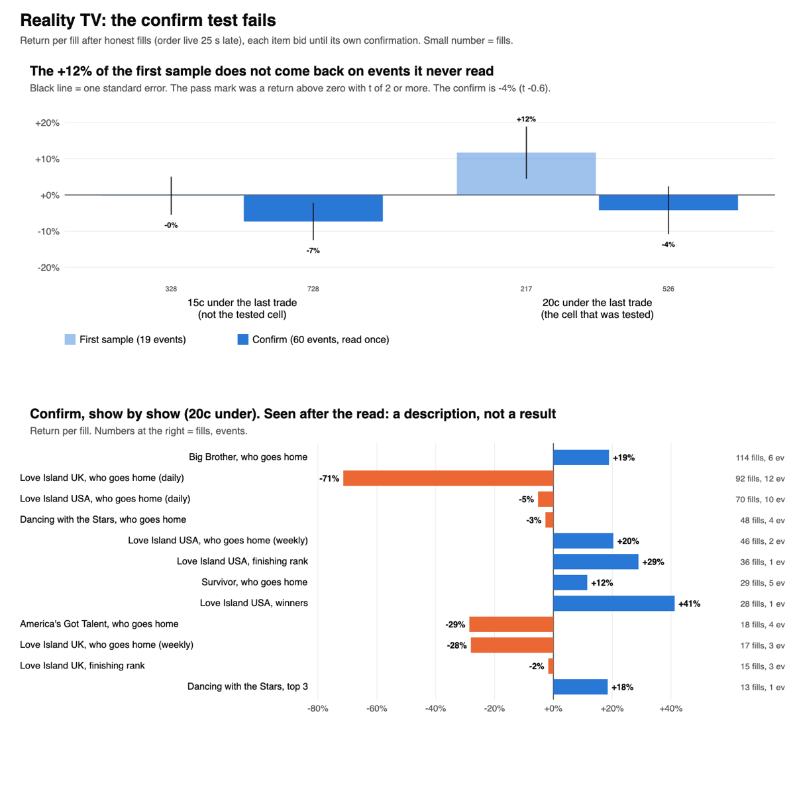

# Reality TV: the confirm test fails (Nov 16 2026)

Research only. The screen (`items_screen_2026-11-16.md`) found reality TV "who goes home" markets a weak pass for the dump bid:
+11.7% on 217 fills at 20c under. Olu: "Yes, run the reality TV confirm." The question: does it hold on events the screen never read?

**Short answer: no. On the 60 events set aside for the confirm it returns -4.2% a fill. Reality TV is a no. Nothing to build.**

## The result

One cell, fixed before the read: 20c under the last trade, each item bid until its own confirmation, order live 25 seconds late,
honest fills. Pass mark: return above zero with t of 2 or more, by event, on 10 or more events.

| | Fills | Events | Return a fill | t | Sold back | Verdict |
|---|---|---|---|---|---|---|
| First sample (screen) | 217 | 16 | +11.7% | 1.6 | 78% | |
| Confirm, read once | 526 | 52 | -4.2% | -0.6 | 68% | **Fail** |
| Both together | 743 | 68 | +0.4% | 0.1 | | |

About a third of the confirm fills never sell back and lose nearly everything. That is twice the share in mentions and attendance.

## What it shows

- **The screen's +12% was luck of a small sample.** It was thin from the start: one distance, t of 1.6, a quarter of its half read.
- **Passing the gate is not enough.** The gate measure passes again on the confirm events (whole event moved in 13% of drops, 61%
  came back), and the rule still loses. The gate is a cheap first check, not a promise.
- **Autumn does not rescue it.** Autumn events alone: +4.1% on 95 fills in 7 events (t 0.6).

## One thing seen after the read (a description, not a result)

- The loss is carried by thin shows. Love Island UK daily eliminations: -71% on 92 fills, with only 22% sold back. In a market that
  thin, a dump is the result leaking out.
- All 6 confirm events with 20 or more fills are positive (the screen: 5 of 5; the attendance confirm: 26 of 27).
- So "busy events pay, thin events lose" has now shown up in three samples. Each time it was seen after the read, so it is still
  a lead. Testing it needs a rule that can be applied in real time (a busy event known as it happens, not counted afterwards) and
  events not yet read.

## What was run

- **Confirm set:** the 60 reality TV events set aside by the seed before any price was read (7 in autumn). All 60 pulled, no tape cut.
- **1,289 requests** of the 1,400 Olu approved. With the screen: 2,957 in all.
- Still unread: 42 reality TV screen-half events, and for charts 32 confirm-half and 15 screen-half events.

## Verdict on the four families

| Family | Verdict |
|---|---|
| Reality TV | **No.** Passed the screen weakly, failed the confirm |
| Charts (songs in the top 10) | **Lead only.** Beat the screen mark, missed the gate by under a point; not confirmed, very thin |
| Politics lists | **No** |
| Award nominations | **No.** It loses |

The dump bid is confirmed in mentions (#464) and in who attends / who performs (#472) and nowhere else so far.

## Build spec

**None.**

Data, scripts and the pre-registration: `~/edge-research/items_2026-11-16/` (`PREREGISTERED.md`, `confirm.md`, `confirm.py`, `pics2.py`).
