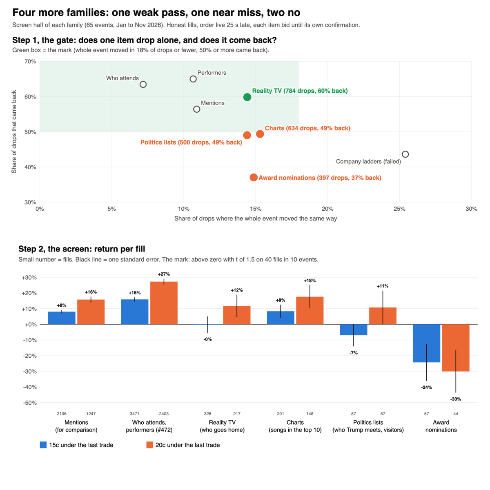
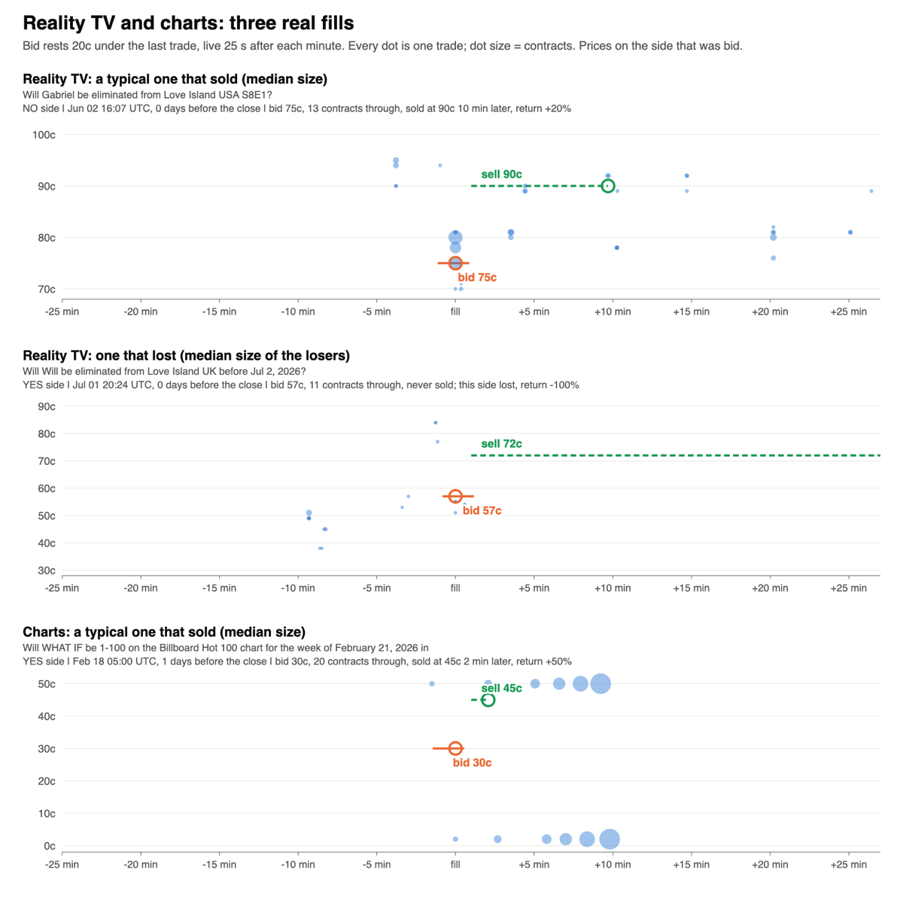

# Four more "separate items" families: map, gate and screen (Nov 16 2026)

Research only. The dump bid pays in mentions (#464) and in who attends / who performs (#472), where an event is many separate
yes/no items. Olu asked for more families of that shape, ideally one that trades in the autumn, when attendance runs at about 5
fills a week. Four were looked at: reality TV, charts and rankings, award nominations, politics lists.

**Short answer: nothing as strong as mentions or attendance. Reality TV passes, weakly, on one cell and goes to a confirm test.
Charts are a near miss and stay a lead. Politics lists and award nominations are a no.**

## The map

Settled Jan 1 to Nov 15 2026. "Autumn" = settled Sep 15 to Nov 15. Kinds come from how events resolved, not from prices.

| Family | Kind | Series | Events | Autumn events | Items an event | Trades an item (est.) | Contracts, autumn | Contracts, Jan to mid-Sep |
|---|---|---|---|---|---|---|---|---|
| Reality TV | separate items (who goes home) | 15 | 121 | 14 | 16 | 54 | 9.0M | 58.2M |
| Reality TV | one item wins (season winners) | 14 | 15 | 5 | 22 | 37 | 12.0M | 55.2M |
| Charts and rankings | separate items (songs in the top 10) | 7 | 66 | 11 | 28 | 6 | 0.8M | 14.8M |
| Charts and rankings | one item wins (#1, runner-up, rank) | 22 | 1,206 | 103 | 15 | 6 | 4.5M | 49.5M |
| Award nominations | separate items | 12 | 27 | 0 | 12 | 58 | 0 | 25.8M |
| Politics lists | separate items (who Trump meets, visitors, who leaves) | 13 | 27 | 5 | 19 | 82 | 7.9M | 9.3M |
| Politics lists | number ladders (orders this week, photos, pardons) | 3 | 79 | 18 | 3 | 142 | 1.6M | 18.1M |

- **One-winner markets and number ladders were left out of the screen**, as asked. They are most of the charts and half of the reality TV volume.
- **Reality TV is mostly a summer market**: 84 of its 121 events are Love Island in June and July. Autumn is Dancing with the Stars and Big Brother.
- **Award nominations have no autumn events**: Oscars settle in January, Emmys in July. Grammy and Golden Globe nomination series had nothing settled in the window.
- **Charts trade every week but are very thin**: about 6 trades an item.

## The result

Screen half of each family, 65 events. Honest fills, order live 25 seconds late, each item bid until its own confirmation.

| Family | Whole event moved | Came back | Gate | 15c under | 20c under | Verdict |
|---|---|---|---|---|---|---|
| Reality TV | 14% | 60% | Pass | -0.2% on 328 | +11.7% on 217 (t 1.6) | **Weak pass: to the confirm test, 20c only** |
| Charts | 15% | 49% | Missed by under a point | +8.3% on 201 (t 2.0) | +17.6% on 148 (t 2.4) | **Lead only** |
| Politics lists | 14% | 49% | No | -7.0% on 87 | +10.8% on 57 (t 1.0) | **No** |
| Award nominations | 15% | 37% | No | -24.3% on 57 | -30.1% on 44 | **No. It loses** |

The marks were written before the pull. Gate: whole event in 18% of drops or fewer and 50% or more come back. Screen: return above
zero with t of 1.5 or more on 40 or more fills in 10 or more events. A family goes forward only if it passes both.

- **Reality TV** passes the gate, but the screen is thin: flat at 15c, and at 20c it clears the mark by a little. Only 78% of fills
  sell back (mentions and attendance: 85% to 93%). Without the best event it is +8.6% (t 1.0). Love Island USA daily eliminations lose
  (-23% on 44 fills); the other shows are positive.
- **Charts** beat the screen mark at both distances but miss the gate (49.4% came back, 50% needed), so by the rules they are not
  forwarded. The book there is extremely wide: in the example below sellers get 2c while buyers pay 50c.
- **Politics lists** are close to zero. **Award nominations lose**: a dump there is usually news (a leak or an earlier award).
- On the mentions clock (stop at the first confirmed item of the event) no family is positive.

## For the autumn gap

In the sample, autumn fills at 20c: reality TV 25 from 2 autumn events (+10.8%), charts 47 from 5 (+20.6%). Scaled to all autumn
events that is roughly 10 to 20 fills a week for reality TV and about 10 for charts. Small, but more than attendance's 5.
These are rough: two and five events.

## What was run

- **Families fixed from the series list on disk:** 124 series with 100,000 or more lifetime contracts.
- **Map:** two listings a series. **Kinds from results only.** One correction to the one-winner rule was made after the listing and
  before any price was pulled (it had missed markets where sometimes no listed item wins); it is written in the rules file.
- **Halves fixed by a seed before any price:** screen half and confirm half. Only the screen half was pulled; inside the budget that
  is all of nominations and politics, 19 of 34 charts events and 19 of 61 reality TV events.
- **The rule and the gate:** the #464 code and the #470 measure, unchanged.
- **1,668 requests** of the 1,750 Olu approved. Pre-registered before any request.

## What could still be wrong

- **Small samples.** 13 to 19 events a family. Reality TV's pass rests on 217 fills and one distance.
- **Reality TV was read at a quarter of its screen half.** Autumn events in the sample: two.
- **Best-bid and queue risk are not judged here**, as agreed. In charts it would matter most.

## Next step: the reality TV confirm test (needs Olu's OK)

Fixed before anything else is read:
- **One cell:** reality TV separate items, 20c under, each item bid until its own confirmation, order 25 seconds late, honest fills.
- **Confirm set, read once:** the reality TV confirm half set aside by the seed, 60 events (7 in autumn).
- **Pass:** return above zero with t of 2 or more, by event, on 10 or more events.
- **About 1,400 requests.**

Charts are not forwarded under the rules. If Olu wants them tested anyway as a labelled exception, their confirm half is 32
events and about 760 requests, with two cells (15c and 20c) fixed the same way.

## Build spec

**None yet.** Nothing here is confirmed.

Data, scripts and the pre-registration: `~/edge-research/items_2026-11-16/` (`PREREGISTERED.md`, `map.md`, `gate.md`, `screen.md`, `items.py`, `pics.py`).
