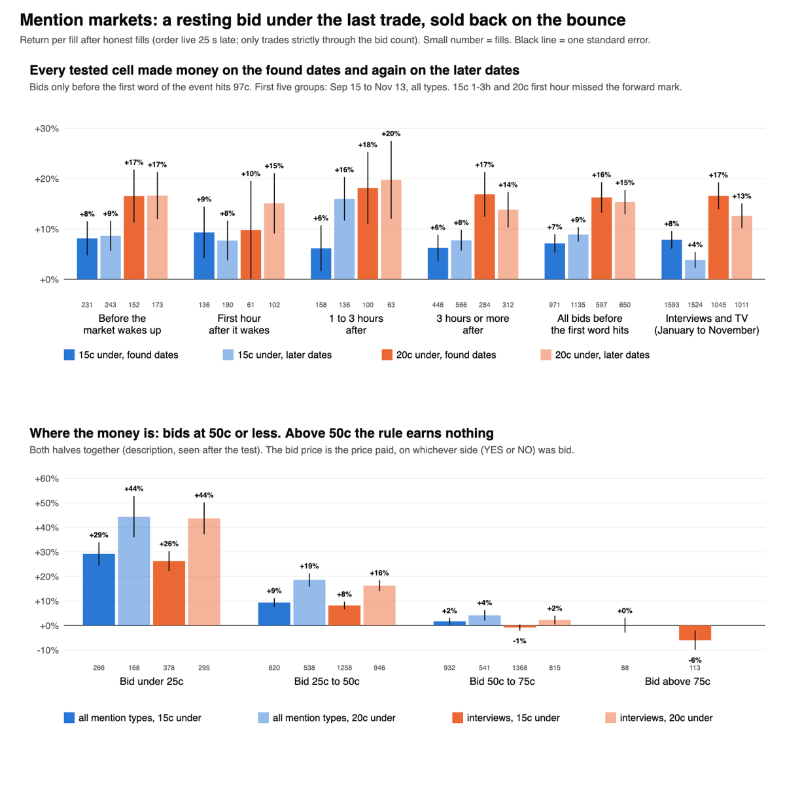
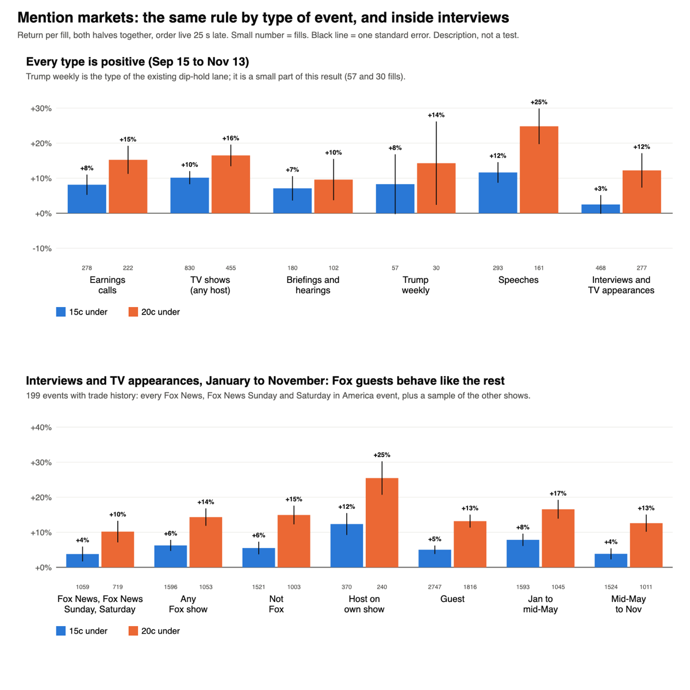
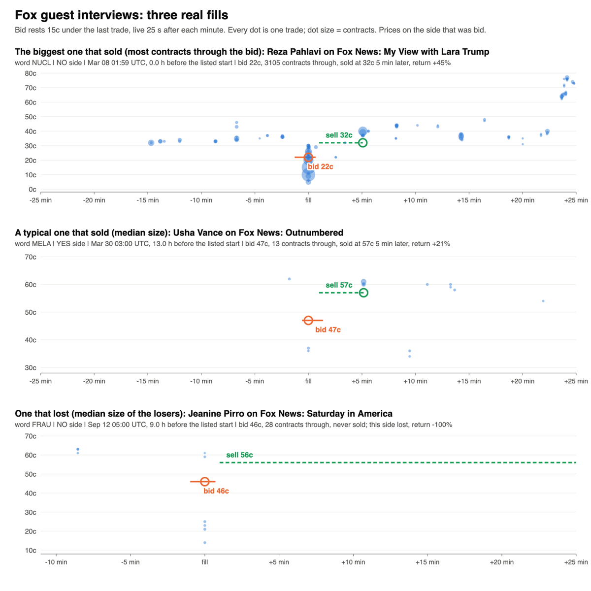

# Mention markets: catching the dump (Nov 14 2026)

Research only. PR #457 found that the mentions profit was not before the start; it looked like a bounce inside the active market.
Olu: "yes, send cricket and start the mentions study", then "extend interviews to January". The question: can a fixed rule capture that
bounce, on dates it was not found on?

**Short answer: yes. It passes. A bid resting 15c or 20c under the last trade, sold back when the price recovers, made money on the
found dates and again on the later dates in all ten cells that went forward. It is worth a paper lane. Build spec at the end.**

## The result

Return per fill, order live 25 seconds late, honest fills, no fees (Kalshi charges none on resting orders in these series).

| Cell | Found dates | Later dates | Verdict |
|---|---|---|---|
| 15c under, before the market wakes up | +8.1% on 231 | +8.6% on 243 (t 2.9) | **Pass** |
| 15c under, first hour after | +9.3% on 136 | +7.7% on 190 (t 2.0) | **Pass** |
| 15c under, 1 to 3 hours after | +6.2% on 158 (t 1.4) | not tested | Missed the forward mark |
| 15c under, 3 hours or more after | +6.2% on 446 | +7.8% on 566 (t 3.8) | **Pass** |
| 15c under, all bids | +7.1% on 971 | +8.9% on 1,135 (t 6.2) | **Pass** |
| 20c under, before the market wakes up | +16.5% on 152 | +16.6% on 173 (t 3.5) | **Pass** |
| 20c under, first hour after | +9.8% on 61 (t 1.0) | not tested | Missed the forward mark |
| 20c under, 1 to 3 hours after | +18.1% on 100 | +19.7% on 63 (t 2.6) | **Pass** |
| 20c under, 3 hours or more after | +16.9% on 284 | +13.8% on 312 (t 3.9) | **Pass** |
| 20c under, all bids | +16.3% on 597 | +15.3% on 650 (t 6.4) | **Pass** |
| 15c under, interviews and TV (Jan to Nov) | +7.8% on 1,593 | +3.9% on 1,524 (t 2.5) | **Pass** |
| 20c under, interviews and TV (Jan to Nov) | +16.6% on 1,045 | +12.6% on 1,011 (t 5.1) | **Pass** |

The first ten rows are every mention type, Sep 15 to Nov 13, found = the earlier half of events. The interview rows are found Jan 5 to
May 17, later May 17 to Nov 10. Scores are clustered by event; the pass mark includes the false-discovery correction across the ten.
Dropping the best event from any cell changes nothing.

## What was run

- **The rule (PR #455's code, unchanged):** each minute a bid rests 15c or 20c under the last trade, on both sides of every word. It
  fills only on a trade strictly through it. It is sold when the price is back within 5c of where it was; what is not sold rides to the result.
- **The clock comes from prices, not the listed start.** Bids stop when the first word of the event is confirmed (trades at 97c or more
  after trading under 90c). "Wakes up" = the first hour in which three or more words move 5c.
- **Markets:** all 465 mention series. 436 settled events Sep 15 to Nov 13; trade prints pulled for a random 145 of them (2,057 words).
  The 160 words seen in PR #457 are left out of every number.
- **Interviews and TV appearances** go back to January: 199 events with trade history, including every Fox News, Fox News Sunday and
  Saturday in America event.
- **Pre-registered** before any request, including the interview rule, the January change and the reading order. About 9,000 requests.

## What it is

Not really a bounce after the market wakes up. The quiet hours pay the same as the active ones. It is simpler: mention books are thin
and wide, and now and then someone sells in a hurry, far under the last price. A bid already resting there buys it, and the price is
usually back within minutes (half of the sales come inside 12 to 19 minutes).

- **About 85% of fills sell back** for +24% (15c) or +41% (20c).
- **The rest (14% to 19%) never sell, and lose nearly everything.** A dump that does not come back is news, as in PR #457.
- **All of the profit is in bids at 50c or less** (second chart): under 25c +26% to +44%, 25c to 50c +8% to +19%, above 50c nothing.
  This split was seen after the test, so it is a lead for the paper lane, not a tested result.
- **Small fills pay most.** Fills with 20 or more contracts through the bid earn +3% (15c) and +9% (20c); weighted by dollars the
  whole rule earns +7.8% and +14.2%.
- **Every type of event is positive**, and so are 9 of 10 weeks at 15c.

## Interviews and TV appearances

1. **What exists.** 63 series and 623 settled events from Jan 1 to Nov 13 name a person on a show. Biggest: The Last Word 71,
   Fox News 65, Jen Psaki 50, Late Night 30, Meet the Press 26, Face the Nation 25, The Weeknight 24. Fox News Sunday 12, Saturday in
   America 4.
2. **The result for the category alone.** Passes: 15c +7.8% then +3.9%; 20c +16.6% then +12.6%. The 15c row is the weakest pass in
   the study; 20c is the one to use.
3. **The clock.** The listed start is not safe for interviews. In one event in three from January to mid-September (one in seven since) a word was confirmed before the
   listed start, and in about one in eight more than an hour before: taped interviews, or a start listed late. The price clock handles this;
   a rule tied to the listed start would bid into a finished market. Prices start moving about 6 to 9 hours before the listed start,
   against 32 hours for speeches and 11 days for earnings calls.
4. **By speaker.** No pattern to trust; most speakers have one to six events. Hosts on their own show do better (+12% and +25% on
   17 events) than guests (+5% and +13% on 178). NBC shows are flat on 17 events. Positive in 8 of 11 months at 15c and 10 of 11 at 20c.

**The three Fox series:** +3.8% on 1,059 fills in 74 events at 15c (t 1.8), +10.2% on 719 fills at 20c (t 3.3). Any Fox show
(Hannity, Special Report and guests on Fox under other series included): +6.2% and +14.3% on 100 events. Fox guests behave like the rest.

## Same as the dip-hold lane, or new?

**Mixed: the same idea, much wider.** The dip-hold lane buys Trump weekly words that fall to 10c and holds them. Here:

- Holding does as well as selling back at 50c or less (15c: held +22% to +28% against +8% to +25% sold back), so the dumped price
  is simply too low. That is the dip-hold idea.
- But it is not confined to that corner. Leaving out cheap YES bids entirely, the rule still earns +6.0% (15c) and +13.2% (20c).
  Trump weekly is 57 of 2,106 fills. It works on NO as well as YES, and in every type.
- Selling back is the better way to run it: the same return with far less swing (t 4.9 against 2.2), and the stake is back in minutes.
  Above 50c holding loses (-2% to -10%), so nothing should be held there.

## What could still be wrong

- **It depends on being the best bid.** These fills are honest on the tape, but if another resting bid sits just above ours, it
  gets the fill. History cannot test that. A paper lane with honest fills is the next check; small live fills are the final one.
- **It is small.** A typical fill is about 70c of stake. About 690 fills a week at 15c or 420 at 20c if every event is worked, and
  bigger fills earn less.
- **Many orders.** One bid a side, a word, a minute. An event has 15 to 30 words.
- **The direction was known** for Sep to Nov from PR #457's sample (those words are left out). Interviews from January to mid-May
  had never been looked at, and they agree.
- **A sample.** 145 of 436 events in the main window; every Fox event but one or two events for most other shows before September.

## Build spec

- **Rule (paper lane, name suggestion `mentions_dump_bid`):** in every word of a mention event, each minute, rest a bid 20c under
  the last trade on YES and on NO. Needs a trade in the last 10 minutes, a last trade of 95c or less and a bid of 5c or more. Fill only
  on a trade strictly through the bid, order live 25 seconds late. On a fill, rest a sale 15c above the bid (5c under the old price).
  What does not sell rides to the result. One open position a side of a word.
- **Scope:** every mention series, every type.
- **Entry timing:** from the open of the market until the first word of the event is confirmed (a trade at 97c or more in a word that
  last traded under 90c). No bids after that. The listed start is not used.
- **Rows:** main = 20c under, all prices (the tested rule). Second = 20c under, bids at 50c or less (the lead). Third = 15c under.
  Control = first fill held to the result.
- **The one change v1 to v2:** the dip-hold lane's fixed 10c YES bid on Trump weekly becomes a bid 20c under the last trade, on both
  sides, in every mention event, sold back on the recovery.
- **Retire or keep:** keep the dip-hold lane running as it is until this lane has 300 fills, then compare; Olu's call.
- **Pre-registration text:** "Mentions dump bid. Paper. Every Kalshi mention event; each minute a bid 20c under the last trade on both
  sides of every word, until the first word is confirmed; honest fills, order 25 seconds late; sold 15c above the bid, otherwise held.
  Read at 100, 300 and 600 fills, scored by event. Held if the main row is positive with t of 2 or more at 300 fills. Retired if it is
  negative at 300. The 50c-or-less row is judged the same way and replaces the main row only if it is ahead at 600."

Data, scripts and the pre-registration: `~/edge-research/mentions_bounce_2026-11-14/` (`PREREGISTERED.md`, `found.md`, `later.md`,
`both.md`, `int_found.md`, `int_later.md`, `int_both.md`, `extras.py`).
