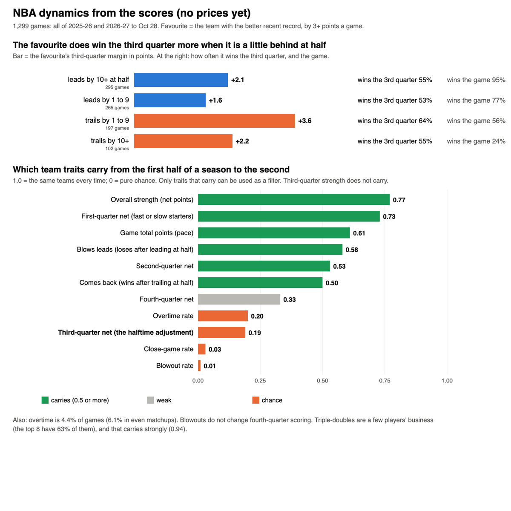
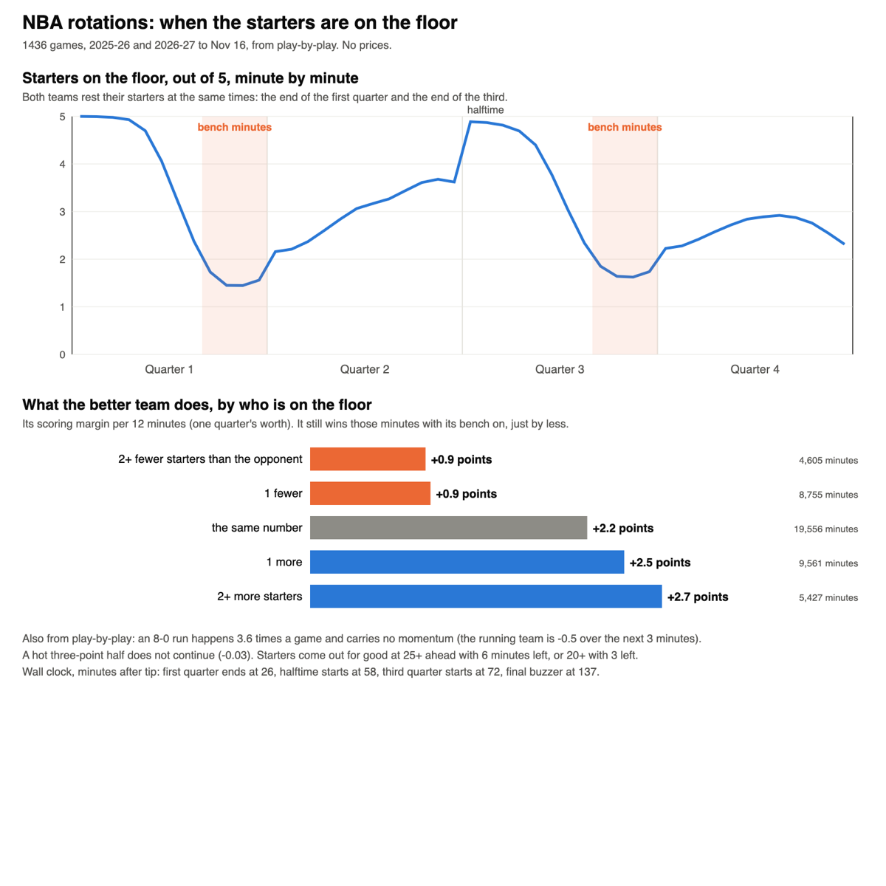

# NBA game primer: what drives a game's flow, and how big each thing really is (Nov 17 2026, version 2)

Research only. Olu: "learn the game first… looking at the prices or creating filters is kind of pointless if you don't understand
the game." This is the first deliverable of the NBA plan. No price was used anywhere in it.

Each mechanism gets a plain explanation, a check on the data, and a label: **sizeable**, **small**, or **myth**. Only the
sizeable ones become filters.

**Data:** quarter scores and box scores for all 1,231 games of 2025-26, and play-by-play for 1,436 games (2025-26 plus this season
to Nov 16), from ESPN. Version 2 adds the play-by-play sections (10 to 15 below).

## The short list

| Mechanism | Label | The number |
|---|---|---|
| Three-point shooting luck | **Sizeable** | 8.5 points a team a game; explains a third of how far results land from expectation; a hot half does not continue |
| Overall team strength, in every quarter | **Sizeable** | The better team gains about 2.2 points a quarter all game, nothing in the last six minutes |
| Rotations: who is on the floor | **Sizeable** | The better team gains 2.2 a quarter with equal starters on, 0.9 when it has fewer on |
| Scoring runs | **Sizeable** as a source of swings | An 8-0 run 3.6 times a game, in every quarter alike |
| Bench quality | **Sizeable** | Bench plus-minus carries (+0.69); the bench plays 39% of minutes |
| Pace | **Sizeable** for totals | Carries (+0.81); explains 29% of a game's total |
| Fast and slow starters (first quarter) | **Sizeable** | First-quarter net carries (+0.73) |
| Blowout minutes | **Sizeable** | Starters are off for good at 25+ ahead with 6:00 left; triple-double regulars drop from 20% to 12% |
| Triple-doubles and points leaders are a few players | **Sizeable** | Top 8 players have 63% of triple-doubles; carries (+0.94) |
| The last two minutes | **Sizeable** for margins | Free throws double; a 1-to-3-point lead at 2:00 grows by 2.1 |
| A big favourite a little behind at half | **Small to sizeable** | Spread 6.5+, behind by 1 to 9: wins the third quarter 69%, the game 61% |
| Trailing team in garbage time | **Small** | A team 15+ down after three wins the fourth on points 56% |
| Rest (second night of a back-to-back) | **Small** | -1.5 points against a rested opponent; stars sit 9 points more often |
| Home court | **Small** | +1.7 points, 55% of wins; largest in the first quarter |
| Officials | **Small** | Fouls a game by crew chief range from 38.6 to 42.7; carries weakly (+0.32) |
| Overtime in even matchups | **Small** | 5.3% at a spread under 3, about 4% otherwise |
| Momentum after a run | **Myth** | The running team is -0.5 over the next 3 minutes |
| Timeouts stop runs | **Myth** | Teams are -2.4 before a timeout and +0.3 after, as they would be anyway |
| "A strong third-quarter team" | **Myth** | Does not carry (+0.19; nothing beyond overall strength) |
| Close-game teams, blowout teams | **Myth** | Do not carry (+0.03, +0.01) |
| End-game fouling lifts fourth-quarter totals | **Myth** | The fourth is still the lowest-scoring quarter, in close games most of all |
| A star in foul trouble sinks the team | **Unclear** | 5 or 6 fouls in 8% of star games; team -2.9 points, cause and effect not separable |
| Injury and inactive news timing | **Not measured** | Not in ESPN data |

## 1. Strength shows in every quarter, and there is no special third quarter

A better team is better all game: more talent on the floor in every stint. The check: the team with the better recent record
(by 3+ points a game) outscores the other by 2.25 in the first quarter, 2.33 in the second, 2.26 in the third and 1.10 in the fourth
(823 games). The fourth is smaller because leaders rest starters and trailing teams press.

So the third quarter is not where favourites do something special. What Olu saw is real but has a simpler cause: a favourite that
is 1 to 9 behind at half is still the better team, so it tends to win what is left. It wins the third quarter 64% of the time by
3.6 points, and the game 56%. A favourite 10+ behind at half wins only 24%: by then the hole is real.

Which teams "own" the third quarter? None, reliably. A team's third-quarter record in its first 41 games says almost nothing about
its last 41 (+0.19), and nothing at all once overall strength is taken out (-0.09). **Myth as a team trait.**

## 2. Rotations and benches (timing needs play-by-play)

Coaches play starters about 31 minutes each and bring bench units in late in the first quarter and early in the second, then again
late in the third. Those bench minutes are where a deep team gains and a thin one bleeds.

- Starters play 62% of a team's minutes, the bench 39%.
- Bench quality is a stable trait: bench plus-minus carries from the first half of the season to the second (+0.69), bench scoring
  (+0.79) and the bench's share of minutes (+0.84) too.
- The gap between a team's bench and its starters also carries, more weakly (+0.42). Largest in 2025-26: Detroit, San Antonio and
  Denver had starters far better than their benches; Sacramento, Washington and Brooklyn the reverse.
- **Sizeable.** A team with a strong starting five and a weak bench should sag when the bench is on. Section 10 shows when.

## 3. Three-point shooting luck

Teams take about 37 threes a game. Whether they make 11 or 16 is mostly luck on the night, and each is worth 3 points.

- A team's threes land 8.5 points above or below its own season rate in a typical game.
- The gap in that luck between the two teams explains 34% of how far the final margin lands from what the teams' records expected.
  When the home team out-shoots its norm by 9+ points more than the visitor, it beats expectation by 9.6; the reverse, -13.2.
- It is luck, not form: it does not carry to the next game at all (0.00).
- **Sizeable; the largest single driver measured.** The open question for in-game prices: does a hot first half cool in the second?
  Section 12 answers it: no, it does not continue, but the points already scored stay scored.

## 4. Fouls, the bonus, and the end of close games

Fouls matter three ways: a star who must sit, free throws once a team is in the bonus, and deliberate fouling by the trailing team
in the last minute.

- Stars (each team's top two scorers) finish with 5 or 6 fouls in 8% of their games. Their team does 2.9 points worse than expected
  in those games, but they do not play fewer minutes (+1.3), and physical, close games produce both fouls and poor results.
  **Unclear**: cause and effect cannot be separated.
- Deliberate fouling does not make fourth quarters high-scoring. With the game within 5 after three quarters the fourth averages
  54.1 points, against 57.7 for the first three quarters of the same games. The fourth is the slowest quarter in every game state.
  **Myth** for quarter totals.
- It does stretch final margins: half of the games that were within 5 after three quarters end 7 or more apart. That matters for
  win-margin and spread markets, not totals.
- The last two minutes are in section 13.

## 5. Blowouts and comebacks

Once a lead is safe the coach sits the starters. The trailing team's bench then plays the leader's bench.

- Starters average 31.2 minutes in games decided by under 10, 27.5 in 20-point games, 25.8 in 30-point games.
- Fourth-quarter scoring does not change: 55.3 points when 20+ apart after three, 55.3 otherwise. **Myth** that garbage time is
  high-scoring.
- The trailing team does slightly win garbage time: 15+ down after three, it wins the fourth on points 56% of the time.
  **Small to sizeable** for a fourth-quarter spread.
- Comebacks are rare and not a team skill: a team 15+ down at half wins 6%, and wins the second half on points only 51% of the
  time. 15+ down after one quarter: 8%.
- The lead and time at which starters come out are in section 14.

## 6. Close games and overtime

- 14% of games end within 3 points, 29% within 6. Overtime is 4.4% of games.
- Matchup closeness matters a little: 6.1% of even matchups go to overtime, 3.9% of lopsided ones. **Small.**
- "Close-game teams" do not exist in the data: a team's rate of close games does not carry (+0.03), nor its overtime rate (+0.20).
  **Myth.**
- Clutch time and overtime by pre-game spread are in section 15.

## 7. Rest and schedule

- Second night of a back-to-back against a rested opponent: 1.5 points worse than expected, 47% of wins (257 team-games). **Small.**
- Stars sit more on those nights: they play in 66% of them, against 75% of other games. That part is public before tip.
- When inactive news lands relative to tip is not in ESPN data and is not measured here.

## 8. Home court and pace

- Home teams win 55% and outscore visitors by 1.7 points; the edge is largest in the first quarter (+0.67). **Small.**
- Pace is a stable team trait (carries +0.81) and explains 29% of a game's total points; shooting explains the rest.
  Scoring efficiency carries too (+0.66). **Sizeable** for totals.
- First-quarter starts carry (+0.73), mostly because good teams are good early as well.
- Officiating crews: fouls a game by crew chief range from 38.6 to 42.7 and carry weakly (+0.32). **Small.**

## 9. Player specials

- Triple-doubles belong to a few players (Jokic in 52% of his games; the top 8 have 63% of all of them) and the rate carries
  strongly (+0.94). A triple-double needs minutes: 36.3 on average.
- Blowouts cut them: the regulars reach one in 20% of games decided by under 10 and 12% of games decided by 20+. **Sizeable.**
- The game's leading scorer is often the same few players (Gilgeous-Alexander and Doncic in over 70% of their games). **Sizeable.**
- Opening tip and first shot were not measured: Kalshi's first-basket market has no volume.

## 10. Rotations, minute by minute (play-by-play)

- Both teams rest starters at the same times. Of 5 starters, 5.0 are on at tip, 4.1 at minute 6, and only 1.4 to 1.7 in minutes
  9 to 12. They come back through the second quarter (3.6 by halftime). The third quarter repeats it: 4.9 at the start, 1.6 in
  minutes 34 to 36, and 2.3 to 2.9 through the fourth.
- Who is on the floor moves the score. The better team outscores the other by 2.2 points a quarter with equal starters on,
  2.7 with two or more extra, and 0.9 with two or more fewer. It still wins its bench minutes, just by less.
- **Sizeable.** A favourite's dip during its bench minutes is the most mechanical kind of dip.

## 11. Runs and timeouts (play-by-play)

- An 8-0 run happens 3.6 times a game (99% of games have one); a 10-0 run 1.4 times (78% of games). They are spread evenly:
  23% to 26% in each quarter.
- There is no momentum. After a run reaches 8-0 the running team is -0.5 over the next three minutes. **Myth.**
- Timeouts do not "stop" runs in any special way: a team that calls one was -2.4 over the three minutes before and is +0.3 over
  the three after, which is what happens anyway when a bad stretch ends. **Myth.**
- So a sudden swing in a game is usually a run, and runs do not predict what comes next.

## 12. Three-point luck inside a game (play-by-play)

- First-half luck is 5.8 points a team. Its link to the same team's second half is -0.03: a hot half does not continue.
- But the lead it built stays. Favourites behind at half win 42% when the underdog was hot from three and 43% otherwise.
- Only when the game is still close is there a hint: behind by 1 to 9 with a hot underdog, the favourite wins 58% (19 games)
  against 53%, and wins the second half by 8.5 against 4.6. Too few games to lean on. **Small as a filter; sizeable as an explanation.**

## 13. The last two minutes (play-by-play)

- Free throws run at 1.9 a minute in the last two minutes, against about 1.0 the rest of the game. Scoring is 19% above the rest
  of the fourth quarter. Take fouls: 0.7 a game.
- A lead of 1 to 3 with 2:00 left wins 70% and grows by 2.1 points on average; 4 to 6 wins 94%; 7 or more wins every time.
- **Sizeable for win-margin and spread markets**, which are outside this study's scope. Not enough to make the fourth a high-scoring quarter.

## 14. When the starters come out (play-by-play)

| Lead | Start of the 4th | 6:00 left | 3:00 left |
|---|---|---|---|
| 10 to 14 | 2.3 starters on | 3.4 | 3.8 |
| 15 to 19 | 2.2 | 3.2 | 2.4 |
| 20 to 24 | 2.1 | 2.4 | 0.9 |
| 25+ | 1.7 | 0.9 | 0.3 |

Starters are done at 25+ ahead with six minutes left, or 20+ with three left. The trailing team pulls its starters at the same time.

## 15. Clutch time, favourites, and overtime by spread (play-by-play and ESPN spreads)

- With 5:00 left, a lead of 1 or 2 wins 57%, 3 to 5 wins 77%, 6 to 9 wins 87%.
- In games within 5 with 5:00 left, the favourite wins 58%: 76% when it is ahead, 40% when it is behind.
- Favourites by pre-game spread, when 1 to 9 behind at half: spread 6.5+ wins 61% and wins the third quarter 69% by 4.3 points
  (121 games); spread 3 to 6 wins 51% and wins the third 53% (79 games). Behind by 10+ at half, either kind wins about 29%.
- Overtime by spread: 5.3% under 3, 3.6% at 3 to 5.5, 4.6% at 6 to 9.5, 3.9% at 10+. Closeness barely matters. **Small.**
- The clock on the wall, minutes after tip: the first quarter ends at 26, halftime starts at 58, the third quarter starts at 72
  and ends at 103, the final buzzer is at 137.

## What this changes in the plan

Written into the pre-registration before any price was seen:
- **Olu's favourite-dip idea** filters on strength: a favourite 8+ points a game better, or a pre-game spread of 6.5 or more.
  Third-quarter strength is kept only because it was asked for, labelled myth.
- **New: the bench window.** A bid that is live only during the first bench stint (18 to 40 minutes after tip), against the same bid
  at other times.
- **Three-point luck at half** stays as a filter with a low expectation.
- **The underdog's early spike** has its plain reason: it is usually a run, and runs carry nothing forward.
- **Overtime** and **rest** stay as written with low expectations. No fourth-quarter total rule.
- Triple-double specialists get a second row that skips likely blowouts.

## What is still not known

- Injury and inactive news timing against tip (not in ESPN data).
- Whether any of this is mispriced. That is Stage 1: prices have not been looked at.

Data and scripts: `~/edge-research/nba_quarters_2026-11-17/` (`stage0.py`, `primer_box.py`, `primer_pbp.py` and their `.md` outputs, `PREREGISTERED.md`).
