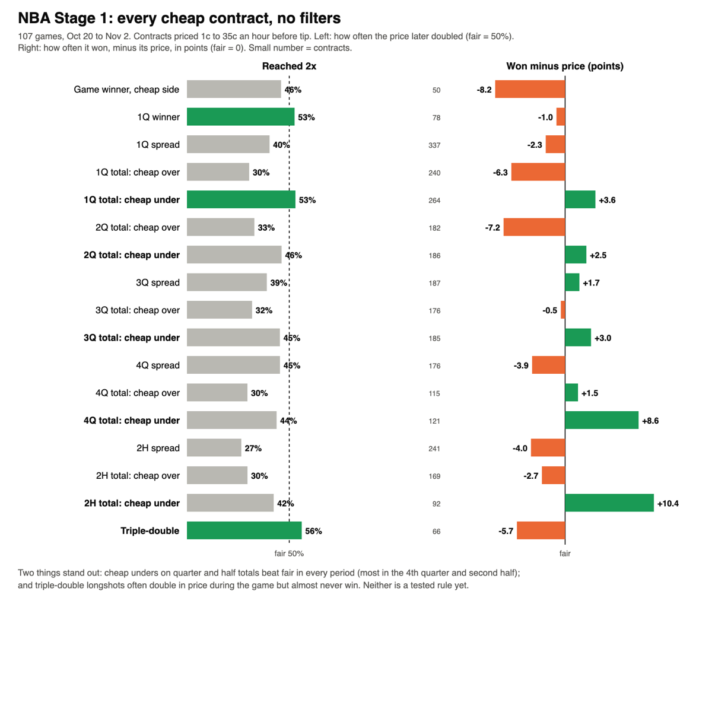
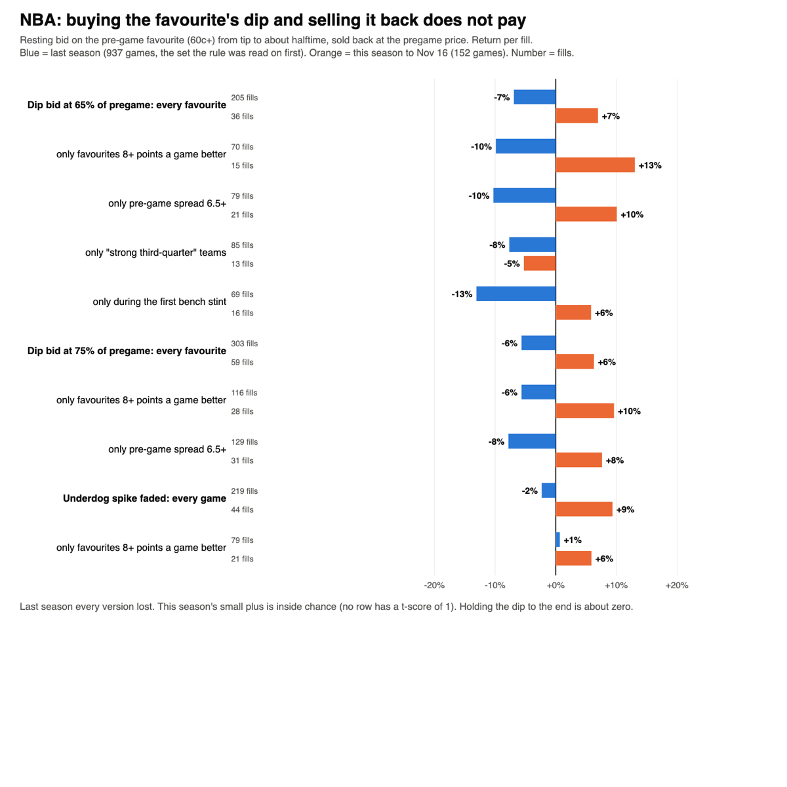
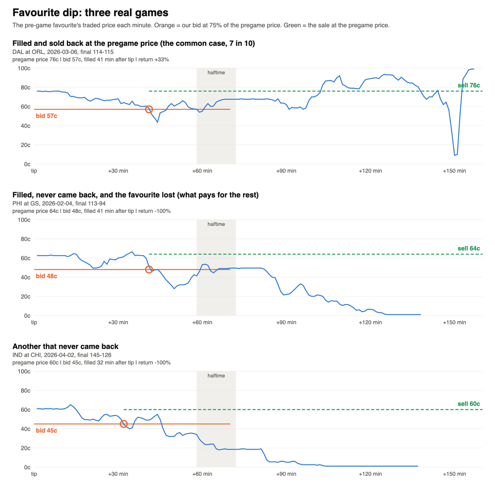
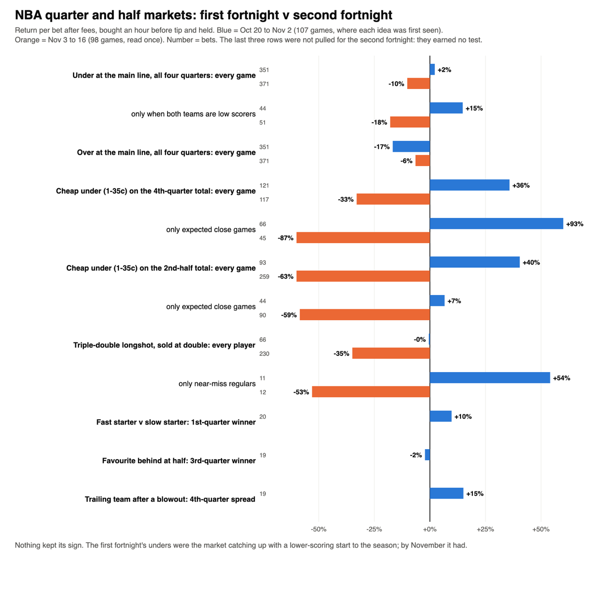
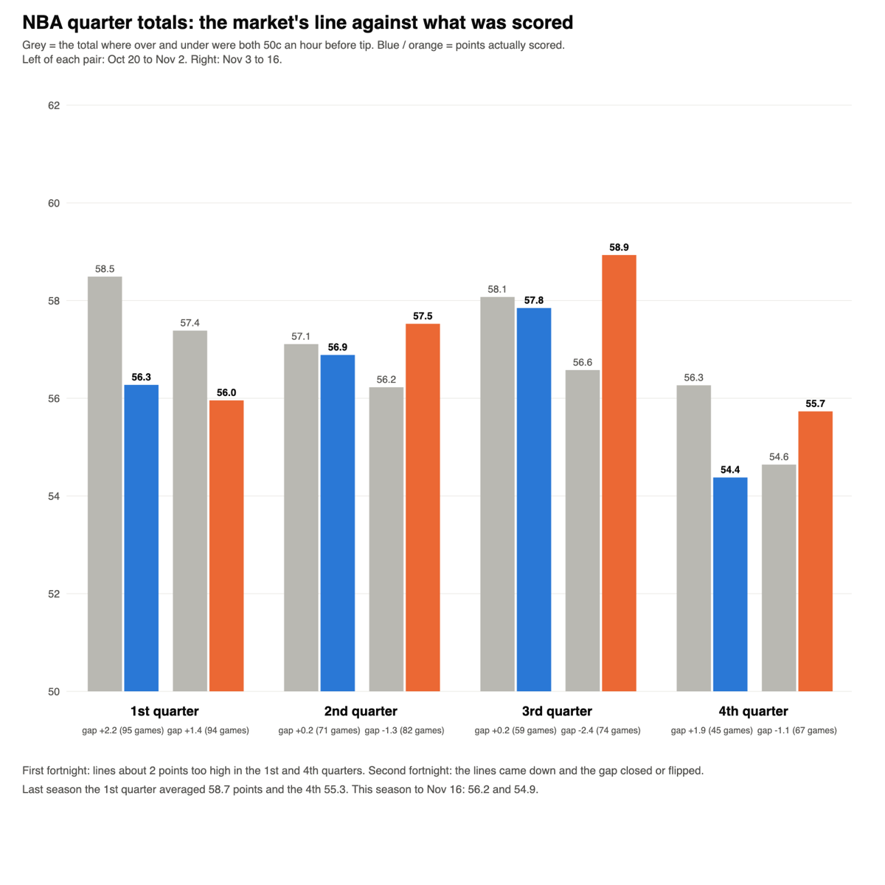

# NBA in-game and quarter markets: the result (Nov 18 2026)

Research only. Olu's question: does the favourite dip in-game and come back, and is there anything in the quarter, half,
overtime and specials markets? The game primer came first (`docs/nba_game_primer.md`); every filter below was written down
from it before any price was read. Rules file with every step, in order: `~/edge-research/nba_quarters_2026-11-17/PREREGISTERED.md`.

**Verdict: no edge anywhere. Nothing to build. Move on.**

## One table

| Angle | What was tried | First read | Second read (unseen) | Verdict |
|---|---|---|---|---|
| A. Favourite dip | Resting bid on the 60c+ favourite at 65% / 75% of its pregame price, tip to halftime, sold back at pregame | Last season, 937 games: -6.9% a fill (205) / -5.7% (303) | Nothing earned a test. This season: +7% / +6%, inside chance | Move on |
| A filters | Strength gap 8+, spread 6.5+, "strong 3rd-quarter" team, comeback team, home, rest, collapse-prone underdog, bench window, three-point luck at half | All negative except three-point luck (+15% on 26 fills) | Three-point luck negative on 7 fills | Move on |
| B. Underdog spike faded | The same swing from the other side | -2.3% a fill (219) | +9% on 44, inside chance | Move on |
| Hold instead of selling | Keep the dip to the final whistle | About zero in nearly every row | One stand-out row (+23.7% on 79) was -2.4% on 21 | The in-game price is fair |
| C1. Fast starter v slow starter | 1st-quarter winner and spread | +10% on 20, +13% on 25 (t 0.5) | Not pulled: did not reach the mark | Move on |
| C2. Fast pair over, slow pair under | Quarter totals at the main line | Slow-pair under +15% on 44 (t 1.0); taken forward as a lead | -18% on 51 | Move on |
| C3. Favourite behind at half | Its 3rd-quarter and 2nd-half winner, bought in the break | -2% on 19, -8% on 18; no better than every game | Not pulled | Move on |
| C4. Trailing team after a blowout | 4th-quarter spread | +15% on 19, but every trailing team is +12% on 80 | Not pulled | Move on |
| D. Overtime, points leader | | Too thin (under 2k contracts a game) | | Dropped |
| E. Triple-double regulars | YES for players at 20%+ | 1 of 9 | 2 of 7 | Too few; move on |
| Lead 1. Cheap unders | NO at 1c-35c on 4th-quarter and 2nd-half totals | +36% on 121, +40% on 93 | -33% on 117, -63% on 259 | Move on |
| Lead 2. Triple-double longshots | Buy at 1c-35c, sell at double | -0.5% on 66 (53% sold) | -35% on 230 (35% sold) | Move on |
| F. Pre-tip dump bids | | Not run: no market type showed anything to bid on | | Not run |

"First read" for the quarter markets is the 107 games of Oct 20 to Nov 2; "second read" is the 98 games of Nov 3 to 16.
A fortnight each: enough to say no, never enough to make a rule.

## The blind screen (107 games, no filters)

Cheap contracts (1c to 35c an hour before tip) sat at or under fair almost everywhere. Two things stood out and were taken
forward as leads; neither repeated.

## A and B: the favourite's dip

A favourite that is behind does win more than a coin flip, but the price already says so. About 6 or 7 fills in 10 sell
back for roughly a third of the stake; the rest lose most of it.

## Quarter and half markets

What the first fortnight really showed: the market's quarter lines started the season too high. First quarters are about
3 points lower this season than in last season's opening weeks, and the lines were still set near last season's level.
By the second fortnight the lines had come down and the gap had closed or flipped.

## What this cost and what was left out

- Kalshi requests: 1,900 (blind screen) + about 1,330 (A and B) + 598 (quarter step; 1,700 were allowed). ESPN: 1,460.
- For the second fortnight only the totals and triple-double series were pulled, because nothing else went forward.
- Fills for A and B come from 1-minute traded prices, not trade tapes. Tapes are only pulled for rules that pass; none did.
- Not tested: last season's quarter markets are in the archive (one request a market). A full-season read of one quarter's
  main line would cost about 1,300 requests. With two fortnights that disagree it is not recommended.

## Build spec

None. No rule, no lane, no page change. The primer stays as the reference for any later NBA idea.
The win-margin lane and tracker are outside this study and are not affected.
