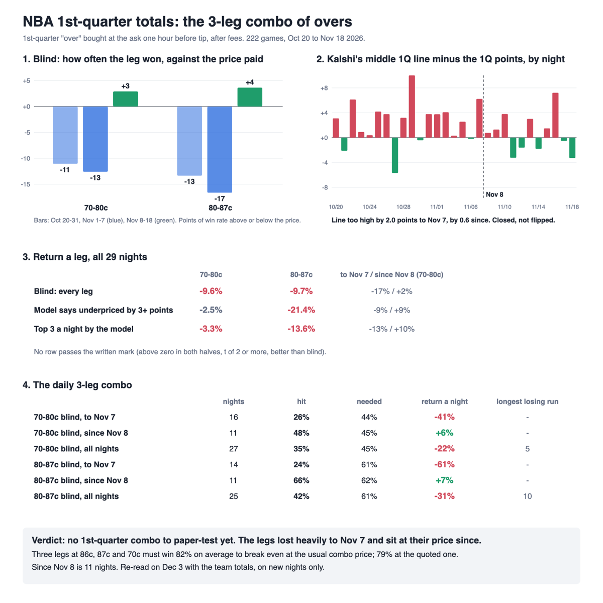

# NBA 1st-quarter totals: the daily 3-leg combo of overs (Nov 19 2026)

**Verdict: no 1st-quarter combo worth a paper test yet.** A 1st-quarter over at 70-87c lost heavily up to Nov 7 and has
sat at about its price since Nov 8. Over all 29 nights a blind 3-leg combo returned -22% a night at 70-80c and -31% at
80-87c. The one filter tested adds nothing. The last 11 nights are slightly positive, the same league-wide swing seen in
the team totals, so this goes into the same Dec 3 re-read.

Same method as the team-total study, unchanged. Data already on disk, no new pulls: the ladder tracker's 1st-quarter
game-total ladder (222 games, Oct 20 to Nov 18, 13 rungs a game, bid and ask one hour before tip, the result). The
1st-quarter TEAM total is not on disk (it had no markets when the tracker was built), so it is not tested. Rules were
written before any price was scored.

## 1. Blind: does a leg win more than its price?

| Band (ask) | Oct 20-31 | Nov 1-7 | Nov 8-18 | All 29 nights |
|---|---|---|---|---|
| 70-80c: won / paid | 64.0% / 75.0c | 62.7% / 75.4c | 78.3% / 75.4c | 69.1% / 75.2c |
| 70-80c: return a leg | -16.0% | -17.8% | +2.0% (t 0.3) | -9.6% (220 legs, t -1.9) |
| 80-87c: won / paid | 70.4% / 83.8c | 67.3% / 84.0c | 87.7% / 84.0c | 76.6% / 83.9c |
| 80-87c: return a leg | -16.9% | -20.7% | +3.2% (t 0.5) | -9.7% (201, t -2.2) |

To Nov 7 an 84c leg won 69% of the time. Now a leg wins about what it costs; +2% and +3% on 11 nights cannot be told
from zero.

## 2. The level: closed, not flipped

| | Oct 20-31 | Nov 1-7 | Nov 8-18 |
|---|---|---|---|
| Kalshi's middle 1Q line | 58.7 | 57.5 | 57.4 |
| 1Q points scored | 57.0 | 55.0 | 56.8 |
| Line minus points | +1.6 | +2.5 | +0.6 |
| Went over the line | 42% | 43% | 49% |

The team-total gap flipped (+1.6 to -1.6). The 1st-quarter gap only closed (+2.0 to +0.6). So there is no lean toward
overs in the 1st quarter now; the line is about right.

## 3. The one filter (written before scoring)

The tracker's pre-tip 1st-quarter projection (both teams' 1st-quarter scoring and allowing form) gives every rung a model
chance. Filter: the model chance is 3 or more points above the ask. Ranking version: the 3 legs a night the model likes most.

| Return a leg, all nights | 70-80c | 80-87c |
|---|---|---|
| Blind: every leg | -9.6% | -9.7% |
| Model says underpriced by 3+ points | -2.5% (47) | -21.4% (24) |
| Top 3 a night by the model | -3.3% (81) | -13.6% (75) |

Neither passes (above zero in both halves, t of 2 or more, better than blind). At 70-80c the ranked three were -13% to
Nov 7 and +10% since; as a combo they hit 8 of the last 11 nights after 5 of the first 16. That is a lead for the re-read,
not a result.

## 4. The daily combo (3 legs from 3 games)

| Blind combo | Nights | Hit | Hit needed | Return a night |
|---|---|---|---|---|
| 70-80c, to Nov 7 | 16 | 26% | 44% | -41% |
| 70-80c, since Nov 8 | 11 | 48% | 45% | +6% |
| 70-80c, all nights | 27 | 35% | 45% | -22% |
| 80-87c, to Nov 7 | 14 | 24% | 61% | -61% |
| 80-87c, since Nov 8 | 11 | 66% | 62% | +7% |
| 80-87c, all nights | 25 | 42% | 61% | -31% |

Taking the three legs nearest the middle of the band every night, the longest losing run was 5 nights at 70-80c and 10
nights at 80-87c.

## 5. The screenshot quote

- Legs at 86c, 87c and 70c multiply to 52.4c. "10 pays 21.12" is a price of 47.3c. **The quote was about 10% cheaper than
  multiplying the three prices shown**, where our earlier measure on other sports was about 1% dearer.
- One quote cannot say why. Most likely the prices on the screen were not the prices the combo was built from, or the
  combo's own pricing rates these overs lower than the single markets do.
- What it changes: those three legs must win 82% on average to break even at the usual combo price, and 79% at the quoted
  one. They cost 81c on average. So at that quote the combo is about fair before any edge, not a bargain.
- If the builder really quotes under the product every night, the combo is a cheaper way in than three single buys. That
  is worth knowing. Five or six more screenshots (each leg's price and the combo payout) would settle it; no data pull.
- For scale, 1st-quarter totals this season: over 47.5 in 86% of games, over 50.5 in 76%, over 51.5 in 73%.

## Verdict and follow-up

- No combo to paper-test now, at either band.
- Fold into the Dec 3 re-read with the team totals, on nights from Nov 19 only, scripts unchanged: (a) blind 1st-quarter
  overs at 70-80c and 80-87c, (b) the ranked three at 70-80c. A row becomes a paper candidate only if it is above zero
  with t of 2 or more on the new nights alone.
- Nothing to build. The tracker already records every rung.

## Limits
- 29 nights; the first 18 and the last 11 point opposite ways.
- Quotes are the last hourly candle before "tip minus one hour".
- No record of real combo quotes on disk beyond the one screenshot.
