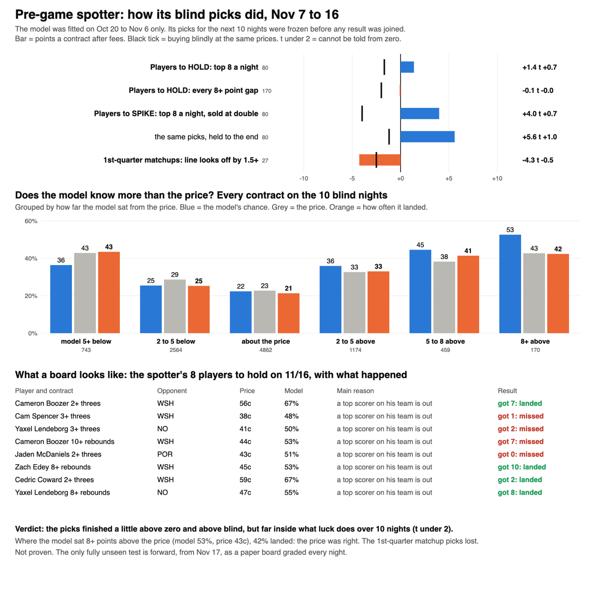

# NBA pre-game spotter: blind scorecard (Nov 18 2026)

**Verdict: not proven.** A model built from what is known before tip barely moves off the price. Its blind picks finished a
little above zero and above blind buying, but well inside what luck does over 10 nights. The 1st-quarter matchup spotter
found nothing.

## What was asked
A spotter, not averages: before each game, name the player contracts and the early-game matchups likely to beat or spike
their pre-match price, with the reason, and prove it blind.

## How it was built
- **Fitted on Oct 20 to Nov 6 only** (12,501 contracts, 17 nights). Picks for Nov 7 to 16 (9,972 contracts, 10 nights) were
  frozen before any result was joined. The rules were written before the fit.
- **Contracts:** points, threes, rebounds, assists, points+rebounds+assists; 5c to 60c one hour before tip.
- **Hold model:** starts from the price and adds: the player's projection against the price, his season average against the
  price, a cold run, minutes and shots up on last season, teammates out, opponent's allowance in that stat, pace, rest,
  home, spread and blowout risk, whether he started his last game.
- **Spike model:** the chance the contract trades above double after tip, from the same inputs plus how volatile the player
  is (night spread, three-point share, fouls, minutes).
- **Matchups:** 1st-quarter totals, from each team's 1st-quarter scoring and allowance, and rest.
- **Limits said up front:** no published injury report on disk, so "out" means did not appear (a late scratch is a small
  look-ahead). The blind nights were blind to the model, but had already been seen in aggregate by the researcher.

## Blind scorecard, Nov 7 to 16 (points a contract after fees)

| Board | Contracts | Paid | Landed | Result | t | Blind at the same prices |
|---|---|---|---|---|---|---|
| Players to hold: top 8 a night | 80 | 44c | 48% | +1.4 | 0.7 | -1.7 |
| Players to hold: every 8+ point gap | 170 | 43c | 42% | -0.1 | 0.0 | -2.0 |
| Players to spike: top 8 a night, sold at double | 80 | 45c | sold 56% | +4.0 | 0.7 | -4.0 |
| The same spike picks, held | 80 | 45c | 52% | +5.6 | 1.0 | -1.2 |
| 1st-quarter matchups: line off by 1.5+ | 27 | 51c | - | -4.3 | -0.5 | -2.5 |

A t under 2 cannot be told from zero. No row passes.

## What the model learned
- **Its weights are small.** The largest are a top scorer on the team being out, shots up on last season, teammates' minutes
  out, and having started the last game. The projection against the price and the cold run carry almost nothing.
- **The price is right where the model disagrees most.** Model 8+ points above the price (model 53%, price 43c): 42% landed.
  Model 5+ below (36%, 43c): 43% landed.
- **Spikes:** the model can rank which contracts are more likely to trade above double (28% to 48%), mostly because dearer
  contracts do it more often. Selling at double loses in every fifth (-42% to -8%).
- **Matchups:** a team's own 1st-quarter record says nothing the line does not (correlation +0.02 and -0.03).

## Build spec (only if a forward watch is wanted)
- **What:** two paper boards a night, graded every night: 8 player contracts to hold (model chance minus ask at least 5
  points, one a player-stat) and 8 contracts at 49c or less to sell at double.
- **Scope:** points, threes, rebounds, assists, points+rebounds+assists. No matchup board.
- **Entry timing:** the ask one hour before tip, bid-ask gap 5c or less, 5c to 60c.
- **Model:** frozen as fitted on Oct 20 to Nov 6; no refit before the read.
- **Read once at 200 graded picks a board.** Keep only if above zero after fees, t of 2 or better by night, and 2+ points a
  contract better than blind at the same prices. Otherwise retire.
- **Needs:** the published injury report in place of the did-not-appear stand-in.
