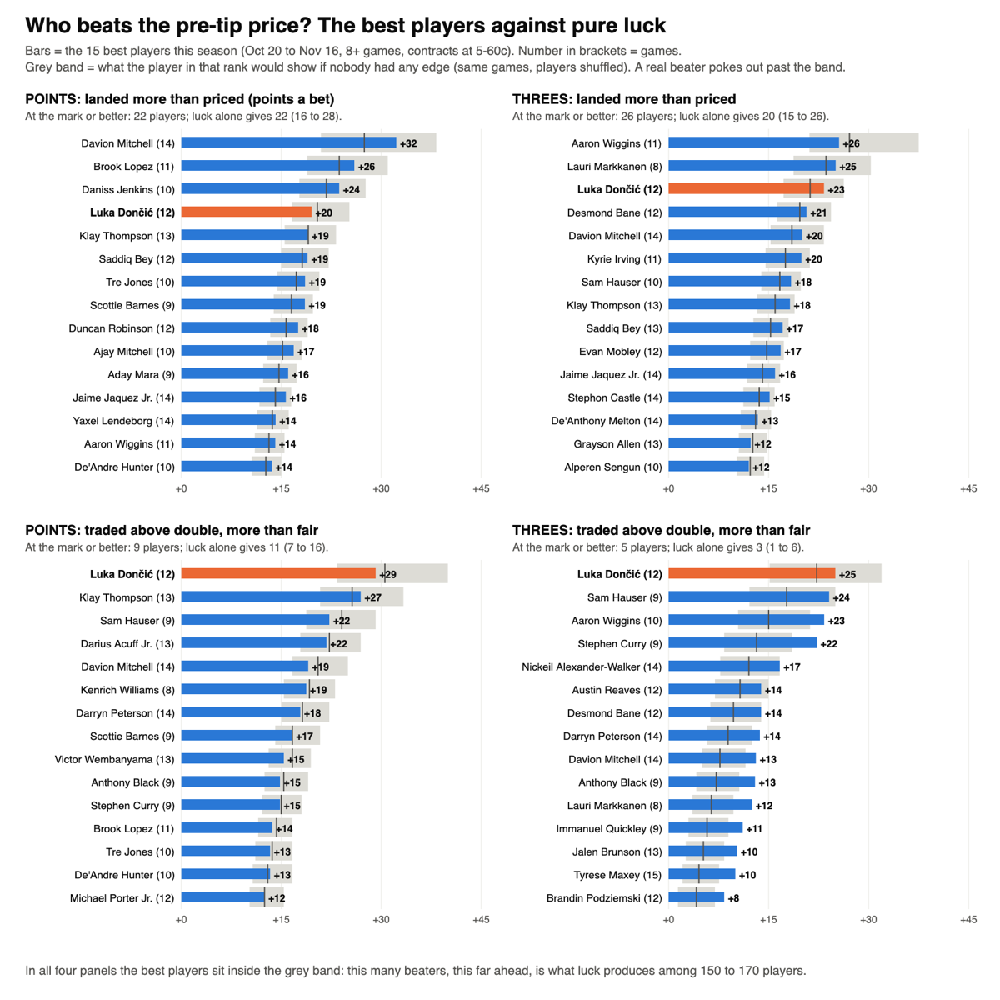
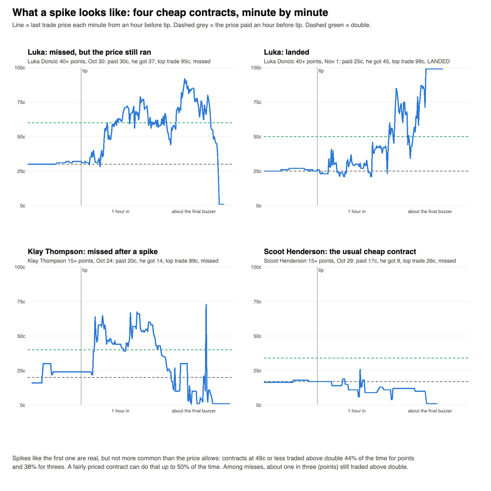

# NBA star points and threes: buying players in form (Nov 18 2026)

**Verdict: no edge.** Buying a player whose last five games say more than his price loses, held to the end or sold into a
spike. The price already carries what recent form says. Build spec: none.

## The idea
Players in form (Luka was the example: cheap before tip, 40 nearly every night, his threes spiking) should beat their price,
and their cheap contracts should trade up during the game even when they miss.

## What was tested
- **Games:** Oct 29 to Nov 16 2026, 133 games, 18 nights. Every player with 5+ games this season. 7,355 contracts.
- **Price:** the ask one hour before tip, contracts at 5c to 60c, bid-ask gap 5c or less. Fees charged.
- **In form:** the chance implied by his last 5 games is 8+ points above the ask.
- **Leader cue:** he was his game's top scorer in 3 or more of his last 5.
- **Two exits:** held to the end; or a resting sale at 2x or 3x, filled only on a later trade above the target.
- Rules were written before any price was read. Luka is shown apart because he prompted the idea.

## Results (return per contract after fees; player-games in brackets)

| Row | Held | Sold at 2x | Sold at 3x |
|---|---|---|---|
| Points, in form | -20% (387) | -21% (368) | -23% (306) |
| Points, in form + leader | -16% (43) | -23% (43) | -2% (37) |
| Points, same rule on the season average | -11% (266) | -12% (247) | -12% (187) |
| Points, every contract, no rule | -11% (1,550) | -19% (1,523) | -18% (1,443) |
| Threes, in form | -7% (378) | -13% (363) | -19% (309) |
| Threes, in form + leader | -6% (28) | -11% (27) | +11% (25) |
| Threes, same rule on the season average | -3% (245) | -7% (230) | -17% (183) |
| Threes, every contract, no rule | -5% (1,352) | -18% (1,314) | -24% (1,230) |
| Luka only, points, every contract | +63% (7) | +48% (7) | +92% (7) |
| Luka only, threes, every contract | +41% (7) | +54% (7) | +64% (6) |

- The in-form rows have the same sign in both parts of the window (to Nov 9, and Nov 10 to 16).
- The two leader rows above zero or near it rest on 25 and 37 player-games; neither is distinguishable from nothing.

## Why
- **Box scores, no prices:** where a player's last 5 ran 8+ points hotter than his season average, last 5 said 43%, the
  season average said 29%, and 29% happened (775 point contracts; threes 43% / 30% / 30%). The next game follows the season
  average, not the last five.
- **The price is right:** where last 5 said 54% and the ask was 33c, 28% landed. Where last 5 said 19% and the ask was 35c,
  35% landed.
- **Spikes:** in-form contracts reached double 41% (points) and 44% (threes) of the time; a fair contract can reach it at most
  50% of the time. Triple: 26% and 27% against 33%. Cheap contracts do not trade up more often than their price implies.
- **Beating the price does not carry over:** of 121 players, the best fifth to Nov 9 (+19 points a bet) made +0.2 from
  Nov 10 to 16.

## Luka
His 40+ ask went from 19-24c in October to 30-45c in November, and 40+ landed 7 of 12. His 5+ threes ask went from 32c to
about 50c, landing 10 of 12. He was cheap in October and the price has been catching up. Over this window he is 9th of 165
players at +17 points a bet; with no edge at all the luckiest of 165 would show about +23. One player cannot be told from luck.

## The screen: who beats the pre-tip price?
Asked for after the rule test: which players beat or spike over their pre-tip prices often, and under what conditions.
All 27 nights from Oct 20 to Nov 16, contracts at 5c to 60c, one number a player-game. Descriptive, not a rule test.

- **The number of beaters is what luck gives.** Points: 22 players at +10 points a bet or better; shuffling players across
  the same games gives 22 (16 to 28). Threes: 26 against 20 (15 to 26). The spread between players equals the luck spread.
- **Spike leaders are the same story.** Points: 9 players at +15 over fair against 11 by luck. Threes: 5 against 3.

- **Beaters do not keep beating.** To Nov 6 against Nov 7 to 16: correlation -0.10 (points, 148 players) and -0.09 (threes,
  129). The top 20 to Nov 6 averaged +22, then -2 (points); +21, then -6 (threes).

### Conditions
Every player pooled (points; threes read the same way). Excess is landed minus the ask, in points a bet.

| Condition (known before the game) | Player-games | Excess | Spike against fair |
|---|---|---|---|
| Home | 1,258 | -1.7 | -6.4 |
| Away | 1,228 | -1.8 | -6.1 |
| Second night of a back-to-back | 412 | -0.4 | -2.8 |
| Opponent leaky (worst third) | 550 | -3.8 | -9.5 |
| Opponent stingy (best third) | 546 | -2.9 | -9.5 |
| A top-2 scorer on his team is out | 1,535 | -1.4 | -5.8 |
| Team favoured by 8+ | 433 | -1.7 | -5.9 |
| Team an underdog by 8+ | 365 | -2.2 | -7.8 |
| Top scorer of his game in 3+ of last 5 | 67 | -1.8 | -2.0 |
| Minutes up 4+ on last season | 121 | +2.7 (t 0.9) | -5.8 |
| Scoring up 3+ on last season | 138 | -1.4 | -8.9 |

No condition is above zero by more than noise.

The top 10 point beaters (Davion Mitchell, Brook Lopez, Daniss Jenkins, Luka, Klay Thompson, Saddiq Bey, Tre Jones, Scottie
Barnes, Duncan Robinson, Ajay Mitchell), 113 games:

| Condition | Their games | Their excess |
|---|---|---|
| Home / away | 55 / 58 | +28 / +15 |
| Back-to-back / rested | 19 / 94 | +17 / +22 |
| Leaky / stingy opponent | 19 / 19 | +11 / +25 |
| Top-2 teammate out / in | 93 / 20 | +19 / +31 |
| Favoured by 5+ / close / underdog by 5+ | 38 / 59 / 16 | +21 / +20 / +28 |
| Played 32+ minutes / under 28 | 49 / 48 | +29 / +12 |

- Their beats are spread across every condition; none of the splits is large for its count.
- What most of them share is a bigger role than last season (Davion Mitchell 16.7 points a game against 9.3, Luka 39.0
  against 33.5, Barnes 24.2 against 18.1, Ajay Mitchell 20.1 against 13.6). But across every player, "scoring up on last
  season" seen before the game does not beat the price: once the rise is visible, the price has it.
- By team (its players' contracts): best Detroit +6.5, worst Milwaukee -8.4; the size expected from 30 teams.

Not pulled: rebounds, assists and points+rebounds+assists (about 630 requests each), team totals (about 250 to 420 a series).

## Also found
- Kalshi listed no star points or threes contracts before Nov 18 2025. This October is the only season opening it has priced,
  so an early-season catch-up cannot be checked on an earlier season.
- One lead, not a result: where the season average says 8+ above the ask and the last five do **not** (a cold run the price
  has followed down), held contracts made +17% on 72 player-games (points) and +22% on 64 (threes). It is the reverse of the
  form idea. It needs 100+ unseen player-games in each series before it means anything.

## Build spec
None. Rule: none. Scope: none. Nothing to retire or keep.
