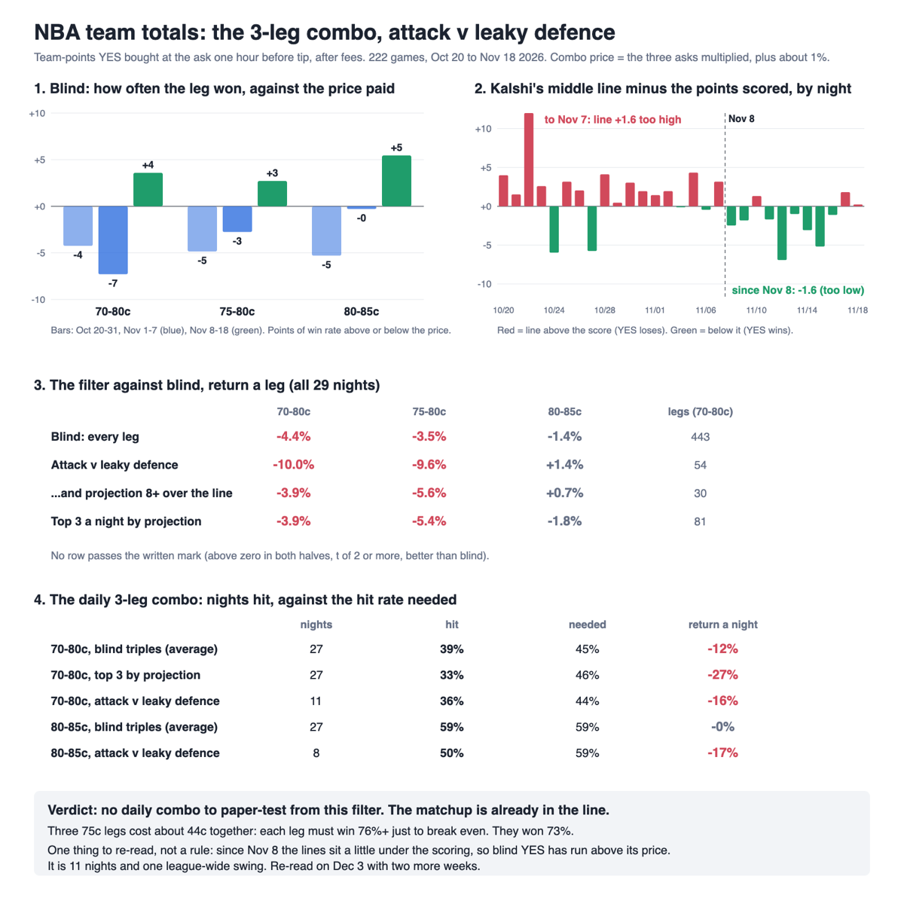

# NBA team totals: the daily 3-leg combo, "attack v leaky defence" (Nov 19 2026)

**Verdict: no daily combo worth a paper test from this filter, at any of the three bands.** Picking a strong attack
against a leaky defence does not beat buying the same-priced legs blind, because the matchup is already inside Kalshi's
line. Three legs at about 75c cost about 44c together, so each leg has to win 76% or more just to break even. They won 73%.

One thing is worth a dated re-read, not a rule: since Nov 8 every team-total YES has run a little above its price,
whatever the matchup. Details in section 5.

Data already on disk, no new pulls: the ladder tracker (222 finished games, Oct 20 to Nov 18, every rung's bid and ask
one hour before tip, and the result) and three seasons of scores. Legs are bought at the ask with the fee. Nights are the
clusters. The rules were written before any price was scored.

## 1. The game first: what drives a team's points

- **Most of a night cannot be known before tip.** A pre-tip projection (own scoring, opponent's allowing, home) explains
  10-17% of a team's night. The spread left around it is about 12 points.
- **It is shot-making, not pace.** Efficiency is 87% of the night-to-night swing, pace 25% (they overlap). Three-point
  luck alone moves a team 8.6 points a night.
- **What carries:** pace (+0.82 from the first half of a season to the second), points a game (+0.70), points allowed a
  game (+0.71). Opponents' three-point make rate does not carry (-0.13): a defence that "allows threes" is mostly luck.
- **Spotting a leaky defence early works, but it shrinks.** The 10 leakiest teams after 12 games allowed 5.4 points more
  than the league early and 3.1 to 3.6 more afterwards; 6 or 7 of the 10 stayed in the bottom 10. Blending the first 12
  games with last season is the best early read (+0.71 to +0.75 with the rest of the season).
- **Situations are small:** second night of a back-to-back -1.1 points, opponent on a back-to-back +1.5, overtime (4.4%
  of games) +12.8. A blowout moves the winner +11 and the loser -11, but that is known only afterwards.
- **Attack v leaky defence is the sum of its parts, no more.** Over two seasons a top-10 attack against a top-10 leakiest
  defence scored 121.5 and 122.9 against projections of 121.7 and 122.6. A team clears "projection minus 8 points" 74-75%
  of the time in every kind of matchup. So a 75c leg is fair only when the line sits 8 points under a correct projection.

## 2. Blind first: does the leg win more than its price?

| Band (ask) | Oct 20-31 | Nov 1-7 | Nov 8-18 | All 29 nights |
|---|---|---|---|---|
| 70-80c: won / paid | 71.0% / 75.3c | 67.6% / 75.0c | 78.8% / 75.2c | 73.1% / 75.2c |
| 70-80c: return a leg | -7.3% | -11.5% | +3.0% (t 0.9) | -4.4% (443 legs, t -1.5) |
| 75-80c: return a leg | -7.7% | -5.1% | +1.9% (t 0.6) | -3.5% (420, t -1.5) |
| 80-85c: return a leg | -7.5% | -1.6% | +5.3% (t 1.8) | -1.4% (407, t -0.6) |

Up to Nov 7 the legs lost at every band. Since Nov 8 they are a little above the price, inside what luck does in 11 nights.

## 3. The filter (written before scoring)

- **Strong attack** = the team's scoring form (this season blended with last) is in the league's top 10 at tip.
- **Leaky defence** = the opponent's points-allowed form is in the top 10.
- **Projection** = the pre-tip projection stored in the tracker.

| Return a leg, all nights | 70-80c | 75-80c | 80-85c |
|---|---|---|---|
| Blind: every leg | -4.4% | -3.5% | -1.4% |
| Attack v leaky defence | -10.0% (54) | -9.6% (53) | +1.4% (47) |
| The matchup and a projection 8+ points over the line | -3.9% (30) | -5.6% (36) | +0.7% (45) |
| Projection 8+ over the line, any matchup | -6.5% (189) | -3.1% (237) | -0.7% (337) |
| Top 3 a night by projection minus line | -3.9% (81) | -5.4% (81) | -1.8% (81) |
| Top 3 a night by model chance minus price | -8.2% (81) | -1.3% (81) | +0.2% (81) |

- No row passes the mark (above zero in both halves, t of 2 or more, better than blind). Random picks from the same band
  did as well as the matchup legs 75% and 82% of the time at 70-80c and 75-80c.
- Ranking the night's legs does no better than a threshold here.
- Since Nov 8 the best legs were the ones with neither a top-10 attack nor a leaky opponent (+9.8% at 70-80c). The lift is
  league-wide, not a matchup effect.

## 4. The daily combo (3 legs from 3 different games)

Price = the three asks multiplied, plus the 1% combo markup we measured, plus the fee.

| Combo | Nights | Hit | Hit needed | Return a night | Longest losing run |
|---|---|---|---|---|---|
| 70-80c, blind (every triple, averaged) | 27 | 39% | 45% | -12.4% | - |
| 70-80c, top 3 by projection | 27 | 33% | 46% | -26.8% | 4 |
| 70-80c, attack v leaky defence | 11 | 36% (4) | 44% | -15.5% | 5 |
| 75-80c, blind | 27 | 44% | 49% | -11.1% | - |
| 75-80c, attack v leaky defence | 11 | 45% (5) | 50% | -9.9% | 3 |
| 80-85c, blind | 27 | 59% | 59% | -0.3% | - |
| 80-85c, attack v leaky defence | 8 | 50% (4) | 59% | -16.9% | 2 |

- **The arithmetic.** Three 75c legs: 42c multiplied, about 44c after the markup and fee. The combo must hit 44% of
  nights, so each leg must truly win 76.3%, which is 1.3 points more than its price, before there is any profit. For
  +10% a night each leg must win about 79%.
- **The matchup combo could only be formed on 11 of 29 nights** at 70-80c (three such legs in three games are rare). It
  hit 1 of the first 6 and 3 of the last 5.
- A night's legs are close to independent: blind triples hit as often as three separate legs would (39% against 39%).
  A combo adds no edge of its own; it multiplies whatever the legs have, and the fee once.

## 5. The level: the October gap has flipped

| | To Nov 7 | Nov 8-18 |
|---|---|---|
| Kalshi's middle line | 114.8 | 113.0 |
| Points scored | 113.2 | 114.6 |
| Line minus points | +1.6 (too high) | -1.6 (too low) |
| Team went over the line | 45% | 53% |

- In October the lines sat above the scoring, and blind YES lost. The lines then came down 1.8 points while scoring went
  up 1.4. Since Nov 8 YES has won more than its price at every rung of the ladder (for example 82c won 87%, 87c won 90%).
- At 80-85c that is +5.3% a leg and +17.6% a night for a blind 3-leg combo, on 11 nights.
- It is one league-wide swing, not 150 separate results, and it is the mirror image of the October gap that closed. The
  win-margin and quarter studies both showed an early-season gap closing within two or three weeks.
- **So: re-read once on Dec 3**, on the nights from Nov 19 only, with the same script and no changes. The tracker already
  records every rung, so nothing needs building. If blind 80-85c legs are above zero with t of 2 or more on those new
  nights alone, a blind 80-85c combo becomes a paper candidate. If not, it was the swing.

## Limits
- 29 nights, and the two halves point opposite ways.
- Quotes are the last hourly candle before "tip minus one hour", not a live book; 97% of legs had a bid-ask gap of 5c or less.
- No record of real NBA combo quotes on disk; the 1% markup is our earlier measure on other sports.
- "Leaky" and "strong" use points a game. Pace-adjusted ratings give the same projection (measured earlier).

## Build spec
None. Nothing to build. The only follow-up is the Dec 3 re-read above.
