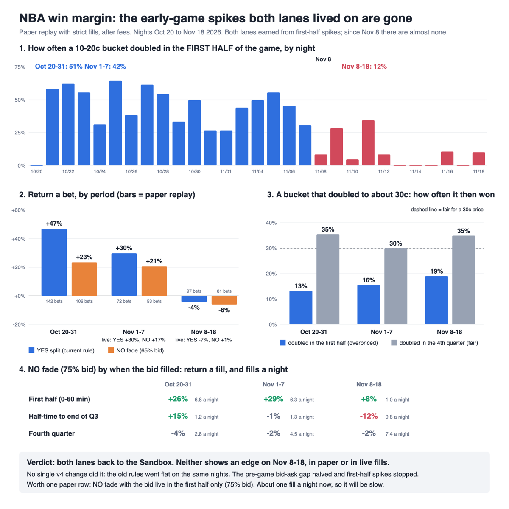

# NBA win margin, the two Production lanes: a deeper look (Nov 19 2026)

**Verdict: move both back to the Sandbox.** Neither lane shows an edge on the nights since Nov 8, in the paper replay or in
the live fills. Both lanes earned from the same thing: bucket prices that spiked in the first half of a game and came
back. Those spikes have almost stopped.

| Lane | Verdict | Why |
|---|---|---|
| NO fade | Back to Sandbox | +23% and +21% a fill up to Nov 7, -6% since (t -0.6). Live +1% since Nov 8. |
| YES split | Back to Sandbox (the weaker of the two) | +47% and +30% a bet up to Nov 7, -4% since. Live -7% since Nov 8. Held to the result it never beat zero. |

One filtered version is worth a paper row: the NO fade with its bid live in the first half only. Details at the end.

Data: the tracker, the NO fade ledger, the decision snapshots and their replays, the live record, and ESPN results with
play-by-play, all already on disk. No new pulls. Returns are after fees, a bet counted once, nights as the clusters.
Found = Oct 20 to 31 (the rules were chosen there). Forward = Nov 1 to 18. The plan was written before reading.

## 1. Is there an edge left?

Paper replay, strict fills.

| | Oct 20-31 (found) | Nov 1-7 | Nov 8-18 | Forward, Nov 1-18 |
|---|---|---|---|---|
| YES split, current rule | +46.9% (142) | +29.8% (72) | -4.3% (97) | +10.2% (169), t 1.1 |
| The same YES bets held to the result | -15.8% | -10.0% | +13.1% | +3.2%, t 0.3 |
| Blind YES: every bucket at 10-20c, split | +38.8% (194) | +32.7% (106) | -9.0% (178) | +6.6% (284), t 0.9 |
| NO fade, 65% bid | +23.5% (106) | +20.5% (53) | -6.1% (81) | +4.5% (134), t 0.6 |
| NO fade, 75% bid | +17.1% (130) | +14.1% (73) | -1.9% (101) | +4.8% (174), t 1.2 |
| Blind NO: bought before the game, held | -2.1% (241) | -3.4% (129) | -2.0% (261) | -2.4% (390) |
| Live fills, YES / NO | - | +29.9% / +16.7% | -6.6% / +1.0% | |

- The written mark was: forward above zero with t of 2 or more, and above the blind version. **Neither lane meets it.**
- The edge was real while it lasted: it held on the forward week of Nov 1 to 7, in paper and in live fills.
- It stopped on Nov 8 for every version at once, old rules and new.
- The YES lane has no price edge at entry. Held to the result, a 10-20c bucket returns about zero. All of its profit came
  from selling the in-game spike.
- The current YES rule is not better than blind buying of every 10-20c bucket (random picks do as well 23% of the time).

## 2. Why live looks better than paper

**NO fade since Nov 8: live +3.1% against paper -21.2% is mostly a counting difference.**

- The page's paper figure is the average of 36 game rows. A game with one losing fill counts as -100%.
- Counted per fill, like the live figure, paper is **-7.2% on 59 fills** against live **+1.0% on 67**.
- On the 57 contracts both filled: live -0.1%, paper -3.9%.
- What is left of the gap: two late bids that only the replay counted (both lost), one sale the replay missed, and ten live
  fills with no decision row. That is luck and bookkeeping, not a better live edge.
- Every fill that was not sold back lost: 20 of 20. The sell-back rate fell from 81% in October to 62%.
- Bucket Priority gave 114 NO buckets to the YES side. In the 65% replay 23 of them would have filled, for -1.0%. Giving
  them up cost nothing. The YES side returned -9.6% on the same contracts.

**YES split since Nov 8: live -6.6% (147) against paper -11.9% (137).**

- On the same 136 contracts: live -5.4%, paper -11.3%.
- Live sold ten legs at the target price that the replay did not count. The replay needs a trade strictly through the
  target; a resting sell is sometimes filled at the touch. The paper rule is a little too strict on sells, by about 5 points.
- Both are below zero.

## 3. Which version 4 change hurt?

None can be singled out. Same nights only, Nov 8 to 18:

| Change | Difference | t |
|---|---|---|
| NO bid at 65% against 75% | -1.1 points a bucket offered | -0.7 |
| YES sells at 2x / 2.5x against 2x / 3x | +3.0 points a bet | +0.8 |
| Adding the 11-20 bucket | -8.4% on its 24 bets | -0.4 |
| Skipping games with a 70%+ favourite | kept +5.8% (73), skipped -1.0% (56) | under 1 |

The old rules, replayed on the same nights, were flat too (YES -0.2% with 2x / 3x; NO 75% -1.9%). One structural point: at
65% the bid caught only 3 first-half fills in 11 nights, against 11 at 75%.

## 4. The game: what moves a margin bucket

**Where the lead sits is a poor guide to the final bucket until late** (1,436 games, 2025-26 and this season).

| The lead is in this bucket | at half-time | end of Q3 | 6:00 left | 2:00 left |
|---|---|---|---|---|
| 1-5: finishes 1-5 | 17% | 22% | 27% | 42% |
| 6-10: finishes 6-10 | 20% | 27% | 34% | 50% |
| 11-20: finishes 11-20 | 36% | 46% | 57% | 74% |
| 21+: finishes 21+ | 69% | 70% | 73% | 82% |

- A 1-5 lead at 2:00 left finishes 6-10 in 30% of games (free throws stretch it) and flips in 26%.
- A 21+ lead at 6:00 left falls back to 11-20 in 27% (starters are pulled).
- Overtime is 4.5% of games; they finish 1-5 (66%) or 6-10 (31%).
- So a first-half price spike in the bucket the lead sits in is mostly noise. A fourth-quarter move is information.
  That is exactly where the money was: **a 10-20c bucket that doubled in the first half went on to win 13-19%; one that
  doubled in the fourth quarter won 30-35%, which is fair for a 30c price.**

**Nothing known before the tip moves the bucket beyond the spread.** A fair chance for each bucket was built from the
pre-game spread alone on 2025-26 results and checked on this season. High or low total, a back-to-back for either team,
home or away favourite: every shift is inside one standard error.

**This season has fewer 1-5 finishes:** 18% of games against 25% the spread implies, and 30% at 6-10 against 24%. It shows
in every condition. It may be luck (about 2 standard errors); a watch, not a rule.

**Pre-tip filters, written before pricing** (held to the result):

| Filter | Found | Forward | Passes? |
|---|---|---|---|
| YES where the spread-fair chance is 3+ points above the ask | +13.6% (29) | +38.9% (28) | No: t 0.7 pooled |
| NO where the price is 3+ points above spread-fair | +3.9% (27) | -3.4% (59) | No |
| Close games, the 1-5 buckets | -2.4% (56) | -66.2% (67) | No |
| Big favourite, its 11-20 bucket | +9.8% (10) | -64.0% (11) | No |

Pre-game bucket prices sit within about 2 points of the spread-fair chance, and Kalshi's spread is ESPN's to within half a
point. There is no bucket to pick before the tip.

**A game-state filter, written after seeing the in-game table and before reading fills by time:** take the NO fade's fill
only in the first 60 minutes after the tip.

| NO fade fills by time | Oct 20-31 | Nov 1-7 | Nov 8-18 |
|---|---|---|---|
| First half, 75% bid | +25.9% (82) | +28.7% (38) | +8.0% (11) |
| First half, 65% bid | +48.7% (45) | +34.9% (9) | -49.0% (3) |
| Fourth quarter, 75% bid | -3.8% (33) | -1.9% (27) | -2.2% (81) |
| Fourth quarter, 65% bid | -6.5% (44) | +21.7% (35) | -3.3% (74) |

As written (65% bid) it fails: three fills in eleven nights. At the 75% bid it is above zero in all three periods and
+24.0% on Nov 1 to 18 (49 fills, t 5.6), but that bid level was chosen after looking, and the fills fell from about 7 a
night to 1. Fourth-quarter fills at 75% never paid in any period.

## 5. Has the pricing tightened?

Yes, in the game, sharply, from Nov 8.

| | Oct 20-31 | Nov 1-7 | Nov 8-18 |
|---|---|---|---|
| 10-20c buckets that doubled in the first half | 51% | 42% | 12% |
| 10-20c buckets that doubled at any time | 75% | 73% | 54% (fair is at most 50%) |
| A bucket trading at 20-40c, 90 minutes in: price / won | 29c / 14% | 26c / 14% | 26c / 22% |
| A bucket trading at 40-70c, 90 minutes in: price / won | 49c / 12% | 52c / 11% | 47c / 56% (9 only) |

Before the game the change is smaller and came a few days later: the bid-ask gap on a bucket went from 4-6c to under 3c
from about Nov 10, and prices moved from 2.5 to 1.8 points away from the spread-fair chance. Before the game the prices
were never far off.

This is the same shape as the quarter-totals study: an opening-weeks gap that the market closed.

## Limits
- Since Nov 8 there are 11 nights. The lanes cannot be told from zero there; they are not shown to lose.
- The first-half result at the 75% bid was found after looking. It needs its own forward record.
- Live entries before Nov 6 were rebuilt from the order list. In-game prices are last trades at fixed minutes.
- ESPN results on disk end Nov 16; the last two nights use Kalshi's own spread.

## Build spec (for the build session; nothing is built here)

**NO fade, first half only (paper).**
- Rule: post-only NO bid at 75% of the bucket's pregame NO price, live from the tip to 60 minutes after it, then
  cancelled. Sell back at the pregame price on a trade strictly above it, else hold. A 65% row beside it.
- Scope: every bucket, pregame NO price 10-95c, bid-ask gap 5c or less, the ask check. Sandbox, paper.
- Entry timing: the read an hour before the tip, the bid at the tip, cancelled at tip + 60 minutes.
- The one change from version 4: the bid's time window. The bid returns to 75% because 65% almost never fills early.
- The NO fade ledger already replays all three bids with fill times, so the row is a filter on its fills.
- Pre-registration: fresh record from the first night after the build. Read once at 30 fills. Promote only if above zero
  with t of 2 or more, above the all-fills version on the same nights, and not carried by one night. Retire at 30 fills
  if at or under zero, or after 30 nights if fills stay under one a night.

**YES split:** no next version. Keep the tracker as the watch. One line to follow each week: the share of 10-20c buckets
that double in the first half. It was 51%, it is 12%. A return above 30% for a full week is the reason to look again.

**Paper replay:** count a sell as filled at the touch when 10 or more contracts trade at the target, so paper matches the
live sells more closely. Show the NO fade a fill beside the game-row figure.
