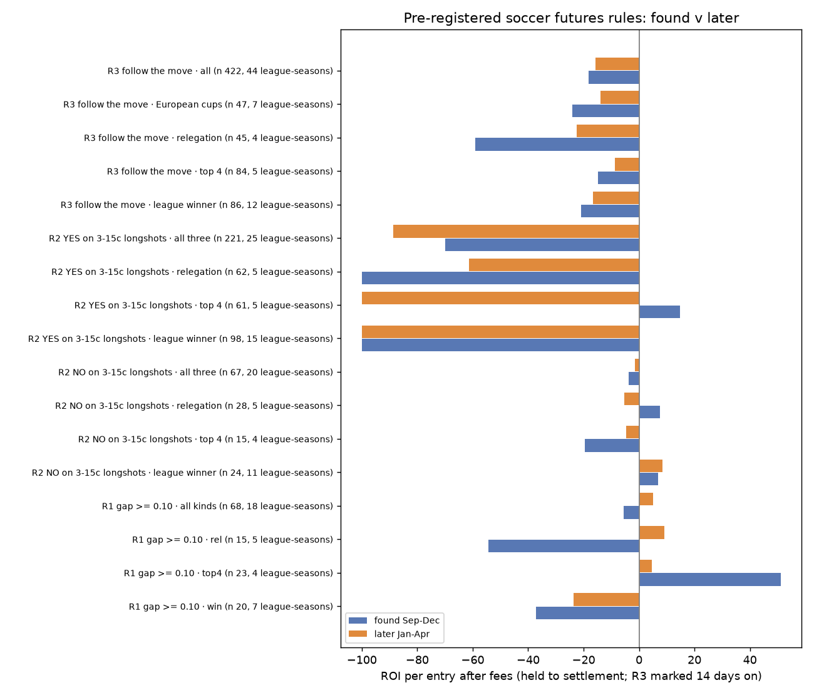
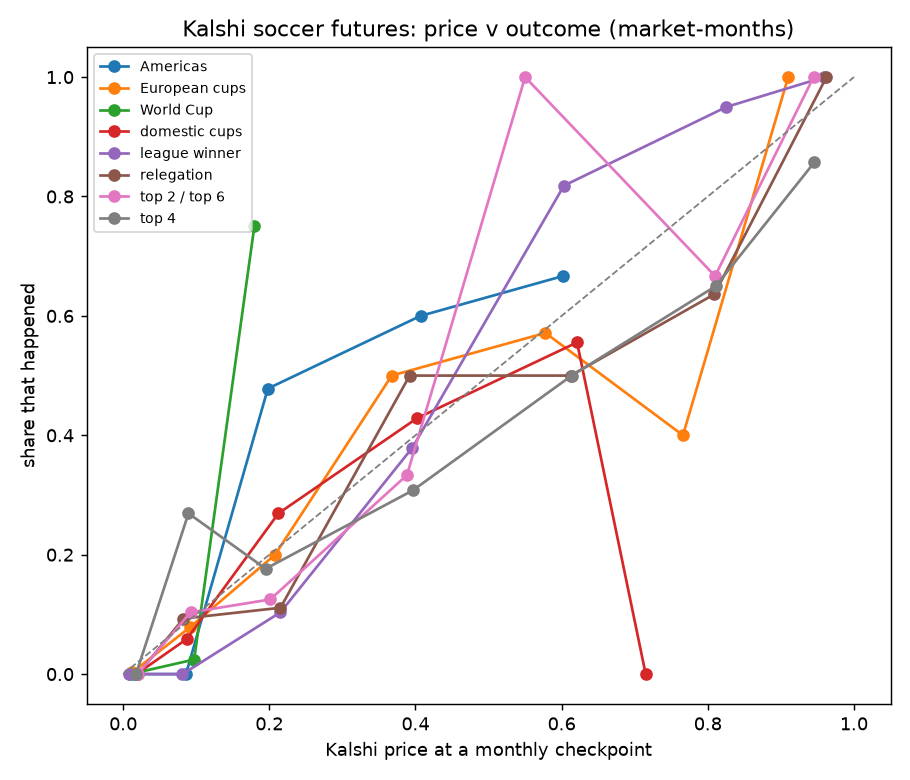
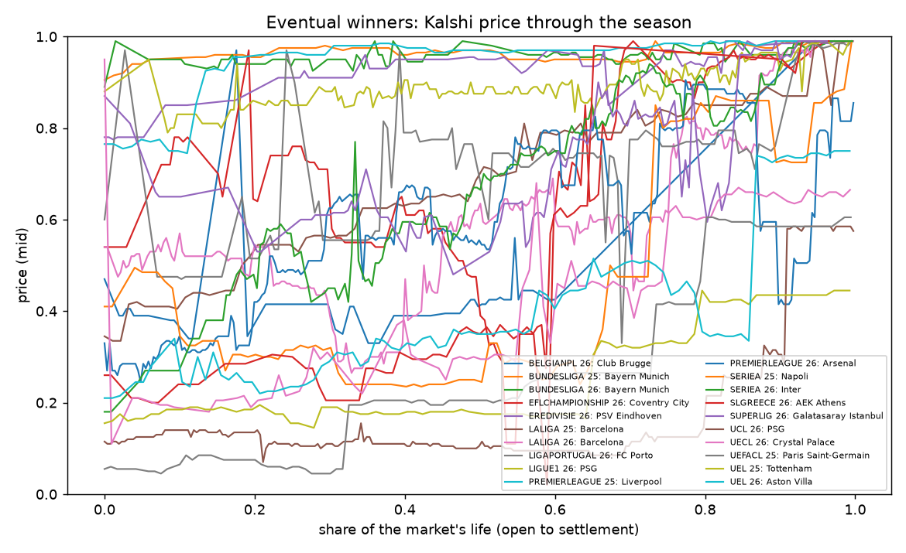

# Kalshi soccer futures: is there a repeatable rule? (Nov 14 2026)

Research only, no lane. Olu: "Assign someone soccer futures": long, slow markets driven by things that can be measured (points pace,
goal difference, the schedule left), so the question is whether Kalshi's prices lag them.

**Short answer: one WATCH, nothing to build.** Selling league-winner longshots (buying NO when a team's title YES is 3-15c) made
+7.8% a bet in both seasons Kalshi has, with no longshot winning in 24 tries. But 24 bets in 11 league-seasons is thin, the chance of
that run under fair prices is 0.13, and one winning longshot wipes out about 11 wins. Everything else fails or has no history.

## Verdict by market type

| Market type | What was found | Verdict |
|---|---|---|
| **League winner: NO on 3-15c longshots** | +7.8% on 24 bets, 11 league-seasons; found +7.0%, later +8.5%; 2024-25 and 2025-26 both positive; held ~4.5 months, about +22% a year | **Watch (paper)** |
| League winner: model v market | The goal-difference simulator loses to the market on winners (−32% at a 10-point gap): prices already carry squad strength | Move on |
| League winner: buy the favourite (context only) | 10 of 14 won at a 67c average: flat (+0.1%) | Move on |
| Top 4, top 2, top 6 | One settled season; 5-15c longshots happened 27% of the time (priced 9%), longshot NO −12.6% | Move on |
| Relegation | Longshot NO −4.9%, model gap −3.6%, longshot YES −71% | Move on |
| Following a big daily move | −16% after 14 days on 422 moves: the spread eats it, and fading pays the same spread | Move on |
| Cross-market (winner prices summing past 1, top 4 below winner) | No tradeable case in 2,602 event-days after fees | Move on |
| European cups, domestic cups, World Cup, MLS | 1-7 settled events each: calibration only | Move on |
| Last place, winning margin, team points, top scorer / assists ("leader") | No settled event yet; most books 6-95c wide | Nothing to test |

## Price v outcome

League winners show the usual favourite-longshot pattern, checked on the 1st of each month:

| Kalshi price | Market-months | Priced to happen | Happened |
|---|---|---|---|
| 5-15c | 38 | 8% | 0% |
| 15-30c | 29 | 22% | 10% |
| 50-70c | 22 | 60% | 82% |
| 70-90c | 20 | 83% | 95% |

Market-months repeat the same teams month after month, so these are a few dozen independent outcomes, not hundreds.

The eventual winners' prices through each season: dominant sides (Bayern, PSG, PSV, Liverpool 2024-25) sit above 85c from early on.
Open races (Arsenal and Barcelona 2025-26, Napoli 2024-25) were priced 25-55c for most of the season.

## What was run

**Data and budget**
- One throttled, cached Kalshi puller: 1,240 requests (budget 2,000).
- The market map covered ~75 series, open and settled, with archived events read from the historical endpoints. Daily candles were pulled for 974 settled futures markets.
- ESPN results and fixtures for nine leagues, 2024-25 to 2026-27.

**No sharp benchmark:** the Odds API key lives only in GitHub secrets, and point-in-time outrights are a paid feature.

**Pre-registered** in the study README before any price was read against an outcome:
- **Checkpoints:** the 1st of each month, September to April, on point-in-time prices only.
- **Fills:** honest, at the YES ask or 1 − the YES bid, spread 10c or less, Kalshi taker fee, held to settlement.
- **Simulator:** goal difference per game shrunk over 10 games, last season's form as the early prior, Poisson goals, 10,000 seasons over the remaining fixtures.
- **Four rules:**
  - model gap of 10pp or more;
  - 3-15c longshots, NO and YES;
  - following a 10c day;
  - cross-market consistency.
- **Split:** found = September to December, later = January to April. One cluster per league-season and market type.
- **Name matching:** 171 Kalshi names were matched to ESPN and checked by eye. One wrong match (Inter Milan → AC Milan) was fixed before any rule was read.

**Caveat:** Kalshi has at most two settled seasons per league, and only one for top 4 and relegation. That is about a dozen independent league-winner outcomes in all, so a pass here is a watch, not an edge.

## If Olu wants the watch tracked: Sandbox paper spec

`futures_longshot_no`:
- **When:** on the 1st of each month, September to April.
- **Markets:** every league-winner market in the EPL, La Liga, Serie A, Bundesliga, Ligue 1, Eredivisie, Primeira, Super Lig, Belgian Pro League and EFL Championship whose YES bid is 3-15c with a spread of 10c or less.
- **Entry:** paper-buy NO at 1 − the YES bid, one entry per market per season, held to settlement, Kalshi taker fee.
- **Baseline:** the same rule on top-4 and relegation markets, which lose.
- **Pace:** 19 markets qualify today across 8 leagues, about 20-25 entries a season, so 30 settled entries takes until mid-2027.
- **Reading:** review at 10, decide at 30, using an exact-binomial read (not z), because losses are rare.

Study folder (scripts, cached data, full results): `~/edge-research/soccer_futures_2026-11-14/` (README, data/results.txt).
