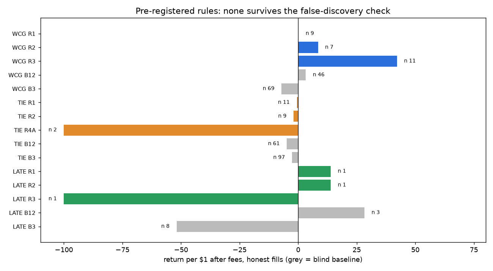
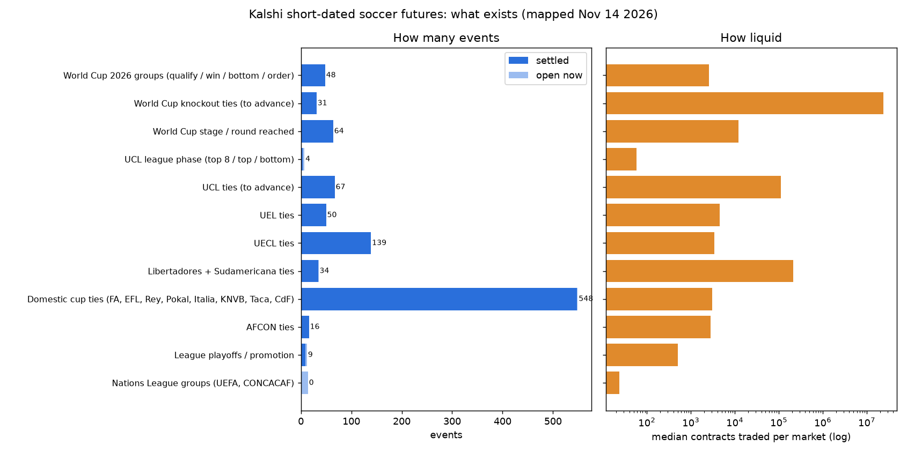
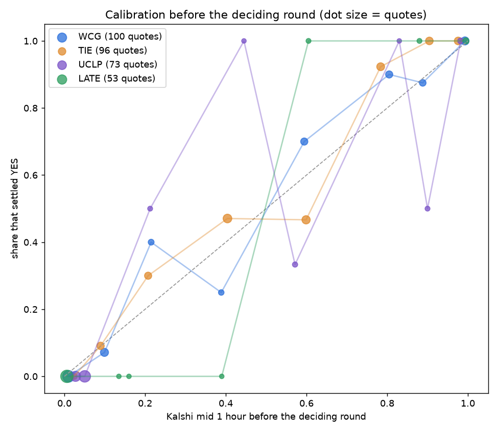
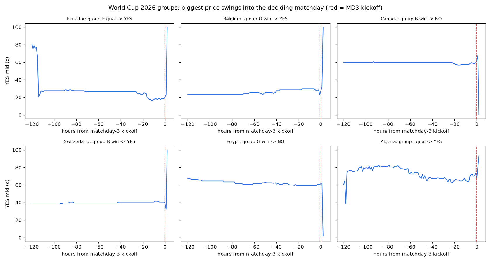
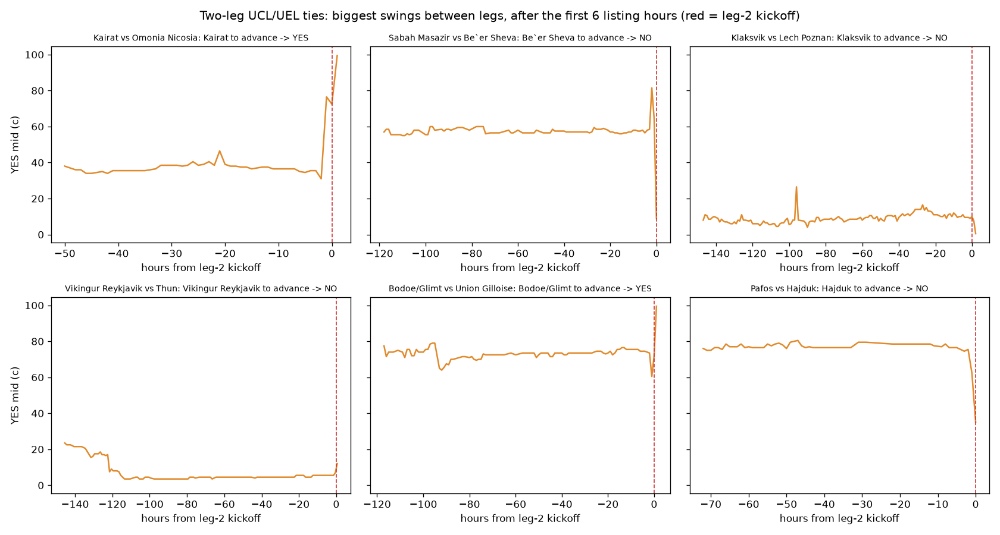

# Kalshi short-dated soccer futures: groups, ties, run-ins (Nov 14 2026)

Research only, no lane. Olu: "who is coming out of a group ... things that are close to ending, not things that are really far out."
This follows the season-long study (`docs/soccer_futures_2026-11-14.md`). The longshot NO watch from that study is unchanged.

**Short answer: move on, nothing to build.**
- In the last round before they settle, Kalshi's group, tie and run-in prices settle about as often as they are priced.
- Near-certain sides (85-95c) return about 0% after fees.
- No pre-registered rule survives the false-discovery check.

## What Kalshi lists

| Family | Settled events | Notes |
|---|---|---|
| World Cup 2026 groups: qualify, win, bottom, exact order | 48 (12 groups) | well traded; one tournament |
| World Cup knockout ties, stage reached | 31 + 64 | knockout ties are single matches |
| UCL league phase: top 8, top, bottom, round of 16 | 1 season | thin; 2026-27 settles late January |
| UCL / UEL / UECL ties (to advance) | 67 / 50 / 139 | listed only **after leg 1** |
| Libertadores + Sudamericana ties | 34 | well traded |
| Domestic cup ties | 548 | mostly single matches |
| Nations League groups (UEFA, CONCACAF) | 0 | open now; about 25 contracts per market, 22-74c spreads |
| World Cup qualifying groups, African/Asian qualifiers | none listed | |

## Price v outcome, 1 hour before the deciding round

| Kalshi mid | World Cup groups | Two-leg ties |
|---|---|---|
| 5-15c | 14 quotes: priced 10%, happened 7% | 11: 9% v 9% |
| 15-30c | 5: 22% v 40% | 10: 21% v 30% |
| 50-70c | 10: 60% v 70% | 15: 60% v 47% |
| 70-85c | 10: 81% v 90% | 13: 78% v 92% |
| 85-95c | 8: 89% v 88% | 12: 91% v 100% |

The bands are small and mixed. A few points of edge at the mid disappears into the ask and the fee.

World Cup groups barely move between matchdays, then jump at the matchday-3 kickoff, where everything is decided in play.

Between legs, tie prices sit flat for days. The real move is in play on leg 2.

## Pre-registered rules and verdicts

All rules use fillsim honest-v1:
- a taker buy is verified by 10+ contracts printed at or under the ask within 60 minutes;
- a resting buy fills only on a print strictly through the limit;
- Kalshi taker fee, held to settlement.

Statistics: clustered by group / tie / league-season; found v later by date; Benjamini-Hochberg at q 0.10. The exact binomial is a floor on p, because a cell where every bet wins has zero clustered variance.

| Rule | Family | Result (honest fills) | Verdict |
|---|---|---|---|
| R1 buy YES at 85-95c before the deciding round | WC groups | 8/9, +0.2% | Move on |
| | Ties | 10/11, −0.6% | Move on |
| R2 buy NO at 85-95c | WC groups | 7/7, +8.5%, binomial p 0.54 (12/13 and +1.1% at the quote) | Move on |
| | Ties | 8/9, −2.0% | Move on |
| R3 fade a 15c+ move between rounds | WC groups | 5/11 at 27c, +42%, found +46% / later +39%, z 0.91 | Move on (below the watch bar; Euro 2028 could re-test) |
| | Ties | untestable: no price before leg 1 | — |
| R4 resting buy into a 40%+ dump with no match on | all | 32 triggers, 3 fills, all 3 lost | Move on |
| UCL league phase, late-season run-ins | — | too thin / mostly decided before the last round | Calibration only |

Post-hoc only, not a finding: tie favourites at 70-85c between legs went 14/14, while 50-70c went 7/19. If Olu wants it, it could be a forward paper watch on the February 2027 UCL/UEL knockout ties. Nothing is built.

## Data and budget
- 1,187 Kalshi requests (cap 2,000, approved by Olu in chat), through one throttled, cached puller.
- ESPN for fixtures.
- Study folder (pre-registration, scripts, data, full results): `~/edge-research/soccer_shortdated_2026-11-14/`.
