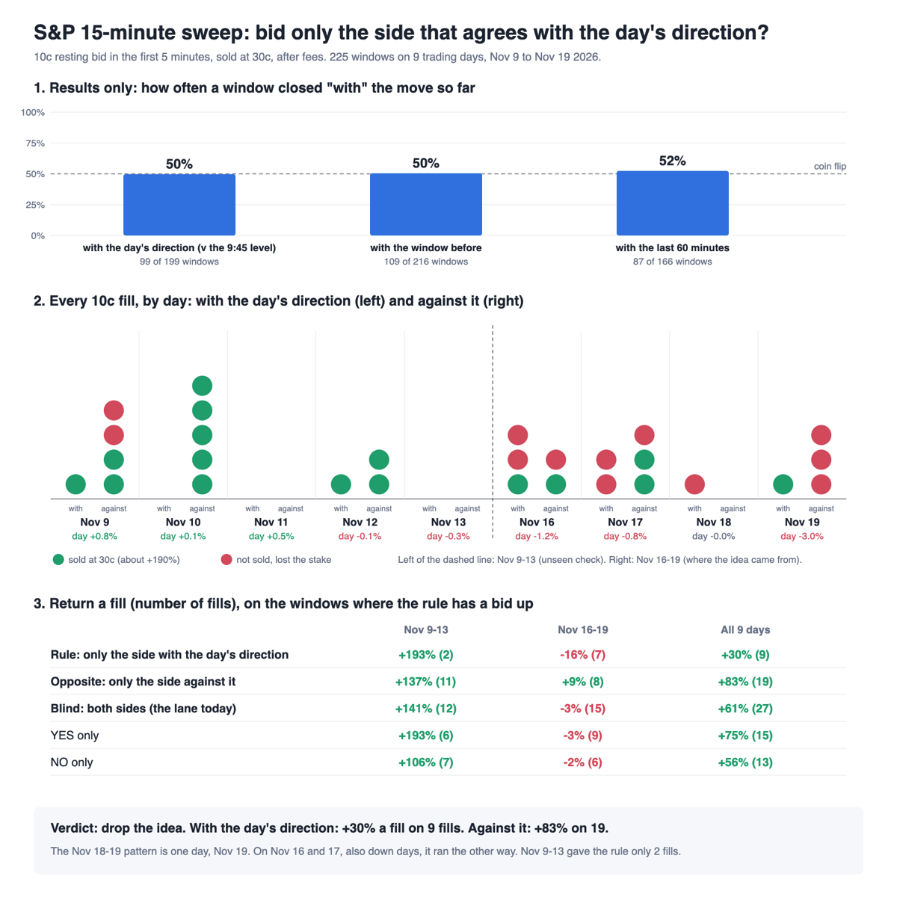

# S&P 15-minute sweep: bid only the side that agrees with the day's direction?

Nov 19 2026. Research only, from data already on disk. The plan was written before any result was read (it is copied at the end).

**Answer: no. Drop the idea. Do not change the live lane for it, and no paper row is needed.**
Over nine trading days the side that agreed with the day's direction returned +30% a fill on 9 fills. The side against it returned +83% on 19. The pattern seen on Nov 18-19 is one day, Nov 19. On Nov 16 and 17, also down days, it ran the other way.

## Primer: how these markets work

- There are 25 windows a day, from 9:45 to 4:00 ET. There is no 9:30 window.
- Each window's target is the index level at the moment the window opens. It equals the close of the window before (checked on 216 of 216 windows).
- YES pays if the index is at or above the target when the window closes. So every window starts as a coin flip near 50c.
- A 10c YES fill means the index fell early in the window. It pays only if the index climbs most of the way back.
- A 10c NO fill means the index jumped early. It pays only if the jump is given back.
- Selling at 30c needs the price to triple, so the early move has to be partly undone, not fully.
- A 15-minute move is small: the middle one is 0.10% of the index, three in four are under 0.17%.

**Trend days and range days.** By the rule written beforehand (close more than 0.5% from the 9:45 level, 80% of windows on that side), 4 of the 9 days were trend days: Nov 9 up, Nov 16, 17 and 19 down.

**What a trend day does not do.** Inside the day, a window closed in the day's direction 99 times in 199, which is 50%. It repeated the window before 109 times in 216 (50%) and followed the last 60 minutes 87 times in 166 (52%). A trend day is built from slightly more and slightly bigger same-way windows, not from a window-by-window lean you can bid on.

## What was tested

- The lane's own fill rule: a resting bid at 10c, up 5 seconds after the open, cancelled at 5 minutes; a fill only on a print strictly through 10c; a resting sell at 30c, else the minute-14 bid less the fee.
- **Primary rule:** index below the day's first level by more than 0.05%: bid NO only. Above by more than 0.05%: bid YES only. Inside the band: no bid.
- The 9:30 level is not on disk, so the day's first level is the 9:45 one. A check with yesterday's close in its place (not in the plan) gives the same answer: +47% a fill with the direction (10 fills), +100% against (16).
- **Two secondaries:** the window before (same way as it closed), and the 60-minute move.
- **Compared on the same windows:** blind both sides, YES only, NO only, and the opposite rule.
- **Two periods:** Nov 16-19, where the idea came from, and Nov 9-13, which had never been split by direction.
- Nov 9-13 fills are replayed from every trade print. Nov 16-19 fills are the paper lane's own ledger. No window on those days had prints through 10c on both sides, so nothing is missed.

## Results at 10c

Return a fill, with the number of fills, on the windows where the rule has a bid up.

| | Nov 9-13 | Nov 16-19 | All 9 days |
|---|---|---|---|
| Rule: only the side with the day's direction | +193% (2) | -16% (7) | +30% (9) |
| Opposite: only the side against it | +137% (11) | +9% (8) | +83% (19) |
| Blind: both sides | +141% (12) | -3% (15) | +61% (27) |
| YES only | +193% (6) | -3% (9) | +75% (15) |
| NO only | +106% (7) | -2% (6) | +56% (13) |

- **Per window the rule is behind in both periods.** With minus against, a window: -11.5% on Nov 9-13, -2.3% on Nov 16-19, -7.4% over all nine days (score -1.2 by day).
- **Shuffle test:** giving each day another day's column of sides did as well as the real rule 87% of the time.
- **The rule mostly removes fills.** Early spikes usually go the same way as the day, so the side that agrees with the day rarely fills: 9 fills in nine days against 27 blind.
- **Nov 9-13 gave the rule 2 fills.** Its +193% there is two sales, not evidence.

By day, 10c:

| Day | Day's move | With: fills, sold | Against: fills, sold |
|---|---|---|---|
| Nov 9 | +0.8% | 1, 1 | 4, 2 |
| Nov 10 | +0.1% | 0 | 5, 5 |
| Nov 11 | +0.5% | 0 | 0 |
| Nov 12 | -0.1% | 1, 1 | 2, 2 |
| Nov 13 | -0.3% | 0 | 0 |
| Nov 16 | -1.2% | 3, 1 | 2, 1 |
| Nov 17 | -0.8% | 2, 0 | 3, 2 |
| Nov 18 | 0.0% | 1, 0 | 0 |
| Nov 19 | -3.0% | 1, 1 | 3, 0 |

Nov 19 is the only day where the side with the direction clearly won. It is the day behind the pattern in the live fills.

**The secondaries.** The window before: with minus against +2.2% a window on Nov 16-19, -5.7% on Nov 9-13, -2.2% over nine days. The 60-minute move: -3.4%, -2.8%, -3.1%. Neither is above zero in both periods, so there is nothing to correct for testing three rules.

**Support cells.** 15c: with minus against -2.9% a window over nine days. 25c: +0.2%. The 2-second and 30-second rows at 10c agree with the 5-second row.

**The live fills (6).** The rule would have kept 2 (one sold, one lost) and dropped 4 (one sold, three lost). All three dropped losers are YES fills on Nov 19.

## How sure

- Nine days is the limit, not the 225 windows. A day's fills move together, so the score is by day.
- The luck bands are wide: the rule's return a fill over nine days could sit anywhere from -39% to +121%.
- This does not prove the two sides are equal. It shows no sign that the day's direction separates them, in the days the idea came from or in the earlier ones.

## Verdict by the written rule

Drop. Per window the rule is below blind in both periods (per fill it is above blind on Nov 9-13, on 2 fills only). With minus against is below zero in both periods, and the opposite rule is at least as good.

## Build spec

Nothing to build.

- **Rule:** none. The live lane keeps both sides.
- **Scope, entry timing:** unchanged.
- **The one change:** none.
- **Retire or keep:** this question does not decide the lane. The lane's own read stays as registered on Nov 13: 10c at 40 settled bets.
- **Pre-registration text:** none needed. If the question comes back, the ledger and the stored targets already hold everything; run `score.py` unchanged on days from Nov 20 only, once, at 10 more trading days.

## The plan as written before the read

- Rules fixed: the primary (day's direction against the day's first level, 0.05% band, no bid inside it), the window before, the 60-minute move. No others.
- Comparisons on the same windows: blind both sides, YES only, NO only, the opposite rule.
- Periods: found Nov 16-19; earlier Nov 9-13 as the one unseen check; later days not read.
- Reading: return a fill and a window; clusters are trading days; luck band from 2,000 day resamples; shuffle test by swapping each day's column of sides for another day's.
- Paper row only if the rule beats blind, YES only and NO only in both periods, with minus against above zero in both, pooled score 2 or more, shuffle share 5% or less.
- Drop if the rule is at or below blind in the earlier days and the opposite rule is at least as good.
- Expectation written beforehand: nothing beyond luck.

Files: `~/edge-research/sp15_trend_2026-11-19/` (PREREGISTERED.md, build.py, primer.py, score.py, pics.py).
